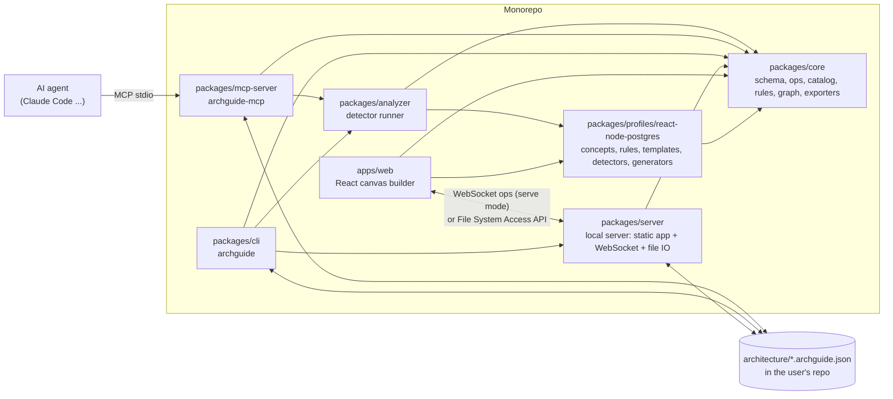

# ArchitectureGuide: Implementation

This is the **single source of truth** for building ArchitectureGuide. It
combines the plan, the v1 stack profile (React + Node.js + PostgreSQL), and the
research findings. It adds the implementation details: interfaces, algorithms,
file formats, tool schemas, commands, and a task checklist per phase.

The earlier planning notes (`docs/PLAN.md`, `docs/STACK-REACT-NODE-POSTGRES.md`,
`docs/RESEARCH.md`) were merged into this file and removed.

**Progress:** Phase 0 (foundations, including the learning foundations) and Phase 1 (canvas MVP) are done. See §26 for the checklists.

---

## Contents

1. [Product summary](#1-product-summary)
2. [Scope of v1](#2-scope-of-v1)
3. [Research findings and decisions](#3-research-findings-and-decisions)
4. [System architecture](#4-system-architecture)
5. [Technology stack](#5-technology-stack)
6. [Repository layout](#6-repository-layout)
7. [Data model and file format](#7-data-model-and-file-format)
8. [Operations (the single way to change a model)](#8-operations-the-single-way-to-change-a-model)
9. [Concept catalog and visual language](#9-concept-catalog-and-visual-language)
10. [Relations and hard constraints](#10-relations-and-hard-constraints)
11. [Rules engine and anti-patterns](#11-rules-engine-and-anti-patterns)
12. [Templates](#12-templates)
13. [Web application](#13-web-application)
14. [Persistence, projects and sync](#14-persistence-projects-and-sync)
15. [Notes, annotations and decisions](#15-notes-annotations-and-decisions)
16. [Change sets (feature planning)](#16-change-sets-feature-planning)
17. [Learning and onboarding](#17-learning-and-onboarding)
18. [Exporters](#18-exporters)
19. [Repository analyzer](#19-repository-analyzer)
20. [MCP server](#20-mcp-server)
21. [Claude Code skill](#21-claude-code-skill)
22. [CLI](#22-cli)
23. [Enforcement and CI](#23-enforcement-and-ci)
24. [Security and privacy](#24-security-and-privacy)
25. [Testing strategy](#25-testing-strategy)
26. [Delivery phases and task checklists](#26-delivery-phases-and-task-checklists)
27. [Risks and mitigations](#27-risks-and-mitigations)
28. [Open decisions](#28-open-decisions)
29. [Glossary](#29-glossary)
30. [Sources](#30-sources)

---

## 1. Product summary

ArchitectureGuide is a drag-and-drop builder for frontend and backend
architecture, for **beginners and seniors**. It helps people **learn** high-level
concepts (models, API construction, database schemas, stored procedures, state
management, authentication, concurrency, parallelism ...), **plan** features, and
**onboard** people and AI agents to a project or a concept (§17).

- You place **geometric shapes** on a canvas. Each shape is an architectural
  concept (service, database, queue, port, page ...). The shape shows the
  category, the **label** names the element, the **color** shows the layer.
- You connect shapes with **typed relations** (`calls`, `reads`, `writes`,
  `enqueues` ...).
- The tool **blocks relations that make no sense** and **flags known
  anti-patterns**, with an explanation and a quick fix.
- You start from **built-in pattern templates** (Hexagonal, BFF, modular
  monolith, outbox ...).
- You keep **many projects**, with autosave, snapshots, **notes**,
  **annotations** and **decision records**.
- You **export** the architecture in a format that AI coding agents read well.
  You plan features as **change sets** and export them as task plans.
- An **MCP server** and a **CLI** analyze a repository, create a draft
  architecture model inside that repository, keep it in sync, and enforce it
  in CI.
- You **learn** with texts at three levels (beginner, intermediate, senior) and
  interactive **lessons** on the real canvas that check your work.
- You **onboard** people and agents with **tours** of a project and an
  **onboarding pack** that explains exactly the concepts the project uses.

### Audiences

| Audience | Needs | Main features |
|---|---|---|
| Beginner developer | Understand what the parts are and why they exist | Lessons, Learn tab, plain-language refusals, tours |
| Senior developer / architect | Design fast, check trade-offs, document decisions | Templates, rules, properties (isolation, auth, scaling), ADRs, change sets |
| Team lead / onboarding | Bring new people up to speed | Tours, onboarding pack, glossary |
| AI agent | Context and constraints before writing code | Agent export with invariants and concept primer, MCP tools |

### Goals

1. Simple to use: drag, type a name, connect. Smart defaults do the rest.
2. Semantic model, not only a picture.
3. Guard rails: hard constraints and anti-pattern rules.
4. Built-in patterns.
5. AI-agent-friendly export and feature planning.
6. Projects, saving, notes, annotations.
7. Repository analysis and enforcement through MCP, CLI and CI.
8. Teach concepts at the reader's level, with checked lessons and correct, referenced content.
9. Onboard people and agents to a project or a concept.

### Non-goals for v1

- Real-time multi-user collaboration (the data model is ready for it later).
- Class-level UML. The level is C4 "container" and "component".
- Generation of business logic. Only minimal scaffolding, later.

### Positioning

"Learn, plan and explain software architecture on one canvas: a checked model for
React + Node.js + PostgreSQL that teaches beginners, speeds up seniors, and briefs your
coding agent."

---

## 2. Scope of v1

v1 supports **one stack in depth**:

| Area | Supported in v1 |
|---|---|
| Frontend | React SPA built with Vite; React Router or TanStack Router; TanStack Query / SWR / RTK Query / Apollo; Zustand / Redux Toolkit / Context |
| Backend | Node.js (22 LTS and later) with Express, Fastify or NestJS; REST, GraphQL, tRPC, WebSocket (Socket.IO / ws) |
| Database | PostgreSQL through Prisma, Drizzle, TypeORM, Kysely, Knex or `pg`; pg-boss / graphile-worker job queues; LISTEN/NOTIFY |
| Languages | TypeScript and JavaScript |
| Repos | Single package or npm / pnpm / yarn workspaces; Turborepo and Nx detected |
| Infra signals | `docker-compose.yml`, `Dockerfile`, `.env*` files |

**Outside the profile, but placeable:** Redis, Kafka, S3, other databases,
other languages. You place them as the generic "Other data store" or "External
system". Only generic rules apply to them, and they show an "outside profile"
badge.

**Learning topics in v1** (details and tracks in §17.3): models (domain, persistence,
DTO, view), API construction, database schemas, stored functions and procedures,
triggers, state management, authentication and authorization, concurrency
(transactions, isolation, locks, idempotency) and parallelism (event loop, worker
threads, instances, pools), and the architecture patterns of the templates.

**Planned as v1.1 profiles:** Next.js / React Server Components,
Supabase / PostgREST. Later: Python, Go, Java profiles.

**Design rule:** the core (schema, canvas, rules engine, exporters, MCP, CLI)
is generic. All stack knowledge lives in a **stack profile** package
(`packages/profiles/react-node-postgres`). A new stack is a new profile. The
core does not change.

---

## 3. Research findings and decisions

### 3.1 Landscape

| Capability | Existing tools | What they lack for our goal |
|---|---|---|
| Architecture as code (C4, model + views) | Structurizr, LikeC4, Ilograph | Text first; no stack-aware anti-pattern rules |
| Drag-and-drop modelling | IcePanel, Cloudcraft, Excalidraw (+ MCP) | No semantic rules; no code enforcement |
| AI: repo → diagram | GitDiagram, Eraser, Archaic, repo-cartographer | Output is a picture (often Mermaid), not an editable checked model |
| Rules on real code | dependency-cruiser, ArchUnitTS, Nx module boundaries | No visual design; rules are written by hand |
| Specs for AI agents | Kiro, GitHub Spec Kit | Text specs; no visual architecture; specs go stale |
| Architecture from runtime | Multiplayer (OpenTelemetry), Cloudcraft (cloud accounts) | Needs a running system |
| Visual model → code | Amplication (NestJS + Prisma) | Code generation product, not architecture planning |
| Postgres schema diagrams | ChartDB | Database only |

**Gap:** no tool found combines a visual semantic canvas, stack-aware
anti-pattern rules, a two-way agent loop, and enforcement on the real code.

### 3.2 Key observations

- **Structurizr MCP:** its author reports that agents often need several
  correction rounds to write valid DSL. Agents improve when a parser returns
  clear errors.
- **LikeC4:** custom element kinds and notation work well, which supports our
  concept catalog approach. It has its own MCP server.
- **IcePanel:** sets the UX bar for "simple to use". Reusable model objects and
  "flows". The vendor says it covers C4 levels 1–3. Vendor pricing (Jan 2026): free for
  1–5 editors, then $40 and $80 per editor per month.
- **Eraser:** codebase diagrams from a prompt, a CI bot (Eraserbot) that keeps
  diagrams current, and support for Claude Code through MCP and Agent Skills.
- **GitDiagram:** popular open-source repo → Mermaid tool (MIT). Clicking a
  component opens its files. It is based on the file tree and README, not on code semantics.
- **Archaic:** desktop app + MCP; Claude Code reads the architecture and pushes
  updates. The closest to our two-way loop.
- **CodeSee:** sources conflict (shut down vs acquired by GitKraken in 2024).
  Careful lesson: visualization alone was hard to sustain.
- **dependency-cruiser:** mature JS/TS import rules (`forbidden` / `allowed` /
  `required`, `from` / `to` paths, cycles, orphans, tsconfig paths,
  programmatic API).
- **ArchUnitTS / Nx:** architecture tests in Jest/Vitest; tag-based
  `depConstraints` in Nx.
- **Kiro / Spec Kit:** `requirements.md` / `design.md` / `tasks.md` and
  `spec.md` / `plan.md` / `tasks.md`. Spec Kit specs stay static after a change.
- **Multiplayer:** architecture and drift from OpenTelemetry traces.
- **Amplication:** visual data model → NestJS + Prisma code; same stack as v1.
- **ChartDB:** open-source web ERD editor with Postgres import (AGPL according
  to one listing).
- **pg-introspection:** typed parser for `pg_catalog`. A known problem:
  `information_schema` foreign-key views can return nothing for a read-only
  role. `pg_catalog` does not have this problem.
- **arkit:** JS/TS diagrams, but uses a hosted PlantUML service by default.

### 3.3 Decisions (R1–R12)

| # | Decision | Where it is applied |
|---|---|---|
| R1 | MCP write tools take **structured JSON**, never DSL text. Every response returns validation errors and new rule findings. | §20 |
| R2 | The import graph comes from **dependency-cruiser** (v1 is JS/TS only). | §19 |
| R3 | **Generate enforcement config** from the model: `.dependency-cruiser.cjs` (default), Nx `depConstraints`, ArchUnitTS spec (optional). | §23 |
| R4 | Change sets export **Spec Kit** and **Kiro** file layouts. | §18 |
| R5 | Ship a **Claude Code skill** next to the MCP server. | §21 |
| R6 | Export to **LikeC4** and **Structurizr DSL**. Do not compete on DSLs. | §18 |
| R7 | Postgres drill-down is a light table view + **DBML** export, not a full ERD editor. | §13, §18 |
| R8 | Live DB introspection is optional, uses a **read-only role** and **`pg_catalog`**. | §19 |
| R9 | Analyzer, rendering and exports run **100% locally**. | §24 |
| R10 | OpenTelemetry trace import is a later analyzer source. | §26 (later) |
| R11 | The value is the workflow (plan → agent → CI), not the picture. | Whole product |
| R12 | Scaffolding stays minimal. No business-logic generation. | §26 (later) |

---

## 4. System architecture



### 4.1 Principles

1. **All logic in `packages/core`.** Pure TypeScript, no DOM, no Node-only APIs
   (file IO lives in `server`, `cli`, `mcp-server`). The same schema, rules and
   exporters run in the browser, CLI, MCP and CI.
2. **Everything is an operation.** Every change (UI action, MCP call, template
   stamp, change set, undo, sync) is a list of `Op`s (§8).
3. **One model, many views.** Meaning is in the model, layout is in views.
4. **Files in git are the sync layer.** No hosted backend in v1.
5. **Profiles are plug-ins.** The core never imports a profile. Apps register
   profiles at startup.

### 4.2 Allowed dependencies between packages

We enforce this with our own generated dependency-cruiser config (dogfooding):

| Package | May import |
|---|---|
| `core` | nothing internal |
| `profiles/*` | `core` |
| `analyzer` | `core`, `profiles/*` |
| `server` | `core` |
| `cli` | `core`, `analyzer`, `server`, `profiles/*` |
| `mcp-server` | `core`, `analyzer`, `profiles/*` |
| `apps/web` | `core`, `profiles/*` (never `analyzer`, `server`, `cli`, `mcp-server`) |

---

## 5. Technology stack

Exact versions are pinned in the lockfile at Phase 0 (latest stable at that time).

| Concern | Choice | Reason |
|---|---|---|
| Language | TypeScript 6 (strict, `moduleResolution: bundler`), ESM only | One language everywhere. TypeScript 7 (native compiler) once typescript-eslint supports it |
| Monorepo | pnpm workspaces + Turborepo | Fast, caching |
| Lint / format | ESLint (flat config) + Prettier | Standard |
| UI | React 19 + Vite | Fast dev loop |
| Canvas | `@xyflow/react` (React Flow 12) | Custom nodes/edges, handles, zoom, minimap, `isValidConnection` |
| State | Zustand 5 + Immer | Small, testable |
| Undo/redo | Own inverse-op history (§8) | Same ops as sync and MCP |
| Schema | Zod 4 → JSON Schema (`z.toJSONSchema`) | One source of truth |
| Script runner | `tsx` | Runs TypeScript scripts (schema generation) |
| Layout | `elkjs` in a Web Worker | Layered layout with groups |
| Rules in UI | Web Worker (Comlink) | Keeps canvas at 60 fps |
| Local DB | Dexie 4 (IndexedDB) | Local-first autosave |
| Files | File System Access API; download/upload fallback | Save into a repo |
| UI kit | Radix UI primitives + Tailwind CSS 4 + Lucide icons | Accessible |
| Markdown | `react-markdown` + `remark-gfm`; editor: CodeMirror 6 (markdown mode) | Notes |
| Image export | `html-to-image` | PNG/SVG of the viewport |
| Local server | Fastify + `@fastify/websocket` + `chokidar` | Serve mode |
| CLI | `commander` + `picocolors` | Simple |
| MCP | `@modelcontextprotocol/sdk` (stdio) | Claude Code and others |
| Import graph | `dependency-cruiser` (programmatic `cruise()`) | R2 |
| AST | `ts-morph` | Framework patterns, static config reading |
| Prisma schema | `@mrleebo/prisma-ast` | Parse `schema.prisma` without running Prisma |
| SQL | `libpg-query` (WASM, real Postgres parser) | Raw migrations |
| Live Postgres | `pg` + `pg-introspection` | R8 |
| YAML | `yaml` | compose files, YAML export |
| Ignore rules | `ignore` + `fast-glob` | Respect `.gitignore` |
| Tests | Vitest, `fast-check`, Playwright | Unit, property, e2e |

---

## 6. Repository layout

```
ArchitectureGuide/
├─ Implementation.md                # this file
├─ README.md
├─ package.json  pnpm-workspace.yaml  turbo.json  tsconfig.base.json
├─ .dependency-cruiser.cjs          # generated from architecture/archguide.archguide.json
├─ architecture/                    # ArchitectureGuide's own model (dogfooding)
├─ schema/
│  └─ archguide.schema.json         # generated JSON Schema (published)
├─ apps/
│  └─ web/
│     ├─ src/app/                   # routes: workspace, project, settings
│     ├─ src/canvas/                # React Flow wrapper, ShapeNode, RelationEdge, handles
│     ├─ src/shapes/                # SVG shape registry
│     ├─ src/panels/                # Palette, Inspector, Problems, Notes, Decisions, ChangeSet, Layers
│     ├─ src/dialogs/               # Template picker, Export, Relation picker, Suppress
│     ├─ src/command/               # Command palette + shortcuts
│     ├─ src/store/                 # projectStore, uiStore, historyStore
│     ├─ src/workers/               # rules.worker.ts, layout.worker.ts
│     ├─ src/persistence/           # dexie.ts, fsAccess.ts, serveClient.ts
│     └─ e2e/                       # Playwright
├─ packages/
│  ├─ core/
│  │  ├─ src/schema/                # Zod schemas (§7)
│  │  ├─ src/ops/                   # Op types, apply, invert, validate (§8)
│  │  ├─ src/catalog/               # categories, generic concepts, relation types, registry
│  │  ├─ src/graph/                 # GraphQuery, SCC, paths, layers
│  │  ├─ src/rules/                 # engine + generic rules AP-*
│  │  ├─ src/templates/             # template engine
│  │  ├─ src/changesets/            # overlay, diff, task ordering
│  │  ├─ src/learn/                 # learning schemas, parsers, check evaluator, lesson helpers (§17)
│  │  ├─ src/export/                # agent-md, yaml, plan, speckit, kiro, mermaid, likec4, structurizr, dbml
│  │  ├─ src/import/                # json, mermaid (subset), structurizr (subset)
│  │  ├─ src/serialize/             # deterministic JSON
│  │  ├─ src/migrate/               # schemaVersion migrations
│  │  └─ src/ids.ts
│  ├─ profiles/
│  │  └─ react-node-postgres/
│  │     ├─ src/concepts.ts  relations.ts  nesting.ts
│  │     ├─ src/rules/              # RNP-* rules
│  │     ├─ src/templates/          # T1–T13
│  │     ├─ src/detectors/          # analyzer detectors (§19)
│  │     ├─ src/generators/         # dependency-cruiser, nx, archunit (§23)
│  │     ├─ src/content.generated.ts  # compiled learning content (pnpm content)
│  │     ├─ content/docs/           # learning texts, one Markdown file per ID (§17.4)
│  │     ├─ content/lessons/        # lessons, one YAML file each (§17.5)
│  │     ├─ scripts/build-content.ts
│  │     └─ src/index.ts            # export const profile: StackProfile
│  ├─ analyzer/
│  │  ├─ src/discover.ts  run.ts  resolve.ts  match.ts
│  │  ├─ src/engines/               # depcruise.ts, tsmorph.ts, prisma.ts, sql.ts, compose.ts, env.ts
│  │  ├─ src/introspect/            # live Postgres (pg_catalog)
│  │  └─ fixtures/                  # test repos
│  ├─ server/                       # archguide serve
│  ├─ cli/                          # archguide
│  └─ mcp-server/                   # archguide-mcp
├─ skills/
│  └─ archguide/SKILL.md            # Claude Code skill (§21), copied by `archguide init`
└─ docs/                            # generated reference docs (RULES.md from Phase 2)
```

---

## 7. Data model and file format

### 7.1 Model and views

There is **one model** (elements + relations) and **many views** (layouts).
A view holds positions and visibility only. Exports to agents use the model
only, so layout data never reaches the agent.

### 7.2 Schema (TypeScript shape; the real code is Zod)

```ts
// packages/core/src/schema/*.ts

type Id = string;            // slug, see 7.3
type Status = 'existing' | 'planned' | 'deprecated';
type Iso = string;           // ISO 8601 timestamp

interface Project {
  schemaVersion: 1;
  revision: number;          // +1 on every save; used for conflict detection (§14.5)
  id: Id;                    // "shop"
  name: string;
  description?: string;      // Markdown
  profile: string;           // "react-node-postgres"
  createdAt: Iso; updatedAt: Iso;
  derivedFrom?: { templateId: string; templateVersion: string; rootIds: Id[] }[];
  model: Model;
  views: View[];
  notes: Note[];
  decisions: Decision[];
  tours: Tour[];             // onboarding walkthroughs (§17.8)
  changeSets: ChangeSet[];
  snapshots: SnapshotRef[];  // metadata only; content in .archguide/snapshots/
  settings: ProjectSettings;
}

interface Model { elements: Element[]; relations: Relation[] }

interface Element {
  id: Id;                    // "svc.orders"
  kind: string;              // concept ID: "node.service", "pg.schema", "react.route"
  name: string;              // label
  description?: string;
  parentId?: Id;             // nesting
  layer?: 'presentation' | 'application' | 'domain' | 'infrastructure' | 'data' | 'external';
  tech?: string;             // "NestJS 11", "PostgreSQL 17"
  responsibilities?: string[];
  tags?: string[];
  color?: string;            // token name or hex; default from layer
  status: Status;
  owner?: string;            // team
  qualities?: {
    sensitivity?: 'public' | 'internal' | 'pii' | 'secret';
    criticality?: 'low' | 'medium' | 'high';
    scaling?: 'single' | 'horizontal' | 'serverless';
    sla?: string;
    slow?: boolean;          // external calls known to be slow (RNP-008)
  };
  properties?: Record<string, unknown>;  // validated by the concept's propertySchema
  codePaths?: string[];      // globs relative to repo root: "services/orders/src/domain/**"
  notes?: string;            // Markdown
  source?: Provenance;
}

interface Relation {
  id: Id;                    // "rel.web-calls-bff"
  type: string;              // relation type ID: "calls", "migrates", "enqueues" ...
  sourceId: Id;
  targetId: Id;
  label?: string;            // "POST /orders"
  mode?: 'sync' | 'async';   // default from relation type
  protocol?: 'http' | 'graphql' | 'trpc' | 'websocket' | 'grpc' | 'sql' | string;
  via?: string;              // ORM for reads/writes: "prisma", "drizzle" ...
  inTransaction?: boolean;   // for enqueues (RNP-007)
  contract?: string;         // path or URL: "openapi.yaml#/paths/~1orders/post"
  properties?: Record<string, unknown>;   // validated by the relation type's propertySchema (§10.2)
  status: Status;
  notes?: string;
  source?: Provenance;
}

interface Provenance {
  origin: 'manual' | 'inferred' | 'template';
  confidence?: number;       // 0..1, for inferred
  evidence?: { path: string; line?: number; symbol?: string; detector?: string }[];
  reviewed?: boolean;        // a human accepted it
}

interface View {
  id: Id; name: string;
  kind: 'free' | 'context' | 'container' | 'component' | 'database' | 'scenario';
  scopeElementId?: Id;       // drill-down root
  nodes: { elementId: Id; x: number; y: number; w?: number; h?: number; collapsed?: boolean }[];
  edges: { relationId: Id; waypoints?: { x: number; y: number }[]; labelPos?: number }[];
  annotations: Annotation[];
  scenario?: { steps: { relationId: Id; note?: string }[] };   // for kind = scenario
}

interface Annotation {
  id: Id;
  kind: 'sticky' | 'callout' | 'comment' | 'region';
  text: string;              // Markdown
  anchor: { elementId: Id } | { relationId: Id } | { x: number; y: number; w?: number; h?: number };
  color?: string;
  replies?: { author?: string; text: string; createdAt: Iso }[];
  resolved?: boolean;
  author?: string; createdAt: Iso;
}

interface Note { id: Id; title: string; body: string; linkedIds: Id[]; updatedAt: Iso }

interface Tour {
  id: Id; title: string; description?: string;
  audience: 'any' | 'beginner' | 'intermediate' | 'senior' | 'agent';
  steps: {
    id: Id; title: string; body: string;    // Markdown
    viewId?: Id;                            // view to open
    elementIds: Id[]; relationIds: Id[];    // highlighted and zoomed to
    conceptIds?: string[];                  // linked learning texts (§17.4)
  }[];                                      // at least one
}

interface Decision {         // lightweight ADR
  id: Id;                    // "adr-004"
  title: string;
  status: 'proposed' | 'accepted' | 'superseded' | 'rejected';
  context: string; decision: string; consequences: string;
  supersededBy?: Id;
  linkedIds: Id[];
  date: Iso;
}

interface ChangeSet {
  id: Id;                    // "cs.add-payments"
  name: string;
  description: string;       // Markdown: the feature request
  status: 'draft' | 'ready' | 'implemented' | 'abandoned';
  baseRevision: number;      // project revision the change set was based on
  ops: Op[];                 // §8
  tasks?: Task[];            // generated, then editable (§16.4)
}

interface Task { id: Id; title: string; detail?: string; elementIds: Id[]; dependsOn: Id[]; done: boolean }

interface ProjectSettings {
  rulePacks: string[];       // enabled packs
  ruleOverrides: Record<string, 'off' | 'info' | 'warning' | 'error'>;
  suppressions: Suppression[];
  thresholds: { fanOut: number; fanIn: number; syncDepth: number; frontendDirectServices: number };
  palette?: Record<string, string>;
  codeRoot?: string;         // relative path from the architecture folder to the repo root, default ".."
}

interface Suppression { ruleId: string; targetIds: Id[]; reason: string; decisionId?: Id; createdAt: Iso }

interface SnapshotRef { id: Id; name: string; revision: number; createdAt: Iso }
```

### 7.3 IDs

- Format: `<prefix>.<slug>`, lowercase, `[a-z0-9-]`, separated by `.`.
  Example: `svc.orders`, `db.orders`, `schema.orders`, `route.checkout`.
- The concept defines the prefix (`idPrefix`). The slug comes from the name.
- Collisions get a suffix: `svc.orders-2`.
- IDs never change on rename unless the user asks. An MCP `rename_id` tool and a
  UI action update all references.
- Relation IDs: `rel.<source-slug>-<type>-<target-slug>`.
- Why slugs: readable exports, readable git diffs, and agents can refer to
  elements by name.

### 7.4 Deterministic serialization

`core/serialize` writes JSON with:
- 2-space indentation, `\n` line endings, final newline;
- object keys in schema order (not alphabetical, so files stay readable);
- `elements`, `relations`, `notes`, `decisions` sorted by `id`; view `nodes` by
  `elementId`;
- empty optional fields left out.

Property test: `serialize(parse(serialize(p))) === serialize(p)`.

### 7.5 Files on disk

```
<repo>/
└─ architecture/
   ├─ archguide.config.json         # workspace config
   ├─ shop.archguide.json           # one file per project
   ├─ ARCHITECTURE.md               # generated (agent Markdown), optional
   ├─ plans/                        # generated change-set plans
   │  └─ cs.add-payments.md
   └─ .archguide/
      ├─ snapshots/shop/<snapshot-id>.json
      ├─ analysis/last.json         # last analyzer result (gitignored)
      └─ dependency-cruiser.cjs     # generated (can also be written to repo root)
```

`archguide.config.json`:

```json
{
  "$schema": "https://archguide.dev/schema/config.json",
  "profile": "react-node-postgres",
  "defaultProject": "shop",
  "codeRoot": "..",
  "exports": [
    { "format": "agent-md", "project": "shop", "out": "ARCHITECTURE.md" },
    { "format": "dependency-cruiser", "project": "shop", "out": "../.dependency-cruiser.cjs" }
  ],
  "analyzer": {
    "include": ["apps/**", "services/**", "packages/**"],
    "exclude": ["**/*.test.*", "**/fixtures/**"],
    "maxFiles": 20000,
    "database": { "urlEnv": "ARCHGUIDE_DATABASE_URL_READONLY" }
  }
}
```

The database URL is **never** stored. Only the name of the environment
variable is stored.

### 7.6 Migrations

`schemaVersion` starts at 1. `core/migrate` has one function per version step
(`v1→v2` ...). Every released version has a fixture file. A test migrates each
fixture to the latest version and validates it.

---

## 8. Operations (the single way to change a model)

### 8.1 Op types

Implemented in `packages/core/src/schema/ops.ts`.

```ts
// Model ops: everything a change set may hold.
type ModelOp =
  | { op: 'addElement'; element: Element }
  | { op: 'updateElement'; id: Id; patch: Patch }        // shallow merge; null removes a field; no id / parentId
  | { op: 'removeElement'; id: Id; cascade?: boolean }   // cascade: also children and relations
  | { op: 'moveElement'; id: Id; parentId: Id | null }
  | { op: 'addRelation'; relation: Relation }
  | { op: 'updateRelation'; id: Id; patch: Patch }
  | { op: 'removeRelation'; id: Id }
  | { op: 'renameId'; from: Id; to: Id }                 // element or relation
  | { op: 'addView'; view: View }
  | { op: 'updateView'; id: Id; patch: Patch }           // name, kind, scopeElementId, scenario
  | { op: 'removeView'; id: Id }
  | { op: 'setViewNode'; viewId: Id; node: ViewNode } | { op: 'removeViewNode'; viewId: Id; elementId: Id }
  | { op: 'setViewEdge'; viewId: Id; edge: ViewEdge } | { op: 'removeViewEdge'; viewId: Id; relationId: Id }
  | { op: 'upsertAnnotation'; viewId: Id; annotation: Annotation } | { op: 'removeAnnotation'; viewId: Id; id: Id }
  | { op: 'upsertNote'; note: Note } | { op: 'removeNote'; id: Id }
  | { op: 'upsertDecision'; decision: Decision } | { op: 'removeDecision'; id: Id }
  | { op: 'upsertTour'; tour: Tour } | { op: 'removeTour'; id: Id }
  | { op: 'upsertSuppression'; suppression: Suppression } | { op: 'removeSuppression'; ruleId: string; targetIds: Id[] }
  | { op: 'updateProject'; patch: Patch }                // name, description, profile, derivedFrom
  | { op: 'updateSettings'; patch: Patch };              // any ProjectSettings field

// All ops. Change sets hold ModelOps only, so ops never nest more than one level.
type Op = ModelOp
  | { op: 'upsertChangeSet'; changeSet: ChangeSet }
  | { op: 'removeChangeSet'; id: Id };
```

Rules that apply to all ops:
- Elements and relations share **one ID space**.
- Every op is validated with `OpSchema` first (ops from MCP and sync are untrusted).
- Patches are merged, then the full item is validated, so a patch cannot break an item.
- Removing an element or relation also removes its view nodes/edges, the
  annotations anchored to it, view scopes, scenario steps and tour highlights that
  point at it. Removing a view clears it from tour steps. The inverse restores all of them.
- Relation and element `properties` are validated against the type's / concept's
  `propertySchema` (`PROPERTY_INVALID`).
- `renameId` updates parents, relation ends, views, anchors, note/decision links,
  suppressions, tour steps, and element properties whose value is exactly the old ID
  (for example `pg.schema` `ownedBy`). It does not rewrite ops stored in change sets.

### 8.2 Functions (`core/ops`)

```ts
applyOps(project, ops, catalog):                   // pure; works on a structuredClone copy
  | { ok: true; project: Project; inverse: Op[] }
  | { ok: false; errors: OpError[] }
validateOps(project, ops, catalog): OpError[]      // same checks, no result
```

- `applyOps` is all-or-nothing. If one op fails validation, nothing changes.
- `inverse` is the list of ops that undoes the change (used by undo, §13.6).
- `OpError = { index: number; code: ErrorCode; itemId?: Id; message: string; hint?: string; fix?: Op[] }`.

Error codes: `SCHEMA_INVALID`, `ID_EXISTS`, `ID_NOT_FOUND`, `UNKNOWN_KIND`,
`UNKNOWN_RELATION`, `RELATION_NOT_ALLOWED`, `NESTING_NOT_ALLOWED`,
`NESTING_CYCLE`, `SELF_RELATION`, `PROPERTY_INVALID`, `HAS_DEPENDENTS`
(remove without `cascade`), `REVISION_CONFLICT`.

For `RELATION_NOT_ALLOWED`, `fix` holds the flipped relation when the reverse
direction is valid (for example "Database calls Service" → "Service reads Database").

### 8.3 Who uses ops

| User of ops | How |
|---|---|
| Web UI | Every action dispatches ops to `projectStore` |
| Undo / redo | Stores `inverse` ops |
| Serve-mode sync | UI sends ops over WebSocket; server applies + broadcasts |
| MCP tools | Each write tool builds ops, validates, applies |
| Templates | `build(params)` returns ops |
| Change sets | Store ops; overlay = apply to a copy |
| Quick fixes | Return ops; preview before apply |
| Analyzer | Candidate model → ops against the current model |

---

## 9. Concept catalog and visual language

### 9.1 Catalog types

```ts
interface Category {
  id: CategoryId;            // 'deployable' | 'module' | 'ui' | 'domain-core' | 'domain-object' | 'port' | 'adapter' | 'schema'
                             // | 'data-at-rest' | 'data-in-motion' | 'event' | 'routing' | 'security'
                             // | 'actor' | 'external' | 'group' | 'cross-cutting' | 'client-state'
  shape: ShapeId;
  defaultLayer?: Element['layer'];
}

interface Concept {
  id: string;                // "node.service"
  name: string;              // "Node service"
  category: CategoryId;
  shape?: ShapeId;           // overrides the category shape
  icon: string;              // Lucide icon name or profile SVG
  idPrefix: string;          // "svc"
  defaultLayer?: Element['layer'];
  allowedParents: Selector[]; // "top" = may have no parent; see Selector in §10.3
  nestingHint?: string;      // shown when a nesting is refused
  propertySchema?: ZodType;  // validates Element.properties; unknown keys allowed
  palette: { group: 'Frontend' | 'Backend' | 'Data' | 'Infra' | 'Events' | 'Groups' | 'Generic'; order: number; basic: boolean };
  docs: string;              // Markdown: what it is, when to use
  aliases?: string[];        // palette search: "prisma" finds Repository
}

interface StackProfile {
  id: string; name: string; version: string;
  concepts: Concept[];
  relationTypes: RelationType[];
  relationRules: RelationRule[];       // §10.3; checked before core rules
  // Added in later phases:
  rules: Rule[];                       // §11
  rulePacks: RulePack[];
  templates: Template[];               // §12
  detectors: Detector[];               // §19
  generators: EnforcementGenerator[];  // §23
}
```

`basic: true` concepts show in the "Basic" palette mode. "Full" mode shows all.

### 9.2 Shapes

| Shape ID | Drawing | Default size (px) | Category |
|---|---|---|---|
| `rect` | Rectangle, 4px radius | 160×80 | deployable |
| `rounded` | Rectangle, 16px radius | 140×64 | module |
| `window` | Rectangle with a 16px title bar | 160×100 | ui |
| `hexagon` | Flat-top hexagon | 120×104 | domain-core |
| `hexagon-sm` | Small hexagon | 84×72 | domain-object |
| `circle` | Circle | 56×56 | port |
| `plug` | Rounded square with a plug notch | 120×64 | adapter |
| `cylinder` | Vertical cylinder | 110×90 | data-at-rest |
| `cylinder-dashed` | Vertical cylinder, dashed outline | 90×72 | client-state / views |
| `pipe` | Horizontal cylinder | 150×56 | data-in-motion |
| `triangle` | Triangle | 80×70 | event |
| `diamond` | Diamond | 100×100 | routing |
| `octagon` | Octagon | 90×90 | security |
| `actor` | Head + body | 60×80 | actor |
| `cloud` | Cloud | 150×90 | external |
| `gear` | Rounded rect with a gear badge | 120×64 | cross-cutting |
| `document` | Page with a folded corner | 120×72 | schema (data shape) |
| `container` | Dashed rectangle with a title tab, resizable | min 240×160 | group |

Each shape is one React component that draws an SVG `path` from width and
height (`shapes/registry.ts`). Every shape has four handles (top, right,
bottom, left) and uses React Flow "loose" connection mode. The icon sits in the
top-left corner, the label in the center (wraps to 2 lines, then ellipsis),
and the status / finding badges sit in the top-right corner.

### 9.3 Color

Color tokens per layer (light / dark variants; WCAG AA for label text):

| Layer | Token | Light | Dark |
|---|---|---|---|
| presentation | `--ag-presentation` | `#3B82F6` | `#60A5FA` |
| application | `--ag-application` | `#14B8A6` | `#2DD4BF` |
| domain | `--ag-domain` | `#8B5CF6` | `#A78BFA` |
| infrastructure | `--ag-infrastructure` | `#64748B` | `#94A3B8` |
| data | `--ag-data` | `#F59E0B` | `#FBBF24` |
| external | `--ag-external` | `#78716C` | `#A8A29E` |

The fill is the token at 12% opacity. The stroke is the full token color.

**Color-by modes:** layer (default), owner/team (generated palette), status
(existing = solid, planned = dashed outline, deprecated = gray + strike),
change set (added green, changed amber, removed red), finding severity.
A legend is generated for the active mode.

### 9.4 Generic concepts (core)

| ID | Name | Category |
|---|---|---|
| `gen.actor` | User / actor | actor |
| `gen.external` | External system | external |
| `gen.auth-provider` | Auth provider | security |
| `gen.gateway` | API gateway / reverse proxy | routing |
| `gen.cdn` | CDN / static hosting | routing |
| `gen.other-store` | Other data store (outside profile) | data-at-rest |
| `gen.other-broker` | Other message broker (outside profile) | data-in-motion |
| `gen.cross-cutting` | Logging / config / feature flags / observability | cross-cutting |
| `group.layer` | Layer | group |
| `group.context` | Bounded context | group |
| `group.zone` | Deployment zone / network | group |
| `group.team` | Team boundary | group |

### 9.5 React concepts

| ID | Name | Shape | Prefix | Allowed parents | Key properties |
|---|---|---|---|---|---|
| `react.app` | React app | rect | `app` | top, `group.*` | `bundler: 'vite'`, `router: 'react-router' \| 'tanstack-router'`, `rendering: 'csr'`, `tokenStorage: 'http-only-cookie' \| 'memory' \| 'local-storage' \| 'session-storage'` |
| `react.route` | Route / page | window | `route` | `react.app`, `react.layout` | `path`, `lazy`, `authRequired` |
| `react.layout` | Layout route | window | `layout` | `react.app`, `react.layout` | `path` |
| `react.feature` | Feature module | rounded | `feat` | `react.app`, `group.layer` | `folder`, `fsdLayer: 'app' \| 'pages' \| 'widgets' \| 'features' \| 'entities' \| 'shared'` |
| `react.component` | Shared component | rounded | `cmp` | `react.app`, `react.feature`, `react.design-system` | `folder` |
| `react.design-system` | UI kit / design system | rounded | `ds` | top, `react.app` | `package` |
| `react.hook` | Custom hook | rounded | `hook` | `react.app`, `react.feature` | – |
| `react.server-state` | Server-state cache | cylinder-dashed | `qcache` | `react.app` | `lib: 'tanstack-query' \| 'swr' \| 'rtk-query' \| 'apollo'`, `staleTimeMs`, `optimisticUpdates` |
| `react.client-store` | Client state store | cylinder-dashed | `store-ui` | `react.app`, `react.feature` | `lib: 'zustand' \| 'redux-toolkit' \| 'context' \| 'jotai'`, `persist: 'none' \| 'local-storage' \| 'session-storage' \| 'indexeddb'` |
| `react.api-client` | API client | plug | `apic` | `react.app` | `kind: 'fetch' \| 'axios' \| 'openapi-generated' \| 'trpc' \| 'graphql'` |

### 9.6 Node.js concepts

| ID | Name | Shape | Prefix | Allowed parents | Key properties |
|---|---|---|---|---|---|
| `node.service` | Node service | rect | `svc` | top, `group.*` | `framework: 'express' \| 'fastify' \| 'nestjs'`, `runtime`, `transport[]`, `dataAccess`, `instances`, `processModel: 'single' \| 'cluster' \| 'worker-threads'`, `poolSize` |
| `node.bff` | Backend-for-Frontend | rect | `bff` | top, `group.*` | same as service, `client` (element ID) |
| `node.worker` | Background worker | rect (cog) | `wrk` | top, `group.*` | `jobLib: 'pg-boss' \| 'graphile-worker'`, `concurrency`, `instances`, `processModel`, `poolSize` |
| `node.scheduler` | Scheduled job | rect (clock) | `cron` | top, `node.service`, `node.worker` | `lib`, `cron` |
| `node.ws-gateway` | Realtime gateway | diamond | `ws` | top, `node.service` | `lib: 'socket.io' \| 'ws'` |
| `node.module` | Module | rounded | `mod` | `node.service`, `node.bff`, `node.worker`, `group.*` | `exports[]` (public API) |
| `node.route-handler` | Controller / route handler | rounded | `ctl` | `node.service`, `node.bff`, `node.module` | `routes[]`, `validation` |
| `node.middleware` | Middleware | rounded (filter) | `mw` | `node.service`, `node.bff`, `node.module` | `kind: 'auth' \| 'validation' \| 'rate-limit' \| 'error'`, `authMethod: 'session' \| 'jwt' \| 'api-key' \| 'oauth-introspection'`, `roles[]` |
| `node.use-case` | Use case / application service | rounded | `uc` | `node.service`, `node.module` | – |
| `node.domain` | Domain model / aggregate | hexagon | `dom` | `node.service`, `node.module`, `group.context` | `invariants[]` |
| `node.port` | Port (interface) | circle | `port` | `node.service`, `node.module` | – |
| `node.repository` | Repository / data access | plug | `repo` | `node.service`, `node.module` | `dataAccess: 'prisma' \| 'drizzle' \| 'typeorm' \| 'kysely' \| 'knex' \| 'pg'` |
| `node.event` | Domain / integration event | triangle | `evt` | any non-data element | `payloadSchema` |
| `node.contract` | API contract package | circle (document) | `api` | top, `group.*` | `kind: 'openapi' \| 'zod' \| 'trpc-router' \| 'graphql-schema'` |
| `node.endpoint` | API endpoint | rounded | `ep` | `node.route-handler`, `node.contract` | `method`, `path`, `request` / `response` (DTO IDs), `statusCodes[]`, `auth: 'none' \| 'required' \| 'roles'`, `roles[]`, `idempotent`, `pagination: 'none' \| 'offset' \| 'cursor'`, `returnsList`, `version` |
| `node.dto` | Data shape (DTO) | document | `dto` | top, `group.*`, contract, shared package, module, handler, service, BFF, React app/feature | `role: 'request' \| 'response' \| 'event-payload' \| 'view-model' \| 'shared'`, `format`, `fields[]` |
| `node.shared-lib` | Shared package | rounded (stacked) | `lib` | top, `group.*` | `package` |

The ORM is a **property** (`dataAccess`, or `via` on relations), not a shape.

### 9.7 PostgreSQL concepts

| ID | Name | Shape | Prefix | Allowed parents | Key properties |
|---|---|---|---|---|---|
| `pg.cluster` | Postgres server | container (elephant) | `pgc` | top, `group.zone` | `version`, `hosting: 'self' \| 'rds' \| 'neon' \| 'supabase' \| ...` |
| `pg.database` | Database | cylinder | `db` | top, `pg.cluster`, `group.*` | `extensions[]`, `maxConnections` |
| `pg.schema` | Schema | cylinder (segment), acts as group | `schema` | `pg.database` | `ownedBy` (element ID), `migrationTool`, `rls` |
| `pg.table` | Table | small rect (database view only) | `tbl` | `pg.schema` | `columns[]`, `primaryKey[]`, `foreignKeys[]`, `indexes[]` |
| `pg.view` | View / materialized view | cylinder-dashed | `view` | `pg.schema` | `materialized`, `refresh` |
| `pg.function` | Function / stored procedure | rounded | `fn` | `pg.schema` | `kind: 'function' \| 'procedure'`, `language: 'sql' \| 'plpgsql'`, `volatility`, `securityDefiner`, `returns` |
| `pg.trigger` | Trigger | rounded (zap) | `trg` | `pg.schema` | `timing: 'before' \| 'after' \| 'instead-of'`, `events[]`, `level: 'row' \| 'statement'` |
| `pg.replica` | Read replica | cylinder (copy) | `replica` | top, `pg.cluster` | `lagTolerance` |
| `pg.pooler` | Connection pooler | diamond (small) | `pool` | top, `pg.cluster` | `kind: 'pgbouncer' \| 'pgcat' \| 'rds-proxy' \| 'app-pool'`, `mode` |
| `pg.job-queue` | Postgres job queue | pipe | `jobs` | top, `pg.database`, `pg.schema` | `lib: 'pg-boss' \| 'graphile-worker'`, `queues[]` |
| `pg.channel` | LISTEN/NOTIFY channel | pipe (thin) | `chan` | top, `pg.database` | `channel` |

---

## 10. Relations and hard constraints

### 10.1 Direction rule

Edges point **from the element that initiates or depends, to the element it
depends on.** Producers and consumers both point at the queue. This makes
cycle detection and the dependency rule simple.

### 10.2 Relation types

```ts
interface RelationType {
  id: string;
  name: string;
  mode: 'sync' | 'async' | 'static';    // static = compile-time / structural
  specializes?: string;                 // "enqueues" specializes "publishes"
  line: { dash?: string; width: 1 | 1.5 | 2.5; marker: 'arrow' | 'open-arrow' | 'triangle-hollow' | 'diamond-tail' | 'none' };
  defaultPriority: number;              // lower = offered first in the picker
  hint?: string;                        // shown when no allow rule matches a pair
  docs: string;
}
```

| Relation | Mode | Line | Meaning | Profile |
|---|---|---|---|---|
| `calls` | sync | solid, arrow | Request/response; `protocol` property | core |
| `publishes` | async | dashed, open arrow | Sends a message/event | core |
| `consumes` | async | dashed, open arrow | Receives messages | core |
| `reads` | sync | solid thin | Reads data; `via` property | core |
| `writes` | sync | solid thick | Writes data; `via` property | core |
| `depends-on` | static | dotted | Compile-time import | core |
| `implements` | static | dotted, hollow triangle | Adapter realizes a port | core |
| `uses-port` | static | dotted, open arrow | Depends on an interface | core |
| `renders` | static | solid, diamond tail | UI composition | core |
| `navigates` | sync | solid curved | UI navigation | core |
| `emits` | async | dashed, triangle | Raises a domain event | core |
| `handles` | async | dashed | Reacts to an event | core |
| `authenticates-with` | sync | dash-dot | Auth dependency | core |
| `migrates` | static | dotted thick | Owns the DDL / migrations | RNP |
| `enqueues` | async | dashed | Adds a job; `inTransaction` | RNP (specializes `publishes`) |
| `processes` | async | dashed | Runs jobs | RNP (specializes `consumes`) |
| `notifies` | async | dashed thin | `NOTIFY` | RNP |
| `listens` | async | dashed thin | `LISTEN` | RNP |
| `connects-via` | sync | solid thin | DB connections through a pooler | RNP |
| `replicates-to` | async | dotted | Replication | RNP |
| `serves` | static | solid, open arrow | Node serves the SPA build | RNP |
| `uses-state` | static | dotted | Component/route → store | RNP |
| `fetches-via` | sync | solid thin | Server-state/hook → API client | RNP |
| `invokes` | sync | solid, arrow | Runs a database function or procedure | RNP |
| `fires-on` | static | dashed thin | A trigger runs when rows of a table or view change | RNP |

Nesting (component inside service) uses `parentId`, never an edge.

**Relation properties.** A relation type may have a `propertySchema`; values live in
`Relation.properties`. These carry the concurrency, auth and reliability decisions
that the learning content (§17) and the rules (§11) talk about:

| Relation | Properties |
|---|---|
| `calls` | `auth: 'none' \| 'session-cookie' \| 'bearer-token' \| 'api-key' \| 'mtls'`, `idempotent`, `idempotencyKey`, `timeoutMs`, `retries` |
| `reads` | `isolation: 'read-committed' \| 'repeatable-read' \| 'serializable'`, `consistency: 'strong' \| 'eventual'`, `cached` |
| `writes` | `isolation`, `concurrencyControl: 'none' \| 'optimistic-version' \| 'row-lock' \| 'advisory-lock' \| 'serializable-retry'`, `idempotencyKey`, `batch` |
| `publishes` | `deliveryGuarantee: 'at-most-once' \| 'at-least-once' \| 'effectively-once'` |
| `consumes` | `concurrency`, `ordering: 'none' \| 'per-key' \| 'strict'`, `deliveryGuarantee` |
| `authenticates-with` | `flow: 'password' \| 'oidc-code-pkce' \| 'oauth-client-credentials' \| 'magic-link' \| 'passkey' \| 'api-key'`, `tokenType: 'session' \| 'jwt' \| 'opaque'` |

### 10.3 Compatibility matrix

```ts
// Selector: "*" | "node.service" | "pg.*" | "category:<id>" | "group:<palette group>"
//           ("top" only in allowedParents)
type RelationRule = AllowRule | DenyRule;

interface AllowRule {
  type: string | string[];
  from: Selector[];
  to: Selector[];
  allowSelf?: boolean;       // default false
  priority?: number;         // overrides the type's defaultPriority for matching pairs
}

interface DenyRule {         // wins over every allow rule; the first match gives the message
  type: string | string[];   // "*" = every type
  deny: { from?: Selector[]; to?: Selector[] };   // a missing side matches anything
  message: string;
}
```

Implemented in `packages/core/src/catalog`: `createCatalog(profiles)`,
`validRelationTypes`, `checkRelation` (with `alternatives` and `flip`),
`checkNesting`. Groups (`category:group`) never take part in relations.

Core rules (excerpt):

```ts
[
  { type: 'calls',     from: ['category:actor','category:ui','category:deployable','category:module','category:routing','category:adapter'],
                       to:   ['category:deployable','category:module','category:routing','category:external','category:port'] },
  { type: 'reads',     from: ['category:deployable','category:module','category:adapter'], to: ['category:data-at-rest'] },
  { type: 'writes',    from: ['category:deployable','category:module','category:adapter'], to: ['category:data-at-rest'] },
  { type: 'publishes', from: ['category:deployable','category:module','category:adapter','category:data-at-rest'], to: ['category:data-in-motion'] },
  { type: 'consumes',  from: ['category:deployable','category:module','category:adapter'], to: ['category:data-in-motion'] },
  { type: 'depends-on',from: ['category:module','category:deployable','category:adapter','category:domain-core'], to: ['category:module','category:port','category:domain-core','category:domain-object'] },
  { type: 'implements',from: ['category:adapter'], to: ['category:port'] },
  { type: 'uses-port', from: ['category:module','category:domain-core'], to: ['category:port'] },
  { type: 'renders',   from: ['category:ui','category:module'], to: ['category:ui','category:module'] },
  { type: 'navigates', from: ['category:ui'], to: ['category:ui'] },
  { type: 'emits',     from: ['category:domain-core','category:domain-object','category:module'], to: ['category:event'] },
  { type: 'handles',   from: ['category:module','category:deployable'], to: ['category:event'] },
  { type: 'authenticates-with', from: ['category:ui','category:deployable','category:routing'], to: ['category:security','category:external'] },
]
```

The profile adds rules for its relations and **restricts** core ones with
`deny` entries (deny wins over allow):

```ts
{ type: 'reads',  deny: { from: ['group:Frontend'], to: ['pg.*'] }, message: 'Browser code cannot connect to PostgreSQL. Go through a Node service.' }
{ type: 'writes', deny: { to: ['pg.replica'] }, message: 'Replicas are read-only. Write to the primary database.' }
```

### 10.4 Hard constraints (blocked)

| Attempt | Error code | Message | Offered fix |
|---|---|---|---|
| Data store `calls` anything | `RELATION_NOT_ALLOWED` | "A data store does not call anything. Did you mean the service *reads/writes* it?" | Flip + change to `reads` |
| Queue `calls` worker | same | "Queues do not call consumers. Use Worker *consumes/processes* Queue." | Flip + `processes` |
| Port `implements` adapter | same | "Reversed. Adapters implement ports." | Flip |
| Domain object `reads` DB | same | "Domain objects have no I/O. Use a repository." | Insert repository |
| Event → any outgoing relation | same | "Events are facts. They do not depend on anything." | – |
| Any `react.*` `reads`/`writes` `pg.*` | same | "Browser code cannot connect to PostgreSQL." | Insert Node service |
| `pg.*` `calls` anything | same | "PostgreSQL does not call services." | Flip + `reads` |
| `writes` → `pg.replica` | same | "Replicas are read-only." | Retarget to primary |
| `processes` from non-Node element | same | "Only Node processes run jobs." | – |
| `migrates` from a `react.*` element | same | "Migrations run from backend code." | – |
| Self relation (where not allowed) | `SELF_RELATION` | "An element cannot relate to itself here." | – |
| `pg.table` outside `pg.schema` | `NESTING_NOT_ALLOWED` | "Tables live in a schema (default: `public`)." | Create `public` schema |
| `react.*` nested in `node.service` | `NESTING_NOT_ALLOWED` | "Use the *serves* relation instead of nesting." | Add `serves` |
| Nesting cycle | `NESTING_CYCLE` | "An element cannot be inside itself." | – |
| Node `calls` / `depends-on` a `pg.function` | `RELATION_NOT_ALLOWED` | "Run database functions with invokes (SELECT fn(...) or CALL proc(...))." | Use `invokes` |
| `pg.function` / `pg.trigger` → app element | same | "Database code only works with database objects." | – |
| React code `depends-on` server code (handler, use case, repository ...) | same | "Browser code must not import server code. Share types through an API contract or a data shape (DTO)." | – |
| Backend or data element `renders` | same | "Only React code renders UI." | – |
| `navigates` to a component | same | "Users navigate to routes, not to components." | – |
| `calls` a connection pooler | same | "A pooler only forwards database connections. Use connects-via." | Use `connects-via` |
| A data shape (DTO) with behaviour (calls, reads ...) | same | Generic: only `depends-on` another data shape | – |

### 10.5 Smart defaults

```ts
// core/catalog/relations.ts
validRelationTypes(sourceKind, targetKind, catalog): RelationType[]   // allow rules minus deny rules, sorted by defaultPriority
```

On connect in the UI:
- 0 valid types → refuse, show the message of the first matching deny rule (or
  a generic one), plus the offered fix if any (§10.4);
- 1 valid type → create it directly;
- 2+ → show the relation picker popup at the drop point with only the valid
  types. `Enter` takes the first. The last choice for the same kind pair is
  remembered and becomes the first option.

`mode` and `protocol` get defaults: `calls` between React and Node → `http`;
`reads`/`writes` → `via` from the source's `dataAccess` property.

---

## 11. Rules engine and anti-patterns

### 11.1 API

```ts
interface Rule {
  id: string;                         // "AP-003", "RNP-001"
  title: string;
  severity: 'error' | 'warning' | 'info';
  pack: string;
  replaces?: string[];                // when this rule's pack is on, the listed rules are off
  scope: 'model' | 'analysis';        // analysis = needs analyzer facts (CLI/MCP/CI, or UI after a scan)
  rationale: string;                  // Markdown, shown in UI and docs
  references?: string[];
  check(ctx: RuleContext): Finding[];
  quickFixes?: (f: Finding, ctx: RuleContext) => QuickFix[];
}

interface RuleContext {
  graph: GraphQuery;
  project: Project;
  catalog: Catalog;
  settings: ProjectSettings;
  analysis?: AnalysisResult;          // §19
}

interface Finding {
  ruleId: string;
  severity: 'error' | 'warning' | 'info';
  message: string;
  targetIds: Id[];                    // elements/relations to badge
  evidence?: Provenance['evidence'];
  suppressed?: { reason: string; decisionId?: Id };
}

interface QuickFix { title: string; ops: Op[] }

runRules(ctx, { changeSetId?, only?: string[] }): Finding[]
```

### 11.2 GraphQuery

```ts
interface GraphQuery {
  element(id): Element | undefined;
  relation(id): Relation | undefined;
  elementsOfKind(pattern: string): Element[];          // "pg.*", "node.service"
  elementsOfCategory(cat): Element[];
  outgoing(id, types?: string[]): Relation[];
  incoming(id, types?: string[]): Relation[];
  children(id): Element[]; ancestors(id): Element[]; deployableOf(id): Element | undefined;
  layerOf(id): Element['layer'];
  paths(fromId, toId, opts: { types?: string[]; maxDepth: number }): Id[][];
  reachable(fromId, opts): Set<Id>;
  scc(types: string[]): Id[][];                         // Tarjan, components with size > 1
  syncDepthFrom(id): number;                            // longest sync `calls` chain (DFS with cycle guard)
  fanIn(id, types?): number; fanOut(id, types?): number;
}
```

- **Relation lifting:** a relation from a child counts for its ancestors when a
  rule asks at deployable level (`deployableOf`). Example: `ctl.orders` (inside
  `svc.orders`) writes `schema.orders` → `svc.orders` writes `schema.orders`.
- The graph index (adjacency maps by type) is rebuilt incrementally from ops.

### 11.3 Execution

- **UI:** rules run in `rules.worker.ts`, debounced 150 ms after the last op.
  Results are keyed by target ID for badges.
- **Performance budget:** 500 elements / 1,000 relations → full run < 100 ms.
  Rules declare the relation types they read. After an op, only the rules
  that read the touched types run again.
- **CLI / MCP / CI:** same `runRules`, plus `scope: 'analysis'` rules when
  analysis facts exist.

### 11.4 Rule packs

| Pack | Content | On by default |
|---|---|---|
| `core` | AP-003, AP-008, AP-011, AP-014, AP-016, AP-018 | always |
| `layered` | AP-005, RNP-005 | T2 |
| `hexagonal` | AP-004, RNP-006, RNP-005 | T3 |
| `modular-monolith` | module public API rules, one migration owner per schema; turns AP-001 off | T4 |
| `microservices` | AP-001/RNP-001, AP-006, AP-007, RNP-011 | T5, T6 |
| `event-driven` | AP-011, AP-012, AP-017, RNP-007, RNP-010 | T7, T8, T10 |
| `cqrs` | read side must not write the write model | T9 |
| `frontend` | AP-002, RNP-003, RNP-004, RNP-012 | all React templates |
| `fsd` | RNP-013, RNP-014 | T11 |
| `security` | AP-010/RNP-016, AP-015, RNP-024, RNP-026 | T13; recommended for all |
| `concurrency` | RNP-019, RNP-020, RNP-021, RNP-022, RNP-023 | T6, T7, T8; on in the concurrency track |
| `api` | RNP-015, RNP-023, RNP-024, RNP-025 | T1, T2, T5, T12 |
| `react-node-postgres` | all RNP rules not listed above | when the profile is active |

### 11.5 Generic anti-patterns (AP)

| ID | Anti-pattern | Detection | Sev. | Quick fix | Replaced by (RNP pack) |
|---|---|---|---|---|---|
| AP-001 | Shared database between services | ≥2 deployables `write` the same data store (lifted) | warn | Split stores; one owner + API | RNP-001 |
| AP-002 | Frontend talks to database | Path from a `ui`/Frontend element to `data-at-rest` with no deployable backend in between | error | Insert API/BFF | – |
| AP-003 | Cyclic dependency | `scc(['depends-on','calls'])` among modules or deployables | warn | Show the cycle; suggest an event or a port | – |
| AP-004 | Dependency rule violation | Element in `domain` layer has `depends-on`/`calls`/`reads`/`writes` to `infrastructure`/`presentation`/data | warn | Insert a port; adapter implements it | – |
| AP-005 | Layer skipping | Presentation → data, or handler → repository with no use case (layered/hexagonal packs only) | warn | Insert use case | – |
| AP-006 | Distributed monolith | Sync `calls` cycle between deployables, or a request chain with sync calls to > N deployables | warn | Make calls async; merge services | – |
| AP-007 | Chatty sync chain | `syncDepthFrom(entry) > thresholds.syncDepth` (default 4) | warn | Async, aggregation, caching | – |
| AP-008 | God element | `fanIn + fanOut > thresholds` or > 7 responsibilities | warn | Split by subdomain | – |
| AP-009 | Frontend fan-out | UI calls > `frontendDirectServices` deployables directly | warn | Add BFF/gateway | RNP-011 |
| AP-010 | Public entry without auth | Path actor → deployable with no `authenticates-with` / auth middleware / gateway | warn | Add auth | RNP-016 |
| AP-011 | Orphan messaging | Queue/topic with producers but no consumers, or the reverse | warn | Add the missing side | – |
| AP-012 | Missing dead-letter handling | Consumer of a queue with no DLQ property (info) | info | Add DLQ | – |
| AP-013 | Dual write | Writes a store and publishes/calls external in the same deployable, no outbox | warn | Apply Outbox template | RNP-007 |
| AP-014 | Cache as source of truth | Cache with writes but no backing store | warn | Add a backing store | – |
| AP-015 | Sensitive data leak | `pii`/`secret` store reachable from `public` zone or external system without a boundary | error | Add a boundary / anonymizing service | – |
| AP-016 | Disconnected element | No relations and no parent (except groups, notes) | info | Connect or delete | – |
| AP-017 | Handler calls publisher back synchronously | Handler of event E `calls` the deployable that emits E | warn | Use a reply event | – |
| AP-018 | Unlabelled call | `calls` without `label` or `protocol` (helps agents) | info | Prompt for a label | – |

### 11.6 Stack anti-patterns (RNP)

| ID | Anti-pattern | Detection | Scope | Sev. | Quick fix |
|---|---|---|---|---|---|
| RNP-001 | Shared tables between services | ≥2 Node deployables `write` the same `pg.schema`/`pg.table` (lifted). Separate databases or schemas on one cluster are fine. | model + analysis | warn | Own schema per service; data via API/events |
| RNP-002 | Several migration owners | ≥2 `migrates` edges to one schema; analysis: two packages' migrations touch the same tables | model + analysis | error | Pick one owner; others read via a view or API |
| RNP-003 | DB client in the frontend bundle | `pg`, `postgres`, `@prisma/client`, `drizzle-orm`, `typeorm`, `knex`, `kysely` reachable in the import graph from a `react.app` package | analysis | error | Move code to Node; share only types / zod |
| RNP-004 | Secrets exposed to the browser | `VITE_*` / `REACT_APP_*` names containing `DATABASE`, `DB_`, `SECRET`, `PRIVATE`, `SERVICE_ROLE`, `PASSWORD`, `TOKEN` | analysis | error | Move to server env; add an endpoint |
| RNP-005 | Route handler uses the ORM directly | `node.route-handler` `reads`/`writes` `pg.*` with no use case/repository in between; analysis: controller file imports the ORM client | model + analysis | warn | Insert use case + repository |
| RNP-006 | Domain depends on the ORM | `node.domain` depends on a repository/ORM; analysis: domain `codePaths` import `@prisma/client` / `drizzle-orm` | model + analysis | warn | Add a port |
| RNP-007 | Dual write | Deployable `writes` Postgres and `calls` external / `publishes` to `gen.other-broker`, with no outbox and no `enqueues` with `inTransaction: true` | model | warn | Outbox template, or enqueue in the same transaction (pg-boss / graphile-worker) |
| RNP-008 | Slow work in the request path | Sync chain from a `node.route-handler` to an element with `qualities.slow`, or responsibilities matching `/export|report|batch|import|email/i`, with no worker | model | info | Move to `pg.job-queue` + `node.worker` |
| RNP-009 | No pooling at scale | `node.service` with `scaling: horizontal \| serverless` and no `connects-via` pooler | model | warn | Add PgBouncer (transaction mode) or a managed pooler |
| RNP-010 | NOTIFY used for durable work | `pg.channel` listened to by a `node.worker` | model | info | NOTIFY is not durable; use `pg.job-queue` |
| RNP-011 | Frontend calls many services | `react.app` `calls` > 2 Node deployables | model | warn | Add a Node BFF (T5) |
| RNP-012 | Server data in the client store | `react.api-client` → `react.client-store` write path while a `react.server-state` exists; analysis: `createAsyncThunk` or fetch inside Zustand actions with TanStack Query present | model + analysis | info | Keep server data in the server-state cache |
| RNP-013 | FSD layer direction | Lower FSD layer imports a higher one (`app > pages > widgets > features > entities > shared`) | model + analysis | warn | Move code down; invert via props/slots |
| RNP-014 | Feature-to-feature imports | `react.feature` depends on another `react.feature` | model + analysis | warn | Lift shared code to `entities`/`shared` |
| RNP-015 | No validation at the boundary | `node.route-handler` without `validation`; analysis: no zod / joi / class-validator / type provider found | model + analysis | info | Add schema validation; share zod via `node.contract` |
| RNP-016 | Public service without auth | Path actor → Node deployable with no auth middleware / `authenticates-with` | model | warn | Add auth middleware or gateway |
| RNP-017 | FK without index | Table FK columns without a matching index (from schema or introspection) | analysis | info | Add an index (migration snippet) |
| RNP-018 | Cycles between Node modules | Import cycle between `node.module` `codePaths` (NestJS `forwardRef` is a hint) | analysis | warn | Extract a shared module, or use events |

**Concurrency, parallelism, API and auth rules.** These use the relation and element
properties (§10.2, §9) and are the rules the learning tracks (§17.3) lean on most:

| ID | Anti-pattern | Detection | Scope | Sev. | Quick fix |
|---|---|---|---|---|---|
| RNP-019 | Lost-update risk | `writes` with no `concurrencyControl` (or `none`) to a target tagged `contended`, or whose writers run with `instances > 1` / worker `concurrency > 1` and responsibilities matching `/stock\|inventory\|balance\|seat\|counter\|quota/i` | model | warn | Set `row-lock` or `optimistic-version`; link to *Concurrency control* |
| RNP-020 | Connection exhaustion | Σ over Node deployables writing/reading one `pg.database` of `instances × poolSize` (defaults 1 × 10) > `maxConnections` (default 100) × 0.8, and no `pg.pooler` in front | model | warn | Smaller pools, or add PgBouncer (transaction mode) |
| RNP-021 | CPU-heavy work on the event loop | Node element with responsibilities matching `/resize\|image\|pdf\|hash\|encrypt\|compress\|report\|parse large/i` or tag `cpu-heavy`, `processModel: single`, and no worker in the path | model | info | Move to `worker_threads` or a `node.worker` |
| RNP-022 | Serializable without retry | `writes` with `isolation: serializable` whose `concurrencyControl` is not `serializable-retry` | model | info | Retry the whole transaction on SQLSTATE 40001 |
| RNP-023 | Retried call is not idempotent | `calls` with `retries > 0` to a `node.endpoint` with `method: POST` (or `PATCH`), `idempotent` not true, and no `idempotencyKey` | model | warn | Accept an `Idempotency-Key`; store it with a unique constraint |
| RNP-024 | Mutating endpoint without auth | `node.endpoint` with method `POST`/`PUT`/`PATCH`/`DELETE` and `auth: none`, reachable from an actor | model | warn | Require auth, or document why it is public (suppression) |
| RNP-025 | Unpaginated list endpoint | `node.endpoint` with `method: GET`, `returnsList: true`, `pagination: none` (or missing) | model | info | Add cursor or offset pagination |
| RNP-026 | Tokens in web storage | `react.app` with `tokenStorage: local-storage \| session-storage`, or a `react.client-store` with `persist` that holds auth data (tag `auth`) | model | warn | HttpOnly, Secure, SameSite cookie; or a BFF that holds the tokens |
| RNP-027 | Logic split between SQL and service | A `pg.function` or `pg.trigger` writes a table that a Node service also writes, and neither is documented in a decision | model | info | Decide where the rule lives; record an ADR |

Every rule links to a learning text (rule text or topic, §17.4) from its "Why?" link.

### 11.7 Suppressions

- A finding can be suppressed **only with a reason** (dialog, min 10
  characters), optionally linked to a decision (ADR).
- Stored in `settings.suppressions` and matched by `ruleId` + sorted `targetIds`.
- A suppressed finding stays in the Problems panel (collapsed, gray) and in
  exports under "Known issues", so agents do not "fix" accepted exceptions.

### 11.8 Visual marking

- Shape: colored halo (red / amber / blue) + badge with the count.
- Edge: red or amber dashed overlay.
- Hover: tooltip with title + one-line message. Click: opens the finding in
  the Problems panel with the rationale, the evidence links, and the quick fixes.
- Quick fix: a preview overlay (change-set style) before **Apply**. Apply is
  one undo step.

---

## 12. Templates

### 12.1 Format

```ts
interface Template {
  id: string;                  // "rnp.hexagonal-service"
  code: string;                // "T3"
  version: string;             // semver
  name: string;
  category: 'backend' | 'frontend' | 'fullstack' | 'integration';
  summary: string;
  whenToUse: string[]; whenNotToUse: string[]; tradeoffs: string[];
  parameters: TemplateParam[];
  rulePacks: string[];
  invariants: string[];        // MUST / MUST NOT sentences with {param} placeholders; exported to agents
  folderLayout?: Record<string, string>;   // element role → path pattern with {param}; feeds codePaths + enforcement
  build(params, ctx: { existingIds: Set<Id>; parentId?: Id; origin: { x: number; y: number } }): { ops: Op[]; rootIds: Id[] };
}

type TemplateParam =
  | { key: string; label: string; type: 'string'; default: string }
  | { key: string; label: string; type: 'number'; default: number; min?: number; max?: number }
  | { key: string; label: string; type: 'enum'; options: string[]; default: string }
  | { key: string; label: string; type: 'string[]'; default: string[] };
```

- **New project from template:** `build()` on an empty project.
- **Stamp into a canvas:** parameter dialog → `build()` with `parentId` (often a
  new `group.context`) and the drop position → one undo step. `derivedFrom` is
  added to the project. The template's rule packs are switched on (the user can
  turn them off).
- **Layout:** templates set positions directly (hand-tuned grids). No ELK call
  is needed.
- **Custom templates:** "Save selection as template" stores the selected
  elements, their internal relations, and positions as a JSON template (no
  parameters, or the name as a single parameter). Shareable as
  `*.archguide-template.json`.

### 12.2 Template set (v1)

| Code | Name | Parameters | Result | Packs |
|---|---|---|---|---|
| T1 | **Starter**: React (Vite) + Express REST + Postgres (Prisma) | appName, apiName, dbName | `gen.actor` → `react.app` (routes: home) → `calls` `node.service` (express) → `writes`/`reads` `pg.database` › `pg.schema public`; `migrates` | core, frontend |
| T2 | **Layered Node API** | serviceName, entities[] | `node.service` with `node.route-handler` → `node.use-case` → `node.repository` → schema; one set per entity | core, layered |
| T3 | **Hexagonal Node service** | serviceName, aggregate, orm | HTTP adapter (`node.route-handler`) → `node.use-case` → `node.domain`; `node.port` ← `node.repository` (`implements`) → schema | core, hexagonal |
| T4 | **NestJS modular monolith** | appName, modules[] | `node.service` (nestjs) › `node.module` × n, each with public API; one `pg.database`, one `pg.schema` per module, `migrates` from its module only | core, modular-monolith |
| T5 | **React + Node BFF** | services[] | `react.app` → `node.bff` → `node.service` × n; each with its own schema | core, microservices, frontend |
| T6 | **Node services, database per service** | services[], gateway | `gen.gateway` → `node.service` × n → own `pg.database` in one `pg.cluster`; `pg.job-queue` for async | core, microservices |
| T7 | **Background jobs on Postgres** | apiName, jobs[], lib | `node.service` `enqueues` (inTransaction) → `pg.job-queue` ← `processes` `node.worker` → schema / `gen.external` | core, event-driven |
| T8 | **Transactional outbox on Postgres** | serviceName, events[] | service writes data + `outbox` table (one transaction) → relay `node.worker` → `pg.job-queue` / `gen.other-broker` → consumers | core, event-driven |
| T9 | **CQRS-lite on Postgres** | serviceName, readModels[] | write tables → projector worker → `pg.view` (materialized) / projection tables → read API | core, cqrs |
| T10 | **Realtime** | appName | `react.app` ↔ `node.ws-gateway` (socket.io); service `notifies` `pg.channel` ← `listens` gateway; durable work via job queue | core, event-driven |
| T11 | **Feature-Sliced React app** | appName, features[] | `react.app` › `group.layer` (app, pages, widgets, features, entities, shared) › `react.feature` × n; `react.server-state` + `react.api-client` | frontend, fsd |
| T12 | **Type-safe monorepo** | api: `trpc` \| `openapi` | `react.app` → `react.api-client` (trpc/openapi) → `node.service`; `node.contract` (zod) used by both; Drizzle → Postgres | core, frontend |
| T13 | **Multi-tenant SaaS** | strategy: `rls` \| `schema-per-tenant` | `rls`: one schema with `rls: true` + tenant middleware; `schema-per-tenant`: schema template + tenant resolver | core, security |

### 12.3 Example: T3 invariants and folder layout

```ts
invariants: [
  '{serviceName}/domain MUST NOT import @prisma/client, drizzle-orm, express, fastify or any adapter.',
  'Persistence MUST go through a node.port; node.repository implements it.',
  'node.route-handler MUST call a node.use-case, never a node.repository.',
],
folderLayout: {
  'node.domain':        'services/{serviceName}/src/domain/**',
  'node.use-case':      'services/{serviceName}/src/application/**',
  'node.port':          'services/{serviceName}/src/domain/ports/**',
  'node.repository':    'services/{serviceName}/src/adapters/db/**',
  'node.route-handler': 'services/{serviceName}/src/adapters/http/**',
}
```

`folderLayout` fills `codePaths`. The user can edit them. If a repo scan
finds other paths, the scan suggests updating them.

---

## 13. Web application

### 13.1 Screen layout

```
┌────────────────────────────────────────────────────────────────────────────┐
│ ◧ Shop ▾   View: Container ▾   Change set: — ▾    [● 2 ▲ 3 ℹ 1] [Export ▾] │
├──────────┬────────────────────────────────────────────────────┬────────────┤
│ Palette  │                                                    │ Inspector  │
│ [search] │                     Canvas                         │ Name       │
│ Basic|Full                                                    │ Kind       │
│ Frontend │          (React Flow, minimap, controls)           │ Layer      │
│ Backend  │                                                    │ Tech       │
│ Data     │                                                    │ Properties │
│ Infra    │                                                    │ Code paths │
│ Events   │                                                    │ Notes      │
│ Groups   │                                                    │ Findings   │
│ Templates│                                                    │ Evidence   │
├──────────┴────────────────────────────────────────────────────┴────────────┤
│ Problems │ Notes │ Decisions │ Change set │ Analysis review                   │
└────────────────────────────────────────────────────────────────────────────┘
```

Routes: `/` (workspace: project list, "New from template", "Open folder"),
`/p/:projectId/:viewId?`, `/learn` (tracks and library), `/learn/:textId`,
`/lessons/:lessonId` (opens the lesson's start model in a scratch project),
`/settings`.

The top bar has a **level switch** (Beginner / Intermediate / Senior, §17.2) and, in
a lesson or tour, a progress strip.

### 13.2 Stores

```ts
// projectStore (Zustand + Immer)
{ project: Project | null; dispatch(ops: Op[], meta?: { label: string; mergeKey?: string }): OpError[];
  selection: Id[]; activeViewId: Id; activeChangeSetId?: Id }

// historyStore
{ past: { label: string; inverse: Op[]; ops: Op[] }[]; future: ...; undo(); redo() }
// mergeKey merges rapid ops (e.g. a drag) into one step

// uiStore
{ paletteMode: 'basic' | 'full'; colorBy: ...; filters: ...; focusId?: Id; panels: ...; theme: 'light' | 'dark' | 'system';
  level: 'beginner' | 'intermediate' | 'senior' }      // §17.2; persisted per browser

// learnStore
{ activeLesson?: { lessonId: string; stepIndex: number; hintsShown: number }; activeTour?: { tourId: Id; stepIndex: number };
  progress: Progress }                                // §17.9; Dexie "progress" table

// findingsStore (from rules worker)
{ byTarget: Map<Id, Finding[]>; all: Finding[]; running: boolean }
```

`dispatch` = `validateOps` → `applyOps` → push history → schedule autosave →
post to the rules worker → (serve mode) send ops over WebSocket.

### 13.3 React Flow integration

Implementation notes (Phase 1):

- **View positions** are relative to the parent element when the parent is shown in the
  same view, and absolute otherwise. A container's size is computed to enclose its
  children (stored `w`/`h` is the minimum).
- **Stacking:** React Flow paints all nodes in one layer above the edges. Containers are
  therefore see-through: only their header strip and handles catch the pointer, so arrows
  and shapes inside them stay visible and clickable.
- **Connections** may be dropped anywhere on a shape: when React Flow finds no handle near
  the pointer, the shape under the pointer is used (`elementsFromPoint`).
- **New shapes** are placed to the right of the selection (or of the selected arrow's
  target), in node-sized steps, and the view fits to show a shape that lands off screen.
- UI preferences (level, palette mode, theme, preferred relation types) are stored in
  localStorage with an in-memory fallback; projects are stored in IndexedDB (Dexie).

- **View ↔ React Flow:** `nodes` and `edges` are derived with selectors from
  `project.model` + the active view. React Flow is controlled. `onNodesChange`
  position changes → `setViewNode` ops (merged per drag via `mergeKey`).
- **Custom node:** one `ShapeNode` component. It reads the concept → shape →
  SVG, label, icon, badges. Groups (`container` shape, `pg.schema`,
  `pg.cluster`) are React Flow parent nodes (`parentId`, `extent: 'parent'`
  off, so you can drag children out).
- **Custom edge:** `RelationEdge` with style from the relation type, label,
  and finding overlay. Smooth-step path by default. Waypoints are supported.
- **`isValidConnection`:** calls `validRelationTypes()`. Returns `false` when the
  list is empty.
- **During connect** (`onConnectStart`): compute valid target IDs once. Add the
  class `ag-target-valid` (glow) or `ag-target-invalid` (30% opacity) to the nodes.
- **`onConnect`:** apply the smart default (§10.5).
- **`onConnectEnd` on empty canvas:** open quick-add filtered to valid targets.
  Create the element and the relation in one step.
- **Nesting:** `onNodeDragStop` → find the innermost group under the pointer →
  `checkNesting()` → `moveElement` op, or a refusal toast + snap back.
- **Drill-down:** double-click a deployable or `pg.database` → open (or create)
  a view with `scopeElementId`. Breadcrumbs show the path.

### 13.4 Panels

| Panel | Content |
|---|---|
| Palette | Search (fuzzy, by name, alias, tech: "prisma" finds Repository), groups, Basic/Full, drag sources, Templates tab |
| Inspector | Form generated from the concept `propertySchema` + common fields; code paths with "open" links (vscode://file, or a copy button); Markdown notes; findings for the selection; evidence list; for relations: type (only valid types), protocol, label, contract |
| Problems | Grouped by severity and rule; filter; click → select + zoom; quick fixes; suppress |
| Notes | Project notes (Markdown pages), list + editor, links to elements via `@id` mentions |
| Decisions | ADR list + editor, status, links |
| Change set | Ops list (human readable), status, tasks, "Export plan" |
| Analysis review | Inferred items grouped by detector, confidence, evidence; Accept / Edit / Reject per item or in bulk |
| Learn (Inspector tab) | Learning text for the selection or finding at the user's level; examples; related texts; quiz (§17.7) |
| Lesson | Current step, check status, hints, "Show me", success text (§17.5) |
| Tours | Tour list, player, editor, "Draft tour" (§17.8) |

### 13.5 Interactions and shortcuts

| Action | Shortcut |
|---|---|
| Command palette | `Ctrl/Cmd + K` or `/` |
| Quick add at cursor | Double-click canvas, or `A` |
| Rename selected | `Enter` or `F2` |
| Connect mode from selected | `C`, then click the target |
| Delete | `Delete` / `Backspace` |
| Undo / redo | `Ctrl/Cmd + Z` / `Ctrl/Cmd + Shift + Z` |
| Copy / paste / duplicate | `Ctrl/Cmd + C` / `V` / `D` |
| Group selection | `Ctrl/Cmd + G` (choose group kind) |
| Auto-layout | `Ctrl/Cmd + L` |
| Focus mode | `F` |
| Zoom to fit | `Shift + 1` |
| Validate now | `Ctrl/Cmd + Shift + V` |
| Export | `Ctrl/Cmd + E` |

Commands in the palette, for example: `add service Orders`, `apply template
hexagonal`, `connect app.web svc.bff`, `color by owner`, `export agent-md`,
`new change set "Add payments"`.

Other features: multi-select (box and `Shift`), align/distribute, snap to
grid (8 px), minimap, focus mode (dim everything not connected to the
selection, depth 1–3), filter by tag/layer/status/owner, dark mode.

**Onboarding:** the first run opens T1 (Starter) with three tips: drag a shape,
connect two shapes, open Problems.

### 13.6 Undo / redo

- Every `dispatch` stores `{ ops, inverse }`.
- Undo dispatches the `inverse` ops without recording them. Redo dispatches the `ops` again.
- In serve mode, undo sends normal ops to the server (no special protocol).
- History holds 200 steps per project session.

### 13.7 Auto-layout

`layout.worker.ts` runs ELK `layered` (direction `RIGHT`), with
`elk.hierarchyHandling: INCLUDE_CHILDREN` so groups stay intact. The layer of
an element becomes an ELK partition (presentation left → data right). The result is
`setViewNode` ops (one undo step).

### 13.8 Views

- `free` (default), `context` (deployables + actors + externals only), `container`
  (deployables + data), `component` (inside one deployable), `database`
  (inside one `pg.database`: schemas + tables + ownership colors), `scenario`.
- A new element is added to the active view only. "Show in view…" adds it to
  other views.
- **Database view:** tables come from analysis (Prisma/Drizzle/SQL or live
  introspection) or manual entry. FKs are drawn as thin edges. Tables are
  colored by the service that `writes` them. Tables written by 2+ services
  get a red outline (RNP-001).
- **Scenario view:** select a start element → "Record scenario" → click the
  relations in order → steps with notes. Play shows the steps one by one.
  Export to a Mermaid `sequenceDiagram`. AP-007 / RNP-008 are checked along the path.

### 13.9 Accessibility and quality

- All panels use keyboard navigation (Radix). The canvas has a hidden "outline"
  list (tree of elements and relations) for screen readers and keyboard users.
- Color is never the only signal: shapes, icons, line styles and badges carry
  the same meaning.
- Performance budget: 500 nodes / 1,000 edges → pan/zoom at 60 fps
  (`onlyRenderVisibleElements`, memoized nodes).

---

## 14. Persistence, projects and sync

### 14.1 Storage modes

| Mode | When | Where data lives |
|---|---|---|
| **Browser** (default) | No folder opened | IndexedDB (Dexie) |
| **Folder** | "Open folder" (Chromium, File System Access API) | `architecture/` files; IndexedDB as cache |
| **Serve** | `archguide serve` | Files, owned by the local server; browser talks over WebSocket |

### 14.2 Dexie schema

```ts
db.version(1).stores({
  projects: 'id, name, updatedAt',        // full Project JSON
  snapshots: 'id, projectId, createdAt',  // full Project JSON
  handles: 'id',                          // FileSystemDirectoryHandle (persisted)
  prefs: 'key',
  progress: 'key',                        // learning progress (§17.9)
});
```

### 14.3 Autosave

- Debounced 500 ms after the last op, max wait 5 s.
- Browser mode: write to Dexie.
- Folder mode: write the file with `createWritable()`. Keep a Dexie copy for
  crash recovery.
- Serve mode: the server saves (see 14.5).
- Status in the top bar: "Saved", "Saving…", "Offline copy only", "Conflict".

### 14.4 Projects and snapshots

- Workspace page: list, search, "New" (empty / template / import), duplicate,
  delete (with confirm), "Open folder".
- **Snapshot:** a named full copy at a revision. Stored in Dexie, or in
  `.archguide/snapshots/<project>/` in folder/serve mode.
- **Compare:** pick two snapshots (or snapshot vs current) → diff (§16.3) →
  shown as an overlay like a change set.
- **Import:** native JSON (with migration), template JSON, Mermaid flowchart
  (subset: nodes, edges, subgraphs → `gen.*` concepts, then the user retypes
  them), Structurizr DSL (subset: software systems, containers, components,
  relationships).

### 14.5 Serve mode and conflicts

`archguide serve` (package `server`):

- Fastify on `127.0.0.1:<port>` (default 4317). It serves the built web app.
- A random session token is printed in the URL (`http://127.0.0.1:4317/?t=…`)
  and required for WebSocket and HTTP calls.
- WebSocket protocol (JSON messages):

```ts
// client → server
{ t: 'hello'; projectId: Id }
{ t: 'ops'; projectId: Id; baseRevision: number; ops: Op[]; clientOpId: string }
// server → client
{ t: 'state'; project: Project }                                  // on hello and after an external change
{ t: 'applied'; clientOpId: string; revision: number }
{ t: 'ops'; projectId: Id; revision: number; ops: Op[]; origin: 'mcp' | 'cli' | 'client' | 'file' }
{ t: 'rejected'; clientOpId: string; errors: OpError[] }
```

- **Single writer:** the server is the only writer of the files while it runs.
  The MCP server and the CLI detect a running server (lock file
  `architecture/.archguide/server.json` with port + token + pid) and send their
  ops to it over HTTP (`POST /api/projects/:id/ops`). The open browser then
  updates live.
- **No server running:** MCP and CLI write files directly: read → check
  `revision` → apply → atomic write (temp file + rename) → `revision + 1`.
- **External edits** (git checkout, editor): `chokidar` sees the change → the server
  reloads → broadcasts `state`. If the browser has unsent ops, it shows
  "The file changed outside the app. Reapply your changes / Discard".
- **Revision conflict:** ops are re-validated against the newest revision. If
  they are still valid, they are applied (ops are small and ID-based, so this
  usually works). Otherwise, `REVISION_CONFLICT` with the details.

---

## 15. Notes, annotations and decisions

| Feature | Where | Data |
|---|---|---|
| Element / relation notes | Inspector, Markdown | `Element.notes`, `Relation.notes` |
| Sticky notes | Canvas, free position | `Annotation.kind = 'sticky'` |
| Callouts | Anchored to an element/relation, leader line, moves with it | `kind = 'callout'` |
| Regions | Colored, titled rectangle behind elements ("Phase 2 scope") | `kind = 'region'` |
| Comments | Threaded, resolvable (single user in v1) | `kind = 'comment'`, `replies` |
| Project notes | Notes panel, Markdown pages; `@id` mentions link elements | `Note` |
| Decisions (ADRs) | Decisions panel; a badge on linked shapes | `Decision` |

- Mentions: typing `@` in any Markdown field opens an element picker and
  inserts `@svc.orders`. In the UI it renders as a link. In exports it stays as
  the ID.
- A glossary is a project note titled "Glossary" with a `term: definition`
  list. The agent export puts it in its own section.
- All notes, decisions and unresolved comments are exported (§18), so the agent
  gets the context too.

---

## 16. Change sets (feature planning)

### 16.1 Concept

- The **baseline** is the current model (often from a repo scan).
- A **change set** is a named list of ops on top of the baseline: the feature
  proposal.
- While a change set is active, every edit is recorded **into the change set**
  instead of the baseline. The top bar shows a colored "Editing change set: Add
  payments" bar.
- The canvas shows the overlay: added = green outline, changed = amber,
  removed = red, dashed and struck through.
- Rules run on `baseline + change set`. The Problems panel shows only **new**
  findings by default ("introduced by this change"), with a toggle for all.

### 16.2 Lifecycle

`draft` → `ready` (plan exported) → `implemented` (the ops are merged into
the baseline: "Apply to baseline") or `abandoned`.

When the baseline changes after the change set was created (`baseRevision` <
current), the ops are re-validated. Conflicts (for example, an element the
change set edits was removed) are listed and can be fixed by hand.

### 16.3 Diff

```ts
diffProjects(a: Project, b: Project): {
  added: { elements: Id[]; relations: Id[] };
  removed: { elements: Id[]; relations: Id[] };
  changed: { id: Id; fields: string[] }[];
}
```

Used for: change set overlay (baseline vs baseline+ops), snapshot comparison,
analyzer drift (§19.6).

### 16.4 Task generation

`generateTasks(baseline, changeSet)`:

1. Collect the added and changed elements. Removals become "Remove X" tasks
   at the end.
2. Build a dependency graph over them. An edge `A → B` means "A needs B to
   exist first" (A `reads`/`writes`/`calls`/`implements`/`uses-port`/`depends-on`/
   `enqueues`/`processes` B, or B is A's parent).
3. Topological sort. Ties are broken by category rank:
   `data-at-rest (schema, table) → data-in-motion → port → domain → adapter
   (repository) → use case → route handler → deployable → BFF/gateway → frontend`.
4. One task per element. Its added relations become sub-steps ("Expose
   `POST /checkout/pay`", "Enqueue `payment.succeeded` in the same transaction").
5. Each task gets the matching invariants (template invariants + rules on
   the involved elements) and the `codePaths`.
6. Cycles in step 2 (rare) are put in one combined task, with a note.

The user can edit, merge, reorder and tick off tasks.

### 16.5 Change-set plan export

See §18.4.

---

## 17. Learning and onboarding

ArchitectureGuide has three jobs, in this order of audience size:

1. **Learn** frontend and backend concepts (beginners and seniors).
2. **Plan** features and systems (people and AI agents).
3. **Onboard** people and AI agents to a project, or to a concept.

All three use the same semantic model. Because the model knows what a "repository",
a "transaction" or an "idempotency key" is, the tool can explain it, check a
learner's work, and hand the same knowledge to an agent.

### 17.1 Principles

- **Learn by building.** Lessons happen on the real canvas, with the real rules. A
  refused relation or an anti-pattern finding is a teaching moment, with a "why" link.
- **One fact, many depths.** Every text has a beginner and a senior version. The reader
  picks a level. Nobody reads a different truth, only a different depth.
- **Concepts are shown where they live.** A transaction is not a box; it is a
  property of a `writes` relation. Isolation, locking, auth method, idempotency,
  retries, instances and pool sizes are properties on elements and relations (§7.2),
  so the diagram shows the decision and the tool can reason about it.
- **Checked content.** Texts and lessons are files in the repo, validated in CI. Every
  lesson is proven solvable by a test (§17.6).
- **The same knowledge for people and agents.** The "concepts used in this project"
  section of the agent export and the onboarding pack come from the same texts.

### 17.2 Experience levels

The user picks a level (stored per browser, not in the project). It changes how much
the UI shows and how it talks, never what the rules allow.

| Area | Beginner | Intermediate | Senior |
|---|---|---|---|
| Palette | Basic concepts only (toggle to Full) | Full | Full, compact |
| Messages | Plain words, the "why", a link to the text | Standard | Short, with rule ID and references |
| Learn tab | Beginner text, analogy, example | Intermediate text, trade-offs | Senior text, trade-offs, references |
| Info findings | Shown as "tips" | Shown | Collapsed by default |
| Glossary hover | On | On | Off |
| Tours | Start automatically on first open | Offered | Offered |

### 17.3 Curriculum (tracks)

| Track | Topics (texts) | Concepts in the catalog |
|---|---|---|
| `foundations` | Client/server, request lifecycle, three parts of a web app, environments | `react.app`, `node.service`, `pg.database` |
| `data-and-models` | Domain vs persistence vs DTO vs view models; tables, keys, constraints, normalization, indexes; migrations; stored functions, procedures, triggers; views and materialized views | `node.domain`, `node.dto`, `pg.table`, `pg.function`, `pg.trigger`, `pg.view` |
| `api-design` | Resources and endpoints, methods and status codes, validation, errors (Problem Details), pagination, versioning, idempotency, REST vs GraphQL vs tRPC, contracts (OpenAPI, zod) | `node.endpoint`, `node.dto`, `node.contract`, `node.route-handler` |
| `state-management` | Client vs server state, caching and invalidation, optimistic updates, forms, global vs local state | `react.server-state`, `react.client-store`, `react.api-client` |
| `auth` | Authentication vs authorization, sessions vs tokens, cookies and CSRF, OIDC + PKCE, token storage, RBAC, ownership checks, Row Level Security | `gen.auth-provider`, `node.middleware`, `node.bff`, `pg.schema` (`rls`) |
| `concurrency-and-parallelism` | Event loop, async I/O vs CPU work, worker threads, cluster and instances, connection pools, transactions and isolation levels, lost updates, locks (row, advisory, SKIP LOCKED), optimistic concurrency, idempotency and retries, job queues | `node.worker`, `pg.job-queue`, `pg.pooler`; relation properties |
| `patterns` | Layered, hexagonal, modular monolith, BFF, database per service, outbox, CQRS-lite, realtime (one text + one tour per template, §12) | templates T1–T13 |
| `operations` (later) | Caching, rate limiting, observability, background jobs at scale | – |

Text IDs: a concept ID (`pg.function`), a relation type (`invokes`), a rule
(`RNP-007`) or a topic (`topic.transactions-and-isolation`). Rule rationales (§11)
link to these texts.

### 17.4 Learning texts

One Markdown file per text in the profile: `content/docs/<id>.md`. Front matter holds
the metadata; `##` sections hold the text. Implemented in `packages/core/src/learn`
(`LearningDocSchema`, `parseLearningDoc`).

```markdown
---
id: pg.function
kind: concept                 # concept | relation | rule | topic | pattern
title: Stored functions and procedures
summary: Code that runs inside PostgreSQL, next to the data.   # max 200 chars
level: intermediate           # the level the text starts at
tracks: [data-and-models]
related: [pg.trigger, invokes, topic.transactions-and-isolation]
references:                   # at least one (checked in CI)
  - title: PostgreSQL docs — CREATE FUNCTION
    url: https://www.postgresql.org/docs/current/sql-createfunction.html
quiz:                         # optional
  - question: What can a procedure do that a function cannot?
    options: [Return a value, Run COMMIT or ROLLBACK inside its body, Read tables, Take parameters]
    answer: 1
    explanation: Procedures may control transactions ...
---

## Beginner          (required)
## Intermediate      (optional)
## Senior            (required)
## Analogy           (optional)
## When to use       (optional, "- " list)
## When not to use   (optional, "- " list)
## Trade-offs        (optional, "- " list)
## Common mistakes   (optional, "- " list)
## Examples          (optional; fenced code blocks, the line before a block is its title)
```

Unknown sections, text before the first section, empty sections and examples
without a language are errors with the file name in the message.

### 17.5 Lessons and checks

A lesson is a YAML file `content/lessons/<name>.yaml` (`LessonSchema`,
`parseLesson`). It starts from a model (a list of ops, empty for a blank canvas) and
has steps. A step is a **reading step** (no check) or a **task step** with:

- `body`: what to do and why (Markdown),
- `check`: when the step is done,
- `hints`: shown one by one on request,
- `success`: what the learner just did, shown after the check passes,
- `solution`: ops for "Show me" (and for the solvability test),
- `focus`: elements to highlight.

**Check language** (`CheckSchema`, `evaluateCheck`). Pure, evaluated after every op:

```yaml
check:
  all:
    - hasRelation:                       # also: min, max
        type: enqueues                   # or a list
        from: { id: uc.reserve }
        to: { kind: pg.job-queue }       # kind selector: "pg.job-queue", "pg.*", "category:...", "group:..."
        where: { inTransaction: true }   # dotted paths: "properties.concurrencyControl"
    - hasElement: { kind: node.worker, parent: { kind: group.context }, nameIncludes: email }
    - noPath: { from: { kind: node.domain }, to: { kind: node.repository }, types: [depends-on] }
    - not: { hasRelation: { type: reads, from: { kind: react.app } } }
    - finding: { ruleId: RNP-007, present: false }   # needs the rules engine (Phase 2)
  message: Optional text shown instead of the generated reason
```

Value matches: a scalar (equal), `{ in: [...] }`, `{ exists: true|false }`,
`{ includes: "text" }`. Failures produce readable reasons, for example
`Expected at least one "enqueues" relation from element ("uc.reserve") ... , found 0`.

**Lesson player (UI).** A side panel shows the current step; the canvas stays fully
usable. After each op the step's check runs; when it passes, the success text appears
and the next step opens. "Hint" reveals hints one by one; "Show me" applies the
solution as one undo step. Progress is stored per browser (§17.9).

**Exercises** are lessons that start from a flawed model ("This design oversells:
fix it") and use `finding` checks, so the rules engine (§11) grades the result.

### 17.6 Content quality

- Files are reviewed in pull requests like code.
- `pnpm content` compiles all texts and lessons into
  `src/content.generated.ts`; `pnpm content:check` fails in CI when it is stale.
- Tests (`content.test.ts`): unique IDs; file name = ID; the ID matches its kind
  (concept and relation IDs exist in the catalog); `related` and lesson `conceptIds`
  resolve; at least one reference per text; known example languages.
- **Solvability test:** for every lesson, from the start model, each task step must
  *fail* before its solution and *pass* after it. A lesson that cannot be finished, or
  that is already finished, fails CI.
- The build prints coverage (concepts and relation types with a text). Goal for v1:
  every concept, relation type and rule has a text.

### 17.7 Learn surfaces in the UI

| Surface | What it does |
|---|---|
| **Learn tab** (Inspector) | Text for the selected concept, relation type or finding, at the user's level; examples with copy buttons; related texts; quiz |
| **Library** | All texts by track, searchable; a page per text |
| **Tracks page** | Lessons per track, with level, time and progress |
| **Lesson player** | §17.5 |
| **"Why?" links** | On every refused connection and every finding |
| **Glossary hover** | Underlined terms in texts and notes show the summary |
| **Concurrency lab** (Phase 5) | A timeline view: two or more requests or workers as lanes, steps as cards (read, compute, write, lock, commit). Play shows the interleaving that causes a lost update; switching the relation's `concurrencyControl` replays it with the lock or version check |
| **API view** (Phase 8) | Endpoints of a route handler or contract as a table: method, path, request/response DTO, status codes, auth, pagination, idempotency; exports an OpenAPI skeleton |

### 17.8 Onboarding people and agents to a project

**Tours** (`Project.tours`, §7.2) are guided walkthroughs stored in the project:
ordered steps, each with a title, Markdown body, the view to open, the elements and
relations to highlight, and linked concept texts. Audience: `any`, `beginner`,
`intermediate`, `senior` or `agent`.

- **Tour player:** highlights and zooms to each step's items; "Learn more" opens the
  linked texts at the viewer's level.
- **Draft a tour automatically:** actors → entry points (what actors call) → follow
  sync `calls` breadth-first → data stores and ownership → async parts (queues,
  workers) → cross-cutting. One step per deployable, with its children and the concepts
  it uses. The author edits the draft.
- **Template tours:** every template ships a tour that explains the pattern on its own
  elements.

**Onboarding pack** (export `onboarding-md`, §18): what the system does; the big
picture (Mermaid); the tour as text; key scenarios; data ownership; rules of the road
(invariants); decisions; glossary; **concepts used in this project** — only the
concepts, relation types and properties that actually appear, each with its summary
and a link to the text at the chosen level; where to start (tasks tagged
`good-first-task`, open change sets).

**For agents:** `agent-md` gains an optional `## Concepts` section (one line per used
concept + project-specific invariants), and MCP tools (§20) let an agent read texts
and tours, and *teach*: an agent can run a lesson with a user through
`get_lesson` / `check_lesson_step`.

**Onboarding to a concept, not a project:** a **concept pack** export bundles a
text, the matching template, its invariants and its tour, so a person or an agent can
apply "transactional outbox" to their own repo.

### 17.9 Progress

Learner progress is per browser in IndexedDB (`progress` store): finished steps,
read texts, quiz answers. Export and import as JSON. No accounts in v1 (§28).

### 17.10 Status

Done in Phase 0: schemas (`LearningDocSchema`, `LessonSchema`, `CheckSchema`), the
Markdown and YAML parsers, the check evaluator, lesson helpers (`startLesson`,
`checkStep`, `applySolution`), tours in the project schema with ops, relation
properties, the content pipeline, and sample content: 9 texts (models, API endpoints,
tables and schema design, stored functions, server vs client state, authentication,
transactions and isolation, concurrency control, concurrency and parallelism in
Node.js) and 2 lessons (`lesson.first-full-stack`, `lesson.prevent-lost-updates`).

---

## 18. Exporters

All exporters live in `core/export`. They are pure functions
`(project, options) → { files: { path: string; content: string }[] }`.
They are available in the UI (Export dialog), the CLI and MCP.

| Format ID | Output | Notes |
|---|---|---|
| `json` | `<id>.archguide.json` | Lossless |
| `agent-md` | `ARCHITECTURE.md` | Primary AI format (§18.2) |
| `agent-yaml` | `architecture.yaml` | Compact (§18.3) |
| `plan-md` | `plans/<cs-id>.md` | Change-set plan (§18.4) |
| `speckit` | `specs/<n>-<slug>/spec.md`, `plan.md`, `tasks.md` | GitHub Spec Kit layout (R4) |
| `kiro` | `.kiro/specs/<slug>/requirements.md`, `design.md`, `tasks.md` | Kiro layout (R4) |
| `agents-snippet` | Text block for `AGENTS.md` / `CLAUDE.md` | Invariants + pointer to ARCHITECTURE.md (§18.5) |
| `dependency-cruiser` | `.dependency-cruiser.cjs` | §23 |
| `nx-constraints` | JSON for `@nx/enforce-module-boundaries` | §23 |
| `archunit` | `architecture.spec.ts` | §23 |
| `dbml` | `<db>.dbml` | Tables, FKs (R7) |
| `mermaid` | `.mmd` flowchart (and `sequenceDiagram` for scenarios) | |
| `likec4` | `.c4` | Element kinds from the catalog (R6) |
| `structurizr` | `workspace.dsl` | Software system / container / component mapping (R6) |
| `plantuml` | `.puml` (C4-PlantUML) | |
| `onboarding-md` | `ONBOARDING.md` | Onboarding pack for people, at a chosen level (§17.8) |
| `concept-pack` | `concepts/<id>.md` | One concept or pattern: text + template + invariants + tour, for people and agents (§17.8) |
| `png` / `svg` | Image | UI only |

**Common options:** `focus?: Id`, `depth?: number` (neighborhood: BFS over
relations up to `depth`, plus ancestors and children of the focus),
`includeNotes` (default true), `includeLayout` (json only), `changeSetId?`.

### 18.1 Design principles for agent formats

1. Stable IDs everywhere.
2. Tables for lists. Prose only where it adds meaning.
3. **Invariants** as MUST / MUST NOT sentences. Sources: template invariants,
   enabled rules (rendered from a sentence template per rule), layer settings,
   ownership (`ownedBy`).
4. Code locations (`codePaths`, evidence) so the agent knows where to work.
5. Known issues with suppressions and reasons.
6. No layout data. Deterministic order (by layer, then ID).
7. A front-matter block for machines. Markdown for both people and agents.

### 18.2 Agent Markdown (`agent-md`)

Section order (empty sections are left out):

1. YAML front matter: `archguide`, `project`, `profile`, `patterns`,
   `revision`, `generated`.
2. `# Architecture: <name>` + description.
3. `## Elements` table: ID, Kind, Name, Parent, Layer, Tech, Responsibilities, Code.
4. `## Relations` table: From, Relation, To, Details (label, protocol, via).
5. `## Data ownership`: schema → owner (`migrates`), writers, readers.
6. `## Invariants`: bullet list.
7. `## Known issues`: rule, where, status, reason.
8. `## Decisions`: accepted / proposed ADRs (title, one-line decision, links).
9. `## Glossary`.
10. `## Concepts` (optional, `includeConcepts`): one line per concept, relation type and
    property value used in the project, from the learning texts' `summary` (§17.8).
11. `## Notes`.
12. `## Open change sets`: name, status, link to the plan file.

Example:

````markdown
---
archguide: 1
project: shop
profile: react-node-postgres
patterns: [hexagonal, bff]
revision: 42
generated: 2026-10-27
---

# Architecture: Shop

Online shop. The React SPA talks to a Node BFF. The Orders service follows Hexagonal.

## Elements

| ID | Kind | Name | Parent | Layer | Tech | Responsibilities | Code |
|---|---|---|---|---|---|---|---|
| app.web | react.app | Web SPA | – | presentation | React 19, Vite | Catalog, cart, checkout UI | apps/web/** |
| bff.web | node.bff | Web BFF | – | application | Fastify | Aggregate catalog + orders for web | apps/bff/** |
| svc.orders | node.service | Orders | – | application | NestJS | Place, cancel, track orders | services/orders/** |
| dom.order | node.domain | Order | svc.orders | domain | – | Order lifecycle invariants | services/orders/src/domain/** |
| port.order-repo | node.port | OrderRepository | svc.orders | domain | – | Persist orders | services/orders/src/domain/ports/** |
| repo.pg-orders | node.repository | PgOrderRepository | svc.orders | infrastructure | Prisma | Implements OrderRepository | services/orders/src/adapters/db/** |
| db.shop | pg.database | Shop DB | – | data | PostgreSQL 17 | – | – |
| schema.orders | pg.schema | orders | db.shop | data | – | – | services/orders/prisma/** |

## Relations

| From | Relation | To | Details |
|---|---|---|---|
| app.web | calls | bff.web | http, `GET /catalog`, `POST /orders` |
| bff.web | calls | svc.orders | http, `POST /orders` |
| repo.pg-orders | implements | port.order-repo | – |
| repo.pg-orders | writes | schema.orders | via prisma |
| svc.orders | migrates | schema.orders | prisma-migrate |

## Data ownership

| Schema | Owner (migrations) | Writers | Readers |
|---|---|---|---|
| schema.orders | svc.orders | svc.orders | svc.orders |

## Invariants

- `dom.*` MUST NOT import `@prisma/client`, `drizzle-orm`, `express`, `fastify` or `repo.*`. (hexagonal)
- `app.web` MUST only call `bff.web`. (bff)
- Only `svc.orders` MAY write `schema.orders`. Only `svc.orders` MAY run migrations on it. (RNP-001, RNP-002)
- Browser code (`apps/web/**`) MUST NOT import database clients. (RNP-003)
- New persistence in `svc.orders` MUST go through a port in `services/orders/src/domain/ports`.

## Known issues

| Rule | Where | Status | Reason |
|---|---|---|---|
| RNP-015 No validation at the boundary | ctl.legacy-import | suppressed | Internal endpoint, removed in Q1 (adr-004) |

## Decisions

- **adr-004** (accepted): Keep the legacy import endpoint until Q1. Links: ctl.legacy-import.

## Glossary

- **Order**: a confirmed cart. Drafts are **Carts**.
````

### 18.3 Agent YAML (`agent-yaml`)

```yaml
archguide: 1
project: shop
profile: react-node-postgres
elements:
  - { id: app.web, kind: react.app, name: Web SPA, layer: presentation, code: [apps/web/**] }
  - { id: svc.orders, kind: node.service, name: Orders, tech: NestJS, code: [services/orders/**] }
  - { id: schema.orders, kind: pg.schema, parent: db.shop, ownedBy: svc.orders }
relations:
  - [app.web, calls, bff.web, { protocol: http }]
  - [repo.pg-orders, writes, schema.orders, { via: prisma }]
invariants:
  - "dom.* MUST NOT import @prisma/client, drizzle-orm, express, fastify or repo.*"
known_issues:
  - { rule: RNP-015, targets: [ctl.legacy-import], reason: "Internal endpoint, removed in Q1" }
```

Relations use the tuple form `[from, type, to, {props}]` to save tokens.

### 18.4 Change-set plan (`plan-md`)

````markdown
---
archguide: 1
project: shop
changeSet: cs.add-payments
status: ready
baseRevision: 42
---

# Plan: Add Stripe payments

> Users pay for an order with a card. Orders become "paid" after the Stripe webhook.

## Changes

| Op | Item | Details |
|---|---|---|
| ADD | svc.payments (node.service) | NestJS; "Create payment intents, handle Stripe webhooks"; code: services/payments/** |
| ADD | schema.payments (pg.schema) | in db.shop; ownedBy svc.payments |
| ADD | ext.stripe (gen.external) | Stripe API |
| ADD | jobs.payments (pg.job-queue) | pg-boss; queue `payment.succeeded` |
| ADD | svc.payments calls ext.stripe | https |
| ADD | svc.payments enqueues jobs.payments | inTransaction: true |
| ADD | svc.orders processes jobs.payments | marks order paid |
| CHANGE | bff.web | add route `POST /checkout/pay` |

## Invariants this change must respect

- `svc.payments` MUST own `schema.payments` and MUST NOT write `schema.orders`. (RNP-001)
- `payment.succeeded` MUST be enqueued in the same transaction as the payment row. (RNP-007)
- `app.web` MUST call `bff.web` only. (bff)

## Rule check (baseline + change)

- Errors: 0
- Warnings: 0
- Info: 1 — AP-012 Missing dead-letter handling on `jobs.payments`.

## Tasks

1. **Create schema.payments**: Prisma schema + first migration in `services/payments/prisma`.
2. **Create jobs.payments**: register pg-boss queue `payment.succeeded`.
3. **Create svc.payments** (template T3 Hexagonal): `PaymentGateway` port, Stripe adapter, `CreatePaymentIntent` use case, webhook handler.
   - Enqueue `payment.succeeded` inside the payment transaction.
4. **Change svc.orders**: worker handler for `payment.succeeded` → mark order paid.
5. **Change bff.web**: `POST /checkout/pay` → `svc.payments`.
6. Run `archguide check`.
````

### 18.5 `AGENTS.md` / `CLAUDE.md` snippet

```markdown
## Architecture
The architecture model is in `architecture/shop.archguide.json`; read `architecture/ARCHITECTURE.md` before you plan changes.
Rules (enforced by `archguide check` in CI):
- dom.* MUST NOT import @prisma/client, drizzle-orm, express, fastify or repo.*
- Browser code (apps/web/**) MUST NOT import database clients.
- Only svc.orders MAY write or migrate schema.orders.
After a structural change, update the model (MCP tool `upsert_elements` / `upsert_relations`) or run `archguide analyze --write`.
```

### 18.6 Spec Kit and Kiro layouts

| Section | Spec Kit file | Kiro file | Content |
|---|---|---|---|
| Feature request, goals | `spec.md` | `requirements.md` | Change set description; acceptance criteria from tasks (Kiro: EARS-style "WHEN … THE SYSTEM SHALL …" sentences generated from added relations) |
| Architecture of the change | `plan.md` | `design.md` | Changes table, invariants, affected elements subset of agent-md, Mermaid diagram of the changed neighborhood, rule check |
| Tasks | `tasks.md` | `tasks.md` | Checkbox list from §16.4, with code paths |

### 18.7 Interop formats

- **Mermaid:** `flowchart LR`; groups → `subgraph`; shapes mapped to Mermaid
  shapes (cylinder `[( )]`, hexagon `{{ }}`, diamond `{ }`, circle `(( ))`); async
  relations as dotted links `-.->`.
- **LikeC4:** `specification` block generated from the catalog (element kinds,
  relationship kinds); `model` block with nesting; one `view` per project view.
- **Structurizr DSL:** deployables → `container`, inner elements →
  `component`, data → `container` with tag `Database`, actors → `person`,
  externals → `softwareSystem` with tag `External`.
- **DBML:** `Table schema.table { ... }` with `Ref:` for FKs. Notes: owner service.

---

## 19. Repository analyzer

### 19.1 Goal

Produce a **draft model with evidence** from a React / Node / Postgres repository,
locally, without running any repository code. An agent or a person then reviews
it.

### 19.2 Pipeline

```
discover → engines → detectors → resolve → match → result
```

1. **discover:** find the repo root, read `.gitignore`, list workspace packages
   (`package.json` `workspaces`, `pnpm-workspace.yaml`), detect Turborepo/Nx,
   list files (`fast-glob` with `ignore`), apply `include` / `exclude` /
   `maxFiles` / max file size (1 MB).
2. **engines** (lazy, cached per run):
   - `depcruise`: `cruise(packages, { tsConfig, combinedDependencies, exclude })` →
     module graph (also gives cycles and resolved `node_modules` targets);
   - `tsmorph`: one `Project` per package, `skipFileDependencyResolution`, files
     added on demand;
   - `prisma`: parse each `schema.prisma`;
   - `sql`: parse `.sql` migrations with `libpg-query`;
   - `compose`: parse `docker-compose*.yml`;
   - `env`: parse `.env*` (names only; **values are never read into results**,
     except `localhost:<port>` URL shapes needed to match services).
3. **detectors:** each detector returns facts.
4. **resolve:** facts → candidate elements and relations (IDs, kinds, names,
   parents, `codePaths`, confidence, evidence).
5. **match:** candidates vs the existing model → `AnalysisDiff`.
6. **result:** `AnalysisResult`, written to `.archguide/analysis/last.json`.

### 19.3 Types

```ts
interface Detector {
  id: string;                          // "react.router"
  profile: string;
  appliesTo(pkg: PackageInfo): boolean;
  run(ctx: DetectorContext): Promise<Fact[]>;
}

interface DetectorContext {
  repoRoot: string; pkg: PackageInfo; packages: PackageInfo[];
  files: string[];                                  // in this package, filtered
  depGraph(): Promise<DepGraph>;
  ts(): Project;                                    // ts-morph
  readText(path): Promise<string>;
  prisma(path): PrismaSchema; sql(path): SqlAst; compose(): ComposeFile[]; env(): EnvVar[];
}

interface Fact {
  type: 'package' | 'deployable' | 'framework' | 'route' | 'handler' | 'middleware' | 'module'
      | 'layer-folder' | 'state' | 'api-client' | 'http-call' | 'external-sdk'
      | 'db-schema' | 'db-table' | 'db-fk' | 'db-index' | 'migrations' | 'orm-usage'
      | 'job-producer' | 'job-consumer' | 'notify' | 'listen' | 'compose-service'
      | 'env-var' | 'import-violation' | 'cycle';
  subject: string;                     // stable key, e.g. "pkg:services/orders", "table:orders.order"
  data: Record<string, unknown>;
  evidence: { path: string; line?: number; symbol?: string }[];
  confidence: number;                  // 0..1
  detector: string;
}

interface AnalysisResult {
  repoRoot: string; analyzedAt: Iso; durationMs: number;
  stats: { files: number; packages: number; facts: number };
  facts: Fact[];
  candidates: Model;                   // origin: 'inferred'
  diff?: AnalysisDiff;
  warnings: string[];                  // limits hit, parse errors
}

interface AnalysisDiff {
  newInCode: Id[];                     // candidates with no model match
  missingInCode: Id[];                 // model elements (status existing) with no candidate match
  changed: { id: Id; fields: string[] }[];
  suggestedOps: Op[];                  // to bring the model in line with the code
}
```

### 19.4 Detectors (profile `react-node-postgres`)

**Workspace and packages**

| Detector | Signal | Facts → result |
|---|---|---|
| `ws.packages` | Workspace manifests | `package` per package |
| `ws.react-app` | deps `react` + `vite`, `index.html`, `vite.config.*` | `deployable` → `react.app` |
| `ws.node-service` | deps `express` / `fastify` / `@nestjs/core` + `listen(` / `NestFactory.create` | `deployable` → `node.service` (framework) |
| `ws.worker` | `pg-boss` `.work(` or graphile-worker `run(` / `tasks/` without an HTTP listen | `deployable` → `node.worker` |
| `ws.libs` | Package imported by others, no entry point; exports zod / OpenAPI / tRPC router | `node.shared-lib` / `react.design-system` / `node.contract` |

**React**

| Detector | Signal | Result |
|---|---|---|
| `react.router` | `createBrowserRouter([...])` route objects, `<Route path>` JSX, TanStack Router `createFileRoute` / `src/routes/**` | `react.route`, `react.layout` (paths, lazy) |
| `react.fsd` | Folders `app/ pages/ widgets/ features/ entities/ shared/` | `react.feature` + `fsdLayer` |
| `react.state` | `@tanstack/react-query`, `swr`, RTK Query, `@apollo/client`; `zustand` `create(`, `configureStore`, `createContext` | `react.server-state`, `react.client-store` |
| `react.api-client` | `axios.create({ baseURL })`, a module that wraps `fetch`, generated OpenAPI clients, `createTRPCProxyClient` / `createTRPCReact` | `react.api-client` (kind) |
| `react.backend-link` | `vite.config` `server.proxy` targets (read **statically** with ts-morph), `VITE_API_URL` in `.env*` | `http-call` from `react.app` to the service matched by port / compose name |

**Node.js**

| Detector | Signal | Result |
|---|---|---|
| `node.express` | `express()`, `Router()`, `app.use('/p', r)`, `r.get/post/...` | `node.route-handler` per router file with route list (mount prefixes joined) |
| `node.fastify` | `fastify()`, `register(plugin, { prefix })`, `.get/.post/.route({})` | same |
| `node.nest` | `@Module({ imports, controllers, providers, exports })`, `@Controller('p')`, `@Get()` … | exact `node.module` graph (`depends-on`), handlers, providers |
| `node.middleware` | `passport`, `express-jwt`, `@nestjs/passport`, `@fastify/jwt`, Clerk / Auth0 SDKs | `node.middleware(auth)` + `gen.auth-provider` |
| `node.validation` | `zod`, `joi`, `class-validator`, `@fastify/type-provider-*` used in handler files | `validation` property |
| `node.external-sdk` | `stripe`, `@sendgrid/mail`, `@aws-sdk/*`, `@anthropic-ai/sdk`, `openai`, `twilio`, … (lookup table) | `gen.external` + `calls` |
| `node.http-calls` | `fetch(`/axios with base URL from env vars that match another service | `calls` between services |
| `node.layers` | Folders `domain/ application/ use-cases/ adapters/ ports/ infra/ repositories/ controllers/` | layer tags; candidates `node.domain`, `node.port`, `node.repository`, `node.use-case` |

**PostgreSQL**

| Detector | Signal | Result |
|---|---|---|
| `pg.prisma-schema` | `schema.prisma` with `provider = "postgresql"`; `@@schema`, `@@map`, models, relations | `pg.database`, `pg.schema`, `pg.table` + FKs |
| `pg.drizzle-schema` | `pgTable(`, `pgSchema(` (ts-morph) | same |
| `pg.typeorm` | `@Entity(`, `@ManyToOne` … | same |
| `pg.sql` | `CREATE TABLE/INDEX/SCHEMA` in `.sql` migrations (libpg-query) | same + indexes |
| `pg.migrations` | `prisma/migrations/`, `drizzle/`, `migrations/` (node-pg-migrate, knex, TypeORM) per package | `migrations` → `migrates` |
| `pg.orm-usage` | Prisma: `prisma.<model>.<method>(` (read: `find*`, `count`, `aggregate`, `groupBy`; write: `create*`, `update*`, `upsert`, `delete*`); Drizzle: `db.select().from(t)`, `db.insert(t)`, `db.update(t)`, `db.delete(t)`; TypeORM repositories; Kysely `selectFrom/insertInto` | `orm-usage` → **data ownership map** |
| `pg.jobs` | pg-boss `send(` / `work(` / `schedule(`; graphile-worker `addJob(` / task names | `pg.job-queue`, `enqueues` (with `inTransaction` when inside `prisma.$transaction` / `db.transaction` callback), `processes` |
| `pg.notify` | `LISTEN` / `NOTIFY` / `pg_notify(` in SQL or `client.query` | `pg.channel`, `listens`, `notifies` |
| `infra.compose` | `postgres`, `pgbouncer`, Node service images, ports, `depends_on` | `pg.cluster`, `pg.pooler`, port map for matching |
| `infra.env` | `DATABASE_URL`-style names per package, browser-exposed names | `env-var` (RNP-004) |

### 19.5 Data ownership algorithm

```
for each deployable package P:
  for each orm-usage fact in P:  (model/table T, op ∈ {read, write})
    resolve T to (schema, table) via @@map / @@schema / pgTable name
    acc[P][T] |= op
for each (P, T): emit relation P -reads|writes-> table T  (or schema-level if tables are hidden)
for each schema S:
  owners = packages with a migrations fact touching tables in S
  if owners.length == 1: S.properties.ownedBy = owners[0]; emit owners[0] -migrates-> S
  if owners.length > 1: emit RNP-002 analysis finding
writers(S) > 1 across deployables → RNP-001 analysis finding (with evidence lines)
```

Lifting (§11.2) shows the result at service level in container views and at
table level in the database view.

### 19.6 Resolve and match

- **Resolve:** one candidate element per fact `subject`. IDs come from
  `idPrefix + slug(name)`. Parents come from file location (a handler file
  inside a package → that package's deployable). Confidence for an element is
  `1 − Π(1 − cᵢ)` over its facts (noisy-or), capped at 0.99.
- **Match** to the existing model (per candidate, first rule that hits):
  1. same `id`;
  2. overlapping `codePaths` with the same kind;
  3. same kind + same normalized name inside the same parent.
- **Diff:** `newInCode`, `missingInCode`, `changed` (fields that differ:
  routes, tech, parent …), and `suggestedOps` (add inferred items with
  `origin: 'inferred'`, `reviewed: false`; never auto-remove: missing items
  become a finding "Element not found in code").

### 19.7 Live Postgres introspection (optional)

- Turned on by `--db` or `analyzer.database.urlEnv`. The URL is read from the
  environment only.
- Opens a **read-only** connection (`SET default_transaction_read_only = on`),
  runs `pg-introspection`'s catalog query against **`pg_catalog`** (not
  `information_schema`; R8), closes it.
- Produces schemas, tables, columns, FKs, indexes, RLS flags (`relrowsecurity`),
  and extensions.
- Never reads table data.

### 19.8 Limits and performance

- Default `maxFiles` 20,000, max file 1 MB, timeout 120 s (configurable).
  When a limit is hit, the result has a warning and stays partial.
- Target: a 2,000-file monorepo in < 20 s on a laptop.
- Cache: file hash → facts, in `.archguide/analysis/cache/`. A second run
  parses only changed files.

### 19.9 Review flow in the UI

The Analysis review panel lists `suggestedOps` grouped by detector, with
confidence and evidence (click → open the file at the line). **Accept** applies
the ops with `reviewed: true`. **Edit** opens the item in the Inspector first.
**Reject** stores the subject in `.archguide/analysis/rejected.json`, so the
next run does not suggest it again.

---

## 20. MCP server

Package `mcp-server`, binary `archguide-mcp`. Transport: stdio.

```bash
# Claude Code
claude mcp add archguide -- npx -y archguide-mcp --workspace ./architecture
```

Options: `--workspace <dir>` (default `./architecture`), `--repo <dir>`
(default: the workspace's `codeRoot`), `--read-only`.

### 20.1 Response envelope (all tools)

```ts
type ToolResult =
  | { ok: true; revision?: number; changed?: Id[]; findings?: Finding[]; data?: unknown; hints?: string[] }
  | { ok: false; errors: OpError[]; hints?: string[] };
```

- Write tools return **only the findings their change introduced** (`findings`)
  and a short count of all findings. The agent can fix its own mistakes right away (R1).
- Errors give `itemId`, `code`, `message`, `hint`, and a `fix` (ops) when one exists.

### 20.2 Tools

| Tool | Input (summary) | Output `data` |
|---|---|---|
| `list_projects` | – | `[{ id, name, revision, elements, relations, openChangeSets }]` |
| `get_architecture` | `projectId`, `format: 'agent-md' \| 'agent-yaml' \| 'json'` (default `agent-md`), `focus?: Id`, `depth?: number` (default 1), `changeSetId?` | text or JSON |
| `get_catalog` | `filter?: string` (kind prefix or category) | concepts (id, name, category, allowedParents, properties), relation types, compatibility pairs |
| `list_templates` | – | `[{ id, code, name, summary, parameters }]` |
| `apply_template` | `projectId`, `templateId`, `params`, `parentId?`, `changeSetId?` | created IDs |
| `create_project` | `id?`, `name`, `description?`, `templateId?`, `params?` | project summary |
| `upsert_elements` | `projectId`, `elements: Partial<Element> & { id?: Id; kind: string; name: string }[]` (max 200), `changeSetId?` | created / updated IDs (generated IDs returned) |
| `upsert_relations` | `projectId`, `relations: { id?: Id; type?: string; sourceId: Id; targetId: Id; ... }[]` (max 400), `changeSetId?`. Missing `type` → smart default; ambiguous → error listing the valid types | IDs |
| `remove_items` | `projectId`, `ids: Id[]`, `cascade?: boolean`, `changeSetId?` | removed IDs |
| `rename_id` | `projectId`, `from`, `to` | – |
| `add_note` | `projectId`, `title`, `body`, `linkedIds?` | note ID |
| `add_annotation` | `projectId`, `viewId?`, `kind`, `text`, `anchorId?` | annotation ID |
| `add_decision` | `projectId`, `title`, `status`, `context`, `decision`, `consequences`, `linkedIds?` | decision ID |
| `validate_project` | `projectId`, `changeSetId?`, `includeSuppressed?` | all findings + quick-fix titles |
| `apply_quick_fix` | `projectId`, `ruleId`, `targetIds`, `fixIndex` | changed IDs |
| `suppress_finding` | `projectId`, `ruleId`, `targetIds`, `reason`, `decisionId?` | – |
| `analyze_repository` | `path?`, `include?`, `exclude?`, `db?: boolean`, `projectId?` (to compute the diff) | summary: packages, candidate counts by kind, top facts, `diff`, warnings; full result saved to `.archguide/analysis/last.json` |
| `apply_analysis` | `projectId`, `accept: 'all' \| Id[]`, `minConfidence?` (default 0.6) | changed IDs |
| `diff_with_repository` | `projectId`, `path?` | `AnalysisDiff` + analysis-scope findings |
| `create_change_set` | `projectId`, `name`, `description` | change set ID |
| `get_change_set` | `projectId`, `changeSetId` | ops (human readable), tasks, new findings |
| `generate_tasks` | `projectId`, `changeSetId` | tasks |
| `export` | `projectId`, `format`, `changeSetId?`, `write?: boolean` (write to the configured path) | content or written paths |
| `generate_enforcement` | `projectId`, `target: 'dependency-cruiser' \| 'nx' \| 'archunit'`, `write?` | content or path |
| `explain_concept` | `id` (concept, relation type, rule or topic), `level?` (default `intermediate`) | the learning text at that level, examples, related IDs |
| `search_learning` | `query`, `track?` | matching texts (id, title, summary) |
| `list_lessons` / `get_lesson` | `track?`, `level?` / `lessonId` | lessons; one lesson with steps (no solutions unless `includeSolutions`) |
| `check_lesson_step` | `projectId`, `lessonId`, `stepId` | `{ passed, failures }` — lets an agent tutor a user |
| `get_onboarding` | `projectId`, `audience?`, `level?` | the onboarding pack (Markdown) |
| `list_tours` / `upsert_tour` / `draft_tour` | `projectId` / tour / `projectId`, `audience` | tours; a drafted tour for review |

Write tools take `changeSetId` to record into a change set instead of the baseline.

### 20.3 Resources

- `archguide://projects` (list)
- `archguide://projects/{id}` (agent-md)
- `archguide://projects/{id}/yaml`
- `archguide://projects/{id}/change-sets/{csId}` (plan-md)
- `archguide://catalog` and `archguide://catalog/{kindPrefix}`
- `archguide://rules` and `archguide://rules/{ruleId}` (rationale)
- `archguide://templates/{id}`

### 20.4 Prompts

| Prompt | Arguments | Steps it gives the agent |
|---|---|---|
| `map-repository` | `projectName?` | 1. `analyze_repository`. 2. Read the top evidence files to confirm the deployables and layers. 3. `create_project` if needed. 4. `apply_analysis` with `minConfidence 0.6`, then `upsert_*` for corrections (responsibilities, names). 5. `validate_project`; fix or `suppress_finding` with reasons. 6. `export` agent-md with `write: true`. 7. Report what is inferred and needs human review. |
| `plan-feature` | `feature` | 1. `get_architecture` (focus on the affected area). 2. `create_change_set`. 3. `upsert_*` / `apply_template` with `changeSetId`. 4. `validate_project` with `changeSetId` until no new errors. 5. `generate_tasks`. 6. `export` `plan-md` (and `speckit`/`kiro` if the repo uses them). |
| `review-change` | `baseRef?` | 1. `diff_with_repository`. 2. Report invariant violations with file and line. 3. Propose model updates or code fixes. |

### 20.5 Concurrency

Writes go through the running `archguide serve` when its lock file exists
(the browser updates live). Otherwise they write the file directly with the
revision check and atomic rename (§14.5). `--read-only` disables all write tools.

---

## 21. Claude Code skill

`skills/archguide/SKILL.md`. `archguide init` copies it to
`.claude/skills/archguide/SKILL.md` in the user's repo. Draft:

```markdown
---
name: archguide
description: Use the project's architecture model (architecture/*.archguide.json) when planning features, mapping the repo, or making structural changes in this React + Node.js + PostgreSQL codebase. Use before adding services, modules, routes, tables, queues or cross-package imports.
---

# ArchitectureGuide

The architecture model lives in `architecture/`. `architecture/ARCHITECTURE.md` is the readable version.

## Before you plan a feature
1. Read the architecture: MCP `get_architecture` (focus on the area you will change), or read `architecture/ARCHITECTURE.md`.
2. Follow every line under "Invariants". Do not "fix" items listed under "Known issues".
3. For a non-trivial feature, create a change set (`create_change_set`), model the change (`upsert_elements`, `upsert_relations`, `apply_template` with `changeSetId`), run `validate_project`, then `generate_tasks` and `export` with `plan-md`. Implement the tasks in order.

## After a structural change
- Update the model (MCP write tools), or run `npx archguide analyze --write` and review the result.
- Run `npx archguide check`. It must pass.

## When the repo has no model yet
Use the MCP prompt `map-repository`, or:
`npx archguide init && npx archguide analyze --write && npx archguide export agent-md --write`.

## When you join a project or explain it to someone
Read the onboarding pack (MCP `get_onboarding`, or `architecture/ONBOARDING.md`). For any
concept you are unsure about, call `explain_concept` instead of guessing.

## Without MCP
Every MCP tool has a CLI equivalent: `npx archguide --help`.
```

---

## 22. CLI

Package `cli`, binary `archguide`. Global options: `--workspace <dir>`
(default `./architecture`), `--project <id>`, `--json` (machine output),
`--quiet`.

| Command | Purpose | Main options |
|---|---|---|
| `archguide init` | Create `architecture/` with config, an empty or template project, the skill, and `.gitignore` entries | `--template <code\|id>`, `--name`, `--no-skill` |
| `archguide serve` | Local server + web app + live sync | `--port 4317`, `--open`, `--host 127.0.0.1` |
| `archguide analyze [path]` | Run the analyzer | `--write` (apply suggested ops as inferred), `--min-confidence 0.6`, `--db`, `--include`, `--exclude` |
| `archguide validate` | Run model rules | `--change-set <id>`, `--fail-on error\|warning` |
| `archguide check` | CI gate: model rules + analysis rules + generated dependency-cruiser rules + drift | `--fail-on error`, `--format text\|json\|github` |
| `archguide drift` | Show model vs code differences | `--format` |
| `archguide export <format>` | Any export | `--change-set`, `--focus`, `--depth`, `--out`, `--write` (use config paths) |
| `archguide generate <target>` | Enforcement configs | `dependency-cruiser \| nx \| archunit`, `--out` |
| `archguide templates` | List templates | – |
| `archguide explain <id>` | Print a learning text in the terminal | `--level beginner\|intermediate\|senior` |
| `archguide onboarding` | Write the onboarding pack | `--audience`, `--level`, `--out` |
| `archguide mcp` | Start the MCP server (same as `archguide-mcp`) | – |
| `archguide migrate` | Upgrade project files to the latest `schemaVersion` | `--dry-run` |

Exit codes: `0` OK, `1` findings at or above `--fail-on`, `2` usage or config
error, `3` internal error.

`--format github` prints GitHub Actions annotations
(`::error file=...,line=...::message`).

---

## 23. Enforcement and CI

### 23.1 Generators

```ts
interface EnforcementGenerator {
  id: 'dependency-cruiser' | 'nx' | 'archunit';
  generate(project: Project, ctx: { repoRoot: string; profile: StackProfile }): { path: string; content: string };
}
```

**Sources of rules:**
1. Template invariants that the profile can compile (they are stored with a
   machine form next to the sentence: `{ from: kind/glob, notTo: kind/glob/package[] }`).
2. Relations that are **absent**: for `depends-on`-style rules between elements
   with `codePaths` in strict packs (layered, hexagonal, fsd), any import that is
   not modeled is forbidden.
3. Profile defaults: no DB clients in React packages (RNP-003), no cycles
   (AP-003 / RNP-018), FSD direction (RNP-013), feature isolation (RNP-014).

### 23.2 Generated dependency-cruiser config (example)

```js
// Generated by archguide from architecture/shop.archguide.json (revision 42). Do not edit.
// Regenerate: npx archguide generate dependency-cruiser
/** @type {import('dependency-cruiser').IConfiguration} */
module.exports = {
  forbidden: [
    {
      name: 'AG-hexagonal-domain-no-infra',
      comment: 'dom.order MUST NOT depend on adapters or ORMs (template T3, svc.orders)',
      severity: 'error',
      from: { path: '^services/orders/src/domain' },
      to: { path: '^(services/orders/src/adapters|node_modules/(@prisma/client|drizzle-orm|express|fastify)/)' },
    },
    {
      name: 'AG-RNP-003-no-db-client-in-frontend',
      comment: 'Browser code MUST NOT import database clients (app.web)',
      severity: 'error',
      from: { path: '^apps/web/src' },
      to: { path: 'node_modules/(pg|postgres|@prisma/client|drizzle-orm|typeorm|knex|kysely)/' },
    },
    {
      name: 'AG-RNP-013-fsd-direction',
      severity: 'warn',
      from: { path: '^apps/web/src/(shared|entities)/' },
      to: { path: '^apps/web/src/(features|widgets|pages|app)/' },
    },
    { name: 'AG-no-circular', severity: 'warn', from: {}, to: { circular: true } },
  ],
  options: {
    doNotFollow: { path: 'node_modules' },
    tsConfig: { fileName: 'tsconfig.json' },
    tsPreCompilationDeps: true,
  },
};
```

The generated file works **without** ArchitectureGuide installed in CI
(`npx depcruise apps services packages`).

### 23.3 `archguide check`

1. Load the project and run model rules (`--fail-on`, default `error`).
2. Run the analyzer (with cache).
3. Run analysis rules (RNP-001…004, 012, 013, 015, 017, 018).
4. Run dependency-cruiser with the generated rules (in memory, the file does not need
   to exist).
5. Compute drift. `missingInCode` items with `status: existing` → warning.
   `newInCode` deployables → info.
6. Print the report. Exit code from the highest severity vs `--fail-on`.

### 23.4 GitHub Action

```yaml
# .github/workflows/architecture.yml
name: architecture
on: [pull_request]
jobs:
  check:
    runs-on: ubuntu-latest
    steps:
      - uses: actions/checkout@v4
      - uses: actions/setup-node@v4
        with: { node-version: 22 }
      - run: npx -y archguide check --format github --fail-on error
```

Later: a published `archguide/check-action` that also posts a PR summary with
new findings and drift.

---

## 24. Security and privacy

- **Local only (R9).** The analyzer, rules, exports and rendering run on the
  user's machine. No telemetry in v1.
- **No code execution.** The analyzer never imports or runs repository files
  (`vite.config.ts`, `next.config.js`, …). It parses them statically with ts-morph.
- **Secrets.** `.env` values are never stored or exported (names only). The
  database URL is read from an env var at run time and never written.
- **Database.** Read-only transaction, catalog queries only, no table data.
- **Local server.** Binds `127.0.0.1` by default; a random token is required;
  CORS off; WebSocket origin check.
- **MCP.** stdio only; `--read-only` mode; file writes are restricted to the
  workspace folder and the configured export paths. Paths are normalized and
  checked to stay inside the repo root.
- **Markdown.** Rendered with `react-markdown` without raw HTML (`skipHtml`), so
  notes cannot inject scripts.
- **Imported files** are validated with Zod before use. Unknown fields are dropped.

---

## 25. Testing strategy

| Layer | Tool | What |
|---|---|---|
| core schema | Vitest + fast-check | Parse/serialize round-trip; deterministic output; JSON Schema matches Zod |
| core ops | Vitest + fast-check | `applyOps(applyOps(p, ops).inverse)` restores `p`; all-or-nothing on error |
| catalog | Vitest | Every concept has a shape, icon, prefix, docs; every relation type has at least one allow rule; hard constraint table (§10.4) as test cases |
| rules | Vitest | Each rule: ≥1 positive and ≥1 negative fixture graph; quick fixes remove the finding; perf test (500/1,000 < 100 ms) |
| templates | Vitest | Each template validates with 0 errors under its packs; IDs unique with any params; snapshot of ops |
| exporters | Vitest golden files | Each format for each template; Mermaid/LikeC4/Structurizr outputs parsed by their tools in CI (optional job) |
| changesets | Vitest | Diff correctness; task order for the "add payments" fixture |
| analyzer | Vitest + fixture repos | Expected facts and candidates per fixture; "bad" fixture triggers each analysis rule; no file outside the repo is read |
| server | Vitest | WebSocket protocol; revision conflicts; external file change |
| MCP | Vitest with the SDK client | Every tool: happy path + error path; envelope shape |
| CLI | Vitest (execa) | Exit codes; `--format github` |
| web | Playwright | Drag a shape, rename, connect (valid + refused), nest, apply template, quick fix, undo/redo, export, change set overlay, finish a lesson, play a tour |
| content | Vitest (`content.test.ts`) | IDs, kinds, links, references, example languages; **every lesson solvable step by step** (§17.6); generated file up to date (`pnpm content:check`) |
| learn | Vitest (`learn.test.ts`) | Markdown/YAML parsers with error messages; every check type; lesson helpers |
| a11y | Playwright + axe | Panels and dialogs without violations |

**Fixture repos** (`packages/analyzer/fixtures/`):
1. `vite-express-prisma`: T1 shape.
2. `nest-modular-drizzle`: NestJS modular monolith, schema per module (T4).
3. `pnpm-bff-pgboss`: React + BFF + 2 services + pg-boss worker (T5 + T7).
4. `bad-practices`: one example of each analysis rule (RNP-001…004, 012, 013, 015, 017, 018).

**Smoke corpus (not committed):** public sample apps, for example React and
Node implementations of the RealWorld "Conduit" app, downloaded at a pinned
commit in a nightly job.

---

## 26. Delivery phases and task checklists

Estimates assume one full-time developer. They are rough.

### Phase 0: Foundations (~1 week)

- [x] pnpm workspace, Turborepo, `tsconfig.base.json` (strict, ESM), ESLint, Prettier
- [x] Vitest setup; GitHub Actions CI (lint, format, typecheck, test, depcruise, schema check)
- [x] `core/schema` with Zod; JSON Schema generation script → `schema/archguide.schema.json`
- [x] `core/serialize` (deterministic) + round-trip property tests; `core/migrate` skeleton
- [x] `core/ids` (slug, prefix, collision suffix)
- [x] `core/ops`: types, `validateOps`, `applyOps` with inverse; property tests
- [x] `core/catalog`: categories, shapes, generic concepts, core relation types, matrix, `validRelationTypes`, `checkRelation`, `checkNesting`
- [x] `profiles/react-node-postgres`: concepts, relations, nesting, deny rules
- [x] Profile registry (`createCatalog(profiles)`); package dependency rules (§4.2) checked with dependency-cruiser
- [x] Learning foundations (§17.10): relation properties, tours + ops, `node.endpoint`, `node.dto`, `pg.function`, `pg.trigger`, `invokes`, `fires-on`; `core/learn` (schemas, parsers, check evaluator, lesson helpers); content pipeline with CI check; 9 texts and 2 lessons proven solvable
- **Done when:** schema round-trips deterministically; the §10.4 table passes as tests. **Done.**

### Phase 1: Canvas MVP (~3 weeks) — done

- [x] Vite + React app shell, hash routes (`#/`, `#/p/:id`, `#/gallery`), Tailwind, theme (light/dark/system); editor and gallery load lazily
- [x] Shape registry: all shapes in §9.2 as SVG components; gallery page
- [x] `ShapeNode` (icon, label, inline rename, four handles), `RelationEdge` (floating ends, line style and markers per relation type, parallel relations spread apart)
- [x] Palette (search by name/ID/alias, Basic/Full, groups), drag and drop, click to add (next to the selection, inside it when allowed)
- [x] Inline label edit (a new element's ID follows its first name); Inspector with forms generated from `propertySchema`
- [x] Connect with `isValidConnection`, valid targets glow and others fade, relation picker (last choice per pair first), drop anywhere on a shape, refusal toast with "Reverse it" and "Why?" (`explainPair` in core)
- [x] Groups and nesting with `checkNesting`, on drop from the palette and on drag between containers
- [x] Color by layer + override, legend
- [x] `projectStore` with history (inverse ops, merge keys), `uiStore` (preferences persisted in localStorage)
- [x] Undo/redo, copy/paste/duplicate, multi-select, delete, snap to grid, minimap
- [x] Dexie persistence, autosave (debounce + max wait + flush on close), workspace page (list/new/starter/duplicate/delete)
- [x] JSON import/export
- [x] Command palette + shortcuts (§13.5)
- [x] Level switch (§17.2); Learn tab showing the text of the selected concept or relation at the reader's level; "Why?" on refusals
- [x] Property forms for relations (concurrency control, isolation, auth, retries ...)
- [x] Tests: 23 unit tests for the web library; 6 Playwright scenarios (build the starter, refusals and fixes, picker, nesting refusal, drag from the palette, drag into another container, duplicate/delete/undo, inspector edits, Learn levels, command palette, reload persistence); e2e job in CI
- Moved: finding badges → Phase 2 (they need the rules engine); align/distribute → Phase 3 (with auto-layout); Radix UI not needed so far (plain accessible elements)
- **Done when:** a user builds the T1 diagram from scratch in < 2 minutes (Playwright scenario: about 9 s scripted), and a refused relation shows a message, a working fix and a "Why?" text. **Done.**

### Phase 2: Rules engine (~2 weeks)

- [ ] `core/graph` (GraphQuery, Tarjan SCC, paths, sync depth, lifting)
- [ ] Rule API, packs, `replaces`, overrides, thresholds
- [ ] Model-scope rules: AP-001…AP-018, RNP-001, 002, 005–011, 014, 016
- [ ] Rules worker with incremental runs; findings store
- [ ] Problems panel, badges, halos, edge overlays, tooltips
- [ ] Quick fixes with preview; suppressions with reason
- [ ] Concurrency, API and auth rules RNP-019 … RNP-027 (packs `concurrency`, `api`, `security`)
- [ ] Finding badges on shapes and edges (moved from Phase 1)
- [ ] "Why?" link from every finding to its learning text; `finding` checks wired into lessons
- [ ] `docs/RULES.md` generated from rule metadata
- **Done when:** every rule has positive and negative fixture tests and a docs entry; perf budget met.

### Phase 3: Templates and projects (~2 weeks)

- [ ] Template engine (params dialog, new project from template, stamp into canvas, `derivedFrom`, packs on)
- [ ] T1, T2, T3, T4, T5, T6, T7, T11
- [ ] Save selection as custom template; import/export template files
- [ ] One tour and one pattern text (`pattern.*`) per template
- [ ] Snapshots (create, list, restore), compare (diff overlay)
- [ ] File System Access "Open folder" mode; `archguide.config.json` reading
- [ ] ELK auto-layout worker; align/distribute (moved from Phase 1)
- **Done when:** each template validates with 0 errors under its own packs; a project saved to a folder reopens identically.

### Phase 4: Notes, annotations, exports (~2 weeks)

- [ ] Element/relation notes; sticky notes, callouts, regions, comments
- [ ] Project notes with `@id` mentions; glossary note
- [ ] Decisions (ADRs) panel and badges
- [ ] Exporters: `agent-md`, `agent-yaml`, `agents-snippet`, `mermaid`, `dbml`, `png`/`svg`, `json`
- [ ] Focus/depth neighborhood export
- [ ] Export dialog with preview and copy
- [ ] Tours: editor, player, "Draft tour" (§17.8)
- [ ] Exporters: `onboarding-md`, `concept-pack`; `## Concepts` section in `agent-md`
- [ ] Golden-file tests for each exporter × template
- **Done when:** the agent-md output of each template is reviewed and stable.

### Phase 5: Learning mode (~3 weeks, plus a content stream)

- [ ] Library page (texts by track, search) and text pages at the chosen level
- [ ] Tracks page with lessons, level, time and progress
- [ ] Lesson player (§17.5): live checks after every op, hints, "Show me", success texts
- [ ] Progress store (Dexie), export/import as JSON
- [ ] Quizzes in texts
- [ ] Exercises: lessons that start from a flawed model and pass when the rule findings are gone
- [ ] Concurrency lab (§17.7): timeline lanes for two or more requests/workers, replay with each `concurrencyControl`
- [ ] Content stream (parallel, continuous): a text for every concept, relation type and rule; about four lessons per track for `foundations`, `data-and-models`, `api-design`, `state-management`, `auth`, `concurrency-and-parallelism`
- **Done when:** a beginner finishes `lesson.first-full-stack` without help in a usability test, every lesson in CI is solvable, and content coverage is 100% for concepts and relation types.

### Phase 6: Server, CLI, MCP, skill (~2 weeks)

- [ ] `server`: Fastify, static app, token, WebSocket protocol, chokidar, lock file, atomic writes, revision checks
- [ ] Web `serveClient` (live updates, conflict UI)
- [ ] CLI: `init`, `serve`, `validate`, `export`, `generate`, `templates`, `migrate`, `mcp`
- [ ] MCP server: envelope, all tools except analysis ones, resources, prompts `plan-feature`
- [ ] Skill file + `init` copy
- [ ] Learning and onboarding tools: `explain_concept`, `search_learning`, `list_lessons`, `get_lesson`, `check_lesson_step`, `get_onboarding`, tours; CLI `explain`, `onboarding`
- [ ] MCP contract tests
- **Done when:** Claude Code creates, edits, validates and exports a project only through MCP, and the open browser tab updates live.

### Phase 7: Repository analysis and enforcement (~4 weeks)

- [ ] Analyzer pipeline (discover, engines, detectors, resolve, match, cache, limits)
- [ ] Detectors in §19.4 (workspace, React, Node, Postgres, infra)
- [ ] Data ownership algorithm (§19.5)
- [ ] Analysis-scope rules RNP-003, 004, 012, 013, 015, 017, 018 (+ analysis parts of 001, 002, 005, 006)
- [ ] Optional live introspection (§19.7)
- [ ] Generators: dependency-cruiser (default), Nx, ArchUnitTS
- [ ] CLI: `analyze`, `check`, `drift`; `--format github`
- [ ] MCP: `analyze_repository`, `apply_analysis`, `diff_with_repository`, `generate_enforcement`; prompts `map-repository`, `review-change`
- [ ] UI: Analysis review panel; database view with ownership colors; evidence links
- [ ] GitHub Action example; fixture repos 1–4
- **Done when:** on fixtures 1–3 the baseline has ≥ 80% of the hand-made reference elements and no element without evidence; fixture 4 triggers every analysis rule; `archguide check` fails on a seeded domain → Prisma import with file and line.

### Phase 8: Change sets and advanced views (~3 weeks)

- [ ] Change-set mode (record ops into a change set), overlay, new-findings filter
- [ ] Rebase on baseline changes; conflict list
- [ ] Task generation (§16.4) + tasks panel
- [ ] Exporters: `plan-md`, `speckit`, `kiro`, `likec4`, `structurizr`, `plantuml`
- [ ] MCP: change-set tools; `plan-feature` end to end
- [ ] Views: context/container/component/database/scenario; drill-down; breadcrumbs
- [ ] API view (§17.7): endpoints table, DTO links, OpenAPI skeleton export
- [ ] Scenario recording, playback, Mermaid sequence export
- [ ] Focus mode and filters
- [ ] Templates T8, T9, T10, T12, T13
- **Done when:** end-to-end flow works: baseline from repo scan → change set in the UI → plan export → agent implements → `archguide check` passes.

### Later (after v1)

- v1.1 profiles: **Next.js / React Server Components**; **Supabase / PostgREST**
  (with an RLS rule).
- OpenTelemetry trace import (R10): confirm `calls` edges and volumes.
- Scaffolding from a change set (folders, ports, empty stubs as a patch) (R12).
- Optional in-app AI assistant ("what is missing?", "explain this finding",
  "draft a model from text", a tutor that answers questions grounded in the learning
  texts), off by default, needs an API key.
- Accounts and progress sync; classrooms (a teacher assigns lessons and sees progress).
- Translations of learning content.
- Complexity score per project and per change set.
- Presentation mode.
- Real-time collaboration (Yjs over the same ops).
- More profiles: Python, Go, Java; Redis, Kafka, S3 concepts.

**Total v1 estimate:** about 22 weeks for one developer, about 13 weeks for
two (core/web and analyzer/MCP can run in parallel after Phase 2). Learning content
is a separate, continuous stream: best done by an author with a senior reviewer.

---

## 27. Risks and mitigations

| Risk | Mitigation |
|---|---|
| Rules too strict; users fight the tool | Only meaningless relations are hard errors; all else is a warning with suppression; packs follow the chosen pattern |
| Palette overwhelms beginners | Basic/Full modes; search by tech name; templates as the main entry point |
| Analyzer guesses wrong | Evidence and confidence on every item; nothing is `reviewed` until a human accepts; rejected items are remembered |
| Agent export too large | `focus` + `depth`; YAML tuple form; change-set-only export |
| File System Access API is Chromium-only | Download/upload fallback; serve mode works in all browsers |
| Schema changes break files | `schemaVersion` + migration fixtures from day one |
| Concurrent writes (UI, MCP, CLI, git) | Single writer in serve mode; revision checks + atomic writes otherwise; reload on external change |
| Framework detection breaks with new library versions | Small detectors with fixtures; confidence < 1 for pattern matches; easy to add detectors |
| Generated CI rules create noise | Generated rules only from strict packs and explicit invariants; `severity` follows the rule; `--fail-on error` default |
| Same niche as Eraser / IcePanel / Archaic | Focus on stack-specific rules + enforcement + change-set planning (R11), and learning |
| Wrong or outdated learning content teaches bad habits | Content in PRs with senior review; at least one official reference per text; examples reviewed as code; `reviewed` dates and a yearly content review |
| Beginners overwhelmed, seniors slowed down | Levels change depth and noise, not rules (§17.2); Basic palette; seniors can hide tips |
| Lessons break when the catalog changes | Solvability test for every lesson in CI (§17.6) |
| Content volume (a text per concept, relation and rule) | Separate content stream; coverage report in every build; start with the tracks in §17.3 |

---

## 28. Open decisions

| # | Question | Recommendation |
|---|---|---|
| 1 | Web only, or also desktop (Tauri)? | Web + `archguide serve` first; Tauri only if file access becomes a pain |
| 2 | Hosted sync / collaboration? | Not in v1. Git is the sync layer. Ops are ready for Yjs later |
| 3 | License and distribution | npm packages (`archguide`, `archguide-mcp`); public static web build. License to choose (MIT or Apache-2.0 fits the goal) |
| 4 | ~~Languages for the analyzer~~ | **Decided:** React + Node.js + PostgreSQL, JS/TS only |
| 5 | Next.js in v1? | v1.1 profile, right after v1 (needs its own rules for server components) |
| 6 | Supabase / PostgREST? | v1.1, with an RLS rule |
| 7 | Product name and domain | "ArchitectureGuide" / `archguide` CLI as a working name |
| 8 | Learning content license | CC BY 4.0 for texts and lessons (reusable by schools and teams), code under the code license |
| 9 | Accounts and progress sync for learners | Not in v1: progress per browser + JSON export. Add accounts with classrooms later |
| 10 | AI tutor in the app | Later and optional; grounded in the learning texts; agents can already tutor through MCP (`get_lesson`, `check_lesson_step`) |
| 11 | Which tracks first | `foundations`, `concurrency-and-parallelism`, `api-design`, `data-and-models`, then `auth`, `state-management` |

---

## 29. Glossary

| Term | Meaning |
|---|---|
| Concept | A type of element in the catalog (`node.service`). Has a shape, icon, rules for nesting |
| Element | An instance of a concept in a model (`svc.orders`) |
| Relation | A typed, directed edge between two elements |
| Model | All elements and relations of a project |
| View | A layout of a subset of the model |
| Profile | A plug-in with stack-specific concepts, rules, templates, detectors, generators |
| Rule pack | A named group of rules switched on together |
| Finding | A result of a rule: severity, message, targets, evidence |
| Suppression | An accepted finding, with a reason |
| Template | A parameterized model fragment for a pattern |
| Invariant | A MUST / MUST NOT sentence exported to agents and compiled into CI rules |
| Op | One atomic change to a project |
| Change set | A named list of ops on top of the baseline: a feature proposal |
| Baseline | The current architecture (model without change sets) |
| Fact | One observation of the analyzer, with evidence |
| Drift | A difference between the model and the code |
| Lifting | Treating a child's relation as its ancestor's relation for higher-level rules |
| Level | Beginner, intermediate or senior: how deep texts go and how much the UI explains |
| Learning text | A Markdown file that explains one concept, relation type, rule, topic or pattern at several levels |
| Topic | A learning text about an idea that is not a shape (`topic.transactions-and-isolation`) |
| Track | A group of texts and lessons on one subject (`concurrency-and-parallelism`) |
| Lesson | Steps on the real canvas; task steps have a check and a solution |
| Check | A condition on the model (`hasRelation`, `noPath`, `finding` ...) that tells whether a step is done |
| Tour | A guided walkthrough of a project, for onboarding people and agents |
| Onboarding pack | An export that explains a project and only the concepts it uses |

---

## 30. Sources

Research date: 2026-10-27. Vendor claims are marked as such in §3.

- Structurizr: [AI](https://docs.structurizr.com/ai), [MCP server](https://docs.structurizr.com/ai/mcp)
- LikeC4: [docs](https://likec4-docs-astro.pages.dev/), [MCP](https://likec4-docs-astro.pages.dev/tooling/mcp), [GitHub](https://github.com/likec4/likec4)
- Ilograph: [example](https://gtrunsec.github.io/Diagrams-as-Code/posts/ilograph), [MCP](https://mcp.so/server/ilograph-mcp-server/QuincyMillerDev)
- IcePanel: [vs Structurizr](https://icepanel.io/blog/2025-11-14-icepanel-vs-structurizr), [tools overview 2026](https://icepanel.io/blog/best-collaborative-software-architecture-diagramming-tools-2026)
- Cloudcraft: [site](https://cloudcraft.co/), [Datadog](https://datadoghq.com/ja/product/cloudcraft)
- Excalidraw MCP: [mcp_excalidraw](https://mcpservers.org/servers/yctimlin/mcp_excalidraw), [excalidraw-mcp-server](https://awesome.ecosyste.ms/projects/github.com%2Ffromsko%2Fexcalidraw-mcp-server)
- GitDiagram: [GitHub](https://github.com/martin226/gitdiagram), [AlternativeTo](https://alternativeto.net/software/gitdiagram/about)
- Eraser: [codebase diagrams](https://docs.eraser.io/docs/codebase-diagrams), [agent integrations](https://docs.eraser.io/docs/using-ai-agent-integrations)
- Archaic: [MCP](https://glama.ai/mcp/servers/archaic-ai/archaic-mcp)
- repo-cartographer: [listing](https://enterprisedna.co/directories/mcp/builditwithgk-repo-cartographer)
- Other MCP diagram servers: [mermaid-mcp-server](https://enterprisedna.co/directories/mcp/gittyburstein-mermaid-mcp-server), [Blueprint MCP](https://www.scriptbyai.com/blueprint-mcp), [DiagramMCP](https://glama.ai/mcp/servers/@LelonDelonMelon/diagramMCP/tree/a2f22b54361bfe09b5adf5e01885e2b4885dbd78)
- CodeSee: [loot-drop](https://www.loot-drop.io/startup/2500-codesee), [CB Insights](https://www.cbinsights.com/compare/codesee-vs-github)
- dependency-cruiser: [GitHub](https://github.com/sverweij/dependency-cruiser), [README](https://cdn.jsdelivr.net/npm/dependency-cruiser@17.3.10/README.md)
- ArchUnitTS: [GitHub](https://github.com/LukasNiessen/ArchUnitTS)
- Nx: [enforce module boundaries](https://nx.dev/docs/features/enforce-module-boundaries.md)
- Kiro / Spec Kit: [Martin Fowler](https://www.martinfowler.com/articles/exploring-gen-ai/sdd-3-tools.html), [comparison](https://glukhov.org/ai-devtools/ai-coding-assistants/spec-kit-vs-kiro-vs-claude-code/), [guide](https://medium.com/@visrow/comprehensive-guide-to-spec-driven-development-kiro-github-spec-kit-and-bmad-method-5d28ff61b9b1)
- Multiplayer: [auto-documentation](https://scriptagc.wasmer.app/https_www_multiplayer_app/docs/features/system-auto-documentation), [press release](https://www.businesswire.com/news/home/20240625383448/en)
- Amplication: [GitHub](https://github.com/rfarrey/amplication), [deep dive](https://blog.brightcoding.dev/2025/09/05/automating-backend-code-and-apis-with-live-templates-and-plugins-a-deep-dive-into-amplication)
- ChartDB: [LogRocket](https://blog.logrocket.com/mastering-charts-database-visualization-chartdb/), [SourceForge](https://sourceforge.net/mirror/chartdb/profile)
- pg-introspection: [npm](https://npmjs.com/package/pg-introspection); read-only role issue: [AgamiAI](https://github.com/AgamiAI/agami-core/issues/175)
- arkit: [GitHub](https://github.com/dyatko/arkit)
