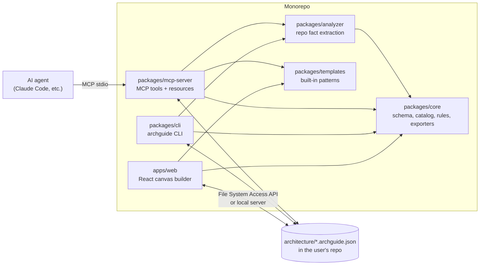
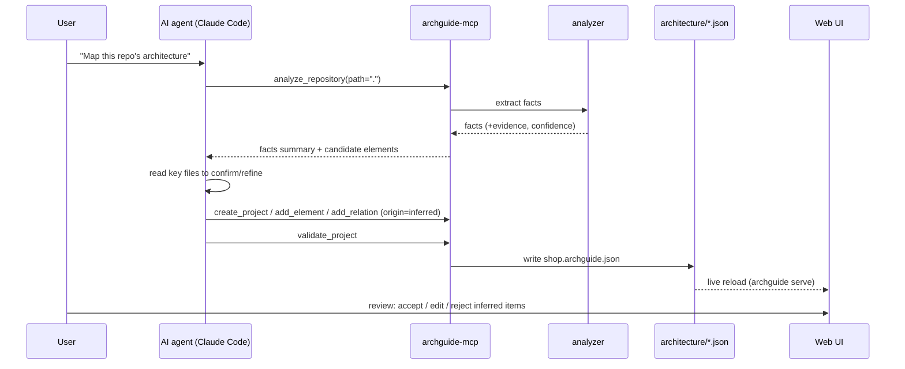

# ArchitectureGuide: Implementation Plan

A drag-and-drop builder for frontend and backend architecture. You place geometric
shapes on a canvas. Each shape is an architectural concept. You connect shapes with
typed relations. The tool blocks relations that make no sense, flags known
anti-patterns, and exports the result in a format that AI coding agents can read
and act on. You can also point it at an existing repository to get a draft of that
repository's architecture.

---

## 1. Goals and non-goals

### Goals

1. **Simple to use.** Drag a shape, type a name, drag a connection. Smart defaults
   handle the rest (relation type, color, layer).
2. **Semantic, not just visual.** Each shape has a concept type. Each edge has a
   relation type. The model knows what a "Repository" or a "Message Queue" is.
3. **Guard rails.** Hard rules block meaningless relations. Soft rules flag
   anti-patterns with an explanation and a suggested fix.
4. **Built-in patterns.** Start from templates such as Hexagonal, CQRS, Microservices
   with API Gateway, BFF, Micro-frontends, Feature-Sliced Design.
5. **AI-agent-friendly export.** A structured Markdown + YAML document that an agent
   (Claude Code, Cursor, etc.) can use as the plan for a feature.
6. **Projects, saving, notes, annotations.** Many projects, autosave, snapshots,
   notes on elements, sticky notes on the canvas.
7. **Repository analysis.** An MCP server and a CLI that read a repository, create a
   draft model, and save it into the repository.

### Non-goals (for v1)

- Real-time multi-user collaboration (the data model allows it later).
- Low-level UML (class diagrams, full sequence diagrams). The level is C4
  "container" and "component", not classes.
- Code generation of business logic. Scaffolding of folders and stubs is a later
  phase (see section 13).

---

## 2. System overview



The key decision: **all logic lives in `packages/core`**, a pure TypeScript package
with no DOM dependency. The web app, the CLI, and the MCP server use the same
schema, the same rules, and the same exporters. A model that is valid in the UI is
valid in CI and in the agent's tool calls.

---

## 3. Technology choices

| Concern | Choice | Reason |
|---|---|---|
| Language | TypeScript (strict) | One language for UI, CLI, MCP server. |
| Monorepo | pnpm workspaces + Turborepo | Fast, simple, good caching. |
| UI framework | React 19 + Vite | Large ecosystem, fast dev loop. |
| Canvas / graph | **React Flow (`@xyflow/react`)** | Nodes, edges, handles, zoom, minimap, and `isValidConnection` hook for rule checks. Custom node components let us draw any shape in SVG. |
| State | Zustand + Immer, `zundo` for undo/redo | Small, predictable, easy to test. |
| Schema / validation | Zod, and JSON Schema generated from Zod | One source of truth; JSON Schema is published for agents and editors. |
| Auto-layout | ELK.js (`elkjs`) | Layered layout that respects groups (layers, bounded contexts). |
| Local storage | IndexedDB via Dexie | Local-first autosave, no backend needed. |
| Files | File System Access API (Chromium), download/upload fallback | Save straight into a repo folder so git versions the model. |
| UI kit | Radix UI primitives + Tailwind CSS | Accessible, unstyled primitives. |
| Markdown | `react-markdown` for notes | Notes and annotations are Markdown. |
| Image export | `html-to-image` for PNG/SVG | Works with React Flow viewport. |
| MCP | `@modelcontextprotocol/sdk` (stdio transport) | Standard for Claude Code and other agents. |
| Code parsing | `tree-sitter` (WASM) + manifest parsers | Multi-language import graphs. |
| Tests | Vitest (unit), Playwright (e2e) | Fast unit tests on core; real browser for canvas. |

Alternatives considered: tldraw (great freeform drawing, weaker typed-graph
semantics), Konva/Fabric (more control, much more work), JointJS (good, but
commercial features). React Flow gives the best balance for a typed graph.

---

## 4. Repository layout

```
ArchitectureGuide/
├─ apps/
│  └─ web/                      # The builder (Vite + React)
│     ├─ src/canvas/            # React Flow setup, node + edge components
│     ├─ src/shapes/            # SVG shape components (rect, cylinder, hexagon ...)
│     ├─ src/panels/            # Palette, Inspector, Problems, Notes, Layers
│     ├─ src/store/             # Zustand stores (project, ui, history)
│     ├─ src/persistence/       # Dexie, file system, import/export
│     └─ e2e/                   # Playwright tests
├─ packages/
│  ├─ core/
│  │  ├─ src/schema/            # Zod schemas: Project, Element, Relation, View ...
│  │  ├─ src/catalog/           # Concept + relation catalog (data)
│  │  ├─ src/rules/             # Hard constraints + anti-pattern detectors
│  │  ├─ src/graph/             # Graph queries (paths, cycles, fan-in/out, layers)
│  │  ├─ src/export/            # agent-md, yaml, json, mermaid, plantuml, c4-dsl
│  │  ├─ src/import/            # json, mermaid (subset), structurizr (subset)
│  │  └─ src/migrate/           # schemaVersion migrations
│  ├─ templates/                # Built-in patterns (one file per pattern)
│  ├─ analyzer/                 # Repo fact extraction (manifests, imports, infra)
│  ├─ cli/                      # `archguide` command
│  └─ mcp-server/               # `archguide-mcp` stdio server
├─ schema/
│  └─ archguide.schema.json     # Generated JSON Schema (published)
└─ docs/
   ├─ PLAN.md                   # This file
   ├─ CONCEPTS.md               # Concept + relation catalog reference
   └─ RULES.md                  # Rule reference with rationale
```

---

## 5. Domain model (the heart of the system)

### 5.1 Model and views are separate

Like C4/Structurizr, there is **one model** and **many views**. The model holds
the meaning (elements, relations). A view holds the layout (positions, sizes,
which elements are visible). This lets you have a "Frontend" view, a "Backend"
view, and a "Checkout flow" view of the same system, without duplicated data.
Export to AI uses the model, so layout noise never reaches the agent.

### 5.2 Core types

```ts
// packages/core/src/schema/project.ts (shape of the data; real code uses Zod)

interface Project {
  schemaVersion: 1;
  id: string;                    // "proj_shop"
  name: string;
  description?: string;          // Markdown
  createdAt: string; updatedAt: string;
  derivedFrom?: { templateId: string; templateVersion: string }[];
  model: Model;
  views: View[];
  notes: Note[];                 // project-level notes (Markdown pages)
  decisions: Decision[];         // ADRs
  changeSets: ChangeSet[];       // feature proposals (see 5.5)
  settings: ProjectSettings;     // enabled rule packs, suppressions, palette
}

interface Model {
  elements: Element[];
  relations: Relation[];
}

interface Element {
  id: string;                    // stable, human-readable: "svc.orders"
  kind: ConceptId;               // "be.service", "data.relational-db", "fe.page" ...
  name: string;                  // label shown on the shape
  description?: string;
  parentId?: string;             // nesting: component inside service, service inside context
  layer?: LayerId;               // "presentation" | "application" | "domain" | "infrastructure" ...
  tech?: string;                 // "NestJS", "PostgreSQL 16", "React"
  responsibilities?: string[];   // short bullet list, great for agents
  tags?: string[];
  color?: string;                // override; default comes from layer/kind
  status: 'existing' | 'planned' | 'deprecated';
  owner?: string;                // team
  qualities?: {                  // optional, feeds rules
    sensitivity?: 'public' | 'internal' | 'pii' | 'secret';
    criticality?: 'low' | 'medium' | 'high';
    scaling?: 'single' | 'horizontal' | 'serverless';
    sla?: string;
  };
  properties?: Record<string, unknown>;   // kind-specific, validated by catalog
  source?: {                     // set when produced by repo analysis
    origin: 'manual' | 'inferred';
    confidence?: number;         // 0..1
    evidence?: { path: string; line?: number; symbol?: string }[];
  };
}

interface Relation {
  id: string;                    // "rel.web-calls-bff"
  type: RelationType;            // "calls" | "publishes" | "reads" ...
  sourceId: string;
  targetId: string;
  label?: string;                // "POST /orders"
  mode?: 'sync' | 'async';       // derived from type, can override where allowed
  protocol?: string;             // "HTTP/JSON", "gRPC", "AMQP", "SQL"
  contract?: string;             // link or inline schema reference
  status: 'existing' | 'planned' | 'deprecated';
  source?: Element['source'];
}

interface View {
  id: string; name: string;
  kind: 'free' | 'context' | 'container' | 'component' | 'scenario';
  scopeElementId?: string;       // for drill-down views ("inside svc.orders")
  nodes: { elementId: string; x: number; y: number; w?: number; h?: number }[];
  edges: { relationId: string; waypoints?: { x: number; y: number }[] }[];
  annotations: Annotation[];
}

interface Annotation {
  id: string;
  kind: 'sticky' | 'callout' | 'comment' | 'region';
  text: string;                  // Markdown
  anchor: { elementId: string } | { relationId: string } | { x: number; y: number };
  color?: string;
  resolved?: boolean;
  author?: string; createdAt: string;
}

interface Note { id: string; title: string; body: string; linkedIds: string[] }

interface Decision {             // lightweight ADR
  id: string;                    // "ADR-003"
  title: string;
  status: 'proposed' | 'accepted' | 'superseded';
  context: string; decision: string; consequences: string;
  linkedIds: string[];
}
```

### 5.3 Stable, readable IDs

IDs are slugs (`svc.orders`, `db.orders`, `fe.checkout-page`), not UUIDs. They make
exports readable, diffs in git readable, and let an agent refer to elements by name
in tool calls. The UI generates them from the label and keeps them unique.

### 5.4 Deterministic serialization

The JSON file is written with sorted keys and elements sorted by ID. Two saves of
the same model produce the same bytes. Git diffs show only real changes.

### 5.5 Change sets: planning features on top of a baseline

This is the feature that makes the tool useful for **feature planning**:

```ts
interface ChangeSet {
  id: string;                    // "cs.add-payments"
  name: string;                  // "Add Stripe payments"
  description: string;
  status: 'draft' | 'ready' | 'implemented';
  ops: ChangeOp[];               // add/update/remove element or relation
  tasks?: { id: string; title: string; elementIds: string[]; done: boolean }[];
}
```

- The **baseline** is the current architecture (often from repo analysis).
- A **change set** is a proposal layered on top. The canvas shows it as an overlay:
  green = added, amber = changed, red strike = removed.
- Rules run on "baseline + change set", so you see anti-patterns your feature
  would introduce before any code exists.
- Export a change set as an agent plan: what to add, what to change, which
  invariants must hold, and an ordered task list.

---

## 6. Visual language: shapes, colors, relations

### 6.1 Shapes encode the concept category

The shape tells you *what kind of thing* it is. The label tells you *which* one.
The color tells you *where* it lives (layer or tier). This keeps the canvas
readable at a glance.

| Shape | Category | Example concepts |
|---|---|---|
| Rectangle | Deployable unit | Service, Web app, Mobile app, Worker, Function (lambda) |
| Rounded rectangle | Code module | Module, Library, Component, Use case, Controller |
| Window (rect with title bar) | UI surface | Page/Route, Screen, Layout, Micro-frontend |
| Hexagon | Domain core | Bounded context core, Aggregate, Domain service |
| Small hexagon | Domain object | Entity, Value object |
| Circle | Port / interface | Port, API contract, Interface |
| Rounded square with plug | Adapter | DB adapter, HTTP adapter, Messaging adapter |
| Cylinder (vertical) | Data at rest | Relational DB, Document DB, Cache, Search index, Object storage, Event store |
| Cylinder (horizontal / pipe) | Data in motion | Queue, Topic/Stream, Event bus |
| Triangle | Event | Domain event, Integration event, Command |
| Diamond | Traffic routing | API gateway, Load balancer, Router, BFF entry |
| Octagon | Security boundary | Auth provider, WAF, Identity |
| Person / circle with head | Actor | User, Admin, External system actor |
| Cloud | External system | Third-party API (Stripe, SendGrid) |
| Dashed container | Grouping | Layer, Bounded context, Tier, Deployment zone, Team |
| Gear | Cross-cutting | Logging, Config, Feature flags, Observability |

Each concept also has an icon inside the shape (Lucide icons) so two concepts with
the same shape (e.g. Relational DB vs Cache) still look different.

### 6.2 Color

- **Default:** color comes from the layer or tier (e.g. presentation = blue,
  application = teal, domain = purple, infrastructure = gray, data = amber,
  external = slate).
- **Override:** per element, or "color by" mode: by layer, by team (owner), by
  status, by change set. A legend is generated automatically.
- All palettes meet WCAG contrast for labels in light and dark themes.

### 6.3 Relation types and line styles

Edges point **from the element that initiates or depends, toward the element it
depends on.** This one rule makes dependency checks (cycles, dependency rule)
straightforward.

| Relation | Line | Meaning | Typical source → target |
|---|---|---|---|
| `calls` | solid, filled arrow | Synchronous request | UI/service → service/gateway/external |
| `publishes` | dashed, open arrow | Sends message/event | service/function → queue/topic/bus |
| `consumes` | dashed, open arrow | Receives from | worker/service/function → queue/topic |
| `reads` | solid, thin | Reads data | service/repository → data store |
| `writes` | solid, thick | Writes data | service/repository → data store |
| `depends-on` | dotted | Compile-time import | module → module |
| `implements` | dotted, hollow triangle | Realizes an interface | adapter → port |
| `uses-port` | dotted, open arrow | Depends on an interface | use case → port |
| `renders` | solid, diamond tail | UI composition | page → component |
| `navigates` | solid, curved | UI navigation | page → page |
| `emits` | dashed, triangle | Raises domain event | aggregate → domain event |
| `handles` | dashed | Reacts to event | handler → domain event |
| `authenticates-with` | dash-dot | Auth dependency | app/gateway → auth provider |

Nesting (component inside service) is expressed with `parentId`, not with edges.

### 6.4 Smart defaults

When you drop a connection from A to B, the tool looks up all relation types that
are valid for `(kind(A), kind(B))`:

- one valid type → it is used directly;
- several → a small popup lists only the valid ones, the most common first;
- none → the drop is refused and a tooltip says why (see 7.1).

---

## 7. Rules engine

Rules live in `packages/core/src/rules`. They are data plus small pure functions,
so they run the same in the UI, in the CLI (`archguide check`), and in the MCP
server (`validate_project`).

### 7.1 Tier 1: hard constraints (block the action)

A **relation compatibility matrix** in the catalog says, for each relation type,
which source categories and target categories are allowed:

```ts
// packages/core/src/catalog/relations.ts
export const relationRules: Record<RelationType, RelationRule> = {
  calls:     { from: ['actor', 'ui', 'deployable', 'module', 'routing'],
               to:   ['deployable', 'module', 'routing', 'external', 'port'] },
  reads:     { from: ['deployable', 'module', 'adapter'], to: ['data-at-rest'] },
  writes:    { from: ['deployable', 'module', 'adapter'], to: ['data-at-rest'] },
  publishes: { from: ['deployable', 'module', 'adapter', 'data-at-rest' /* CDC */],
               to:   ['data-in-motion'] },
  consumes:  { from: ['deployable', 'module', 'adapter'], to: ['data-in-motion'] },
  implements:{ from: ['adapter'], to: ['port'] },
  emits:     { from: ['domain-core', 'domain-object'], to: ['event'] },
  // ...
};
```

Examples of blocked actions, each with a human message:

| Attempt | Message |
|---|---|
| Database `calls` Service | "A data store does not call anything. Did you mean Service *reads* Database?" (offers to flip the edge) |
| Queue `calls` Worker | "Queues do not call consumers. Use Worker *consumes* Queue." |
| Port `implements` Adapter | "Reversed. Adapters implement ports." (offers to flip) |
| Value object `reads` Database | "Domain objects have no I/O. Use a Repository." |
| Domain event → anything outgoing | "Events are facts, they do not depend on anything." |
| Element `contains` itself / nesting cycle | "An element cannot be inside itself." |
| Page `writes` Database | Blocked in browser tier: "Browser code cannot access a database directly." |

Hard constraints also apply to **nesting**: a Page can sit inside a Web app, not
inside a Database; an Entity can sit inside a Bounded context, not inside a Queue.

While you drag a connection, valid targets glow, invalid targets fade. This gives
the guidance *before* the mistake.

### 7.2 Tier 2: anti-pattern detectors (allow, but flag)

These are graph analyses. The relation is allowed, but the result is a known
problem. Each finding shows a badge on the affected shapes/edges, an entry in the
Problems panel, a "why this is a problem" text, and, where possible, a **quick fix**.

| ID | Anti-pattern | Detection | Quick fix |
|---|---|---|---|
| AP-001 | Shared database between services | ≥2 deployables write (or read+write) the same data store | Split into per-service stores; or mark one owner + expose API |
| AP-002 | Frontend talks to database | UI-tier element reaches data store with no backend in the path | Insert API/BFF between them |
| AP-003 | Cyclic dependency | Cycle in `depends-on` / `calls` among modules or services | Highlight the cycle; suggest event or interface to break it |
| AP-004 | Dependency rule violation | Element in `domain` layer depends on `infrastructure`/`presentation` | Insert a Port, make adapter implement it |
| AP-005 | Layer skipping | Presentation → data store, or controller → repository without use case (only in strict-layered patterns) | Insert use case / application service |
| AP-006 | Distributed monolith | Sync `calls` cycle between services, or a service with sync calls to >N services in a request chain | Make some calls async; merge services |
| AP-007 | Chatty sync chain | Sync call depth > 4 from an entry point | Introduce async, aggregation, or caching |
| AP-008 | God service / hub | Fan-in + fan-out above threshold, or >N responsibilities | Split by subdomain |
| AP-009 | Frontend fan-out | UI calls >3 backend services directly | Add BFF or API gateway |
| AP-010 | Public entry without auth | Actor → deployable path with no gateway/auth relation | Add gateway or `authenticates-with` |
| AP-011 | Orphan messaging | Queue/topic with producers but no consumers (or the reverse) | Add consumer/producer or remove |
| AP-012 | Missing dead-letter handling | Consumer of a queue with no DLQ (info-level) | Add DLQ |
| AP-013 | Dual write | Service writes DB and publishes event with no outbox | Apply Outbox template |
| AP-014 | Cache as source of truth | Cache with writes but no backing store | Add backing store |
| AP-015 | Sensitive data leak | `pii` store read by element in `public` zone, or via external system | Add boundary / anonymizing service |
| AP-016 | Disconnected element | Element with no relations and no parent | Connect or delete |
| AP-017 | Event handler calls back publisher synchronously | handler → `calls` → the service that emitted the event | Use reply event |
| AP-018 | Anemic edge labels | `calls` with no label/protocol (info, helps agents) | Prompt for label |

Severity: `error` (red), `warning` (amber), `info` (blue).

### 7.3 Pattern-aware rule packs

Rules are grouped into packs: `core` (always on), `layered`, `hexagonal`,
`microservices`, `event-driven`, `frontend`, `security`. Applying a template turns
on the matching packs. Example: in a Modular Monolith, a shared database is
normal, so AP-001 is replaced by a "module owns its tables" rule.

### 7.4 Suppressions

A finding can be suppressed with a **required reason** ("Legacy reporting DB,
removal planned in Q3"). Suppressions are stored in the project, shown in
exports, and can link to an ADR. Agents see *why* an exception exists.

### 7.5 Rule API

```ts
interface Rule {
  id: string;                       // "AP-001"
  title: string;
  severity: 'error' | 'warning' | 'info';
  pack: RulePackId;
  rationale: string;                // Markdown, shown in UI and docs
  references?: string[];            // links to pattern literature
  check(graph: GraphQuery, ctx: RuleContext): Finding[];
  quickFixes?: QuickFix[];          // produce ChangeOps, preview before apply
}
```

`GraphQuery` gives helpers: `incoming`, `outgoing`, `pathsBetween`,
`stronglyConnectedComponents`, `layerOf`, `ancestors`, `fanIn/fanOut`. Rules stay
short and easy to test.

---

## 8. Built-in pattern templates

A template is a **parameterized model fragment** plus metadata:

```ts
interface Template {
  id: string; version: string;
  name: string; category: 'backend' | 'frontend' | 'fullstack' | 'integration';
  summary: string;
  whenToUse: string[]; whenNotToUse: string[]; tradeoffs: string[];
  parameters: { key: string; label: string; default: string | number }[]; // e.g. service names, count
  rulePacks: RulePackId[];
  invariants: string[];             // plain-language rules exported to agents
  build(params): { model: Model; view: View };
}
```

Templates can create a new project or be **stamped** into an existing canvas
(as a group, with a parameter dialog). Each project records `derivedFrom`, so the
tool can show "drift from pattern" later.

### Initial template set

**Backend**
1. Layered (N-tier): Presentation → Application → Domain → Infrastructure
2. Hexagonal (Ports & Adapters)
3. Clean Architecture / Onion
4. Modular Monolith (modules with public APIs, one DB, schema per module)
5. Microservices + API Gateway (DB per service)
6. Event-Driven (pub/sub on an event bus)
7. CQRS (command side, query side, read model)
8. Event Sourcing (+ projections)
9. Saga: orchestration and choreography variants
10. Transactional Outbox
11. Strangler Fig (legacy + facade + new services)
12. Serverless (API → functions → queues → store)
13. Pipes and Filters / ETL pipeline

**Frontend**
14. Flux / unidirectional data flow (view → action → store → view)
15. MVVM
16. Feature-Sliced Design (app / pages / widgets / features / entities / shared)
17. Atomic Design (atoms → molecules → organisms → templates → pages)
18. Container / Presentational components
19. Micro-frontends (shell + remotes, module federation)
20. Islands architecture / SSR + hydration
21. Offline-first PWA (service worker, local DB, sync queue)

**Full-stack / integration**
22. SPA + REST API + DB (the "starter")
23. Backend-for-Frontend (web BFF + mobile BFF)
24. Next.js / Remix full-stack (server components, route handlers, DB)
25. Real-time app (WebSocket gateway + pub/sub + presence store)

Users can **save any selection as a custom template** and share it as a file.

---

## 9. User experience

### 9.1 Layout

```
┌───────────────────────────────────────────────────────────────────────┐
│ Project ▾  View ▾  Change set ▾       [Validate ●3] [Export ▾] [Save] │
├──────────┬───────────────────────────────────────────────┬────────────┤
│ Palette  │                                               │ Inspector  │
│ [search] │                Canvas                         │  Name      │
│ Frontend │    (React Flow: zoom, pan, minimap)           │  Kind      │
│ Backend  │                                               │  Layer     │
│ Data     │                                               │  Tech      │
│ Infra    │                                               │  Notes     │
│ Events   │                                               │  Problems  │
│ Groups   │                                               │  Evidence  │
│ Templates│                                               │            │
├──────────┴───────────────────────────────────────────────┴────────────┤
│ Problems (3)  │  Notes  │  Decisions  │  Change set ops                │
└───────────────────────────────────────────────────────────────────────┘
```

### 9.2 Interactions that keep it simple

- **Drag from palette** to place a shape. **Double-click** canvas: quick-add search.
- **`/` command palette**: "add service Orders", "apply template CQRS",
  "connect web → bff", "export agent".
- **Type to rename** right after placing (label in edit mode).
- **Drag from a shape's edge handle** to connect; valid targets glow.
- **Drop a shape onto a group** to nest it (validated by nesting rules).
- **Auto-layout** button (ELK), respecting groups and layers.
- **Drill-down:** double-click a service to open its component view.
- **Undo/redo**, copy/paste, multi-select, align/distribute, snap to grid.
- **Focus mode:** select an element, dim everything not connected to it.
- **Filter:** by tag, layer, status, team.
- **Keyboard first:** every action has a shortcut; shown in tooltips.
- **Onboarding:** first run opens the "SPA + REST API + DB" template with three
  guided tips.

### 9.3 Notes and annotations

- **Element notes:** Markdown in the Inspector for any element or relation.
- **Sticky notes:** free text on the canvas, in a view.
- **Callouts:** a note anchored to an element/edge with a leader line. Moves with it.
- **Regions:** a highlighted area with a title ("Phase 2 scope").
- **Comments:** threaded, can be resolved (single-user in v1, ready for multi-user).
- **Project notes:** Markdown pages (glossary, context, constraints).
- **Decisions (ADRs):** linked to elements; shown as a small badge on the shape.

All notes are part of the export, so the agent gets the context too.

---

## 10. Projects, saving, versions

- **Workspace:** a list of projects in IndexedDB. Each project autosaves (debounced
  500 ms) to IndexedDB.
- **Open folder (repo mode):** with the File System Access API, open a repo's
  `architecture/` folder. Each project is one file: `<id>.archguide.json`. Saves
  go to disk; git versions them. Fallback for non-Chromium browsers: download /
  upload.
- **Snapshots:** named versions inside the project ("Before payments"). Compare
  any two snapshots as a visual diff (same overlay as change sets).
- **Duplicate / branch a project:** start a variant to compare two designs.
- **Import:** native JSON, template file, Mermaid flowchart (subset), Structurizr
  DSL (subset).
- **Schema migrations:** `schemaVersion` + migration functions in `core/migrate`,
  tested with fixtures of every old version.
- **Local server mode (`archguide serve`):** the CLI serves the web app and
  watches the folder. When the MCP server or an agent changes a file, the open
  browser tab updates live (WebSocket). This is the bridge between the UI and the
  agent.

---

## 11. Export formats

| Format | Use |
|---|---|
| `archguide.json` | Lossless native format, JSON Schema published |
| **Agent Markdown** (`ARCHITECTURE.md`) | Primary AI format (see below) |
| **Agent YAML** (`architecture.yaml`) | Compact, machine-first, low token count |
| **Change-set plan** (`plans/<change-set>.md`) | Feature plan with ordered tasks |
| `AGENTS.md` / `CLAUDE.md` snippet | Invariants only, to paste into agent memory |
| Mermaid | Embed in READMEs, PRs |
| PlantUML / C4 / Structurizr DSL | Interop with existing tools |
| PNG / SVG | Slides, docs |

### 11.1 Agent Markdown format (design)

Design principles:

1. **Stable IDs everywhere**, so the agent can refer back.
2. **Tables for lists, prose only where it adds meaning.**
3. **Invariants as MUST / MUST NOT statements**, derived from rules, template
   invariants, and layer settings. These are what an agent most needs.
4. **Evidence paths** for inferred elements, so the agent knows where code lives.
5. **Known issues** with suppressions and reasons, so the agent does not "fix"
   accepted exceptions.
6. **No layout data.**

Example output:

````markdown
---
archguide: 1
project: shop
patterns: [hexagonal, bff]
generated: 2026-10-27
---

# Architecture: Shop

Online shop. Web SPA talks to a BFF. Orders service follows Hexagonal.

## Elements

| ID | Kind | Name | Layer | Tech | Responsibilities | Code |
|---|---|---|---|---|---|---|
| fe.web | fe.web-app | Web SPA | presentation | React | Catalog, cart, checkout UI | apps/web |
| svc.bff | be.bff | Web BFF | application | Node/Fastify | Aggregate catalog + orders for web | apps/bff |
| svc.orders | be.service | Orders | application | NestJS | Place, cancel, track orders | services/orders |
| dom.order | be.aggregate | Order | domain | – | Order lifecycle invariants | services/orders/src/domain |
| port.order-repo | be.port | OrderRepository | domain | – | Persist orders | services/orders/src/domain/ports |
| ad.pg-orders | be.adapter | PgOrderRepository | infrastructure | Prisma | Implements OrderRepository | services/orders/src/infra |
| db.orders | data.relational-db | Orders DB | data | PostgreSQL 16 | – | – |

## Relations

| From | Relation | To | Details |
|---|---|---|---|
| fe.web | calls | svc.bff | HTTP/JSON, `GET /catalog`, `POST /orders` |
| svc.bff | calls | svc.orders | gRPC `PlaceOrder` |
| ad.pg-orders | implements | port.order-repo | – |
| ad.pg-orders | writes | db.orders | SQL |

## Invariants

- `dom.*` MUST NOT depend on `ad.*` or any infrastructure element. (hexagonal)
- `fe.web` MUST only call `svc.bff`. (bff)
- `db.orders` MUST only be accessed by `svc.orders`. (database-per-service)
- New persistence MUST go through a port in `services/orders/src/domain/ports`.

## Known issues

| Rule | Where | Status | Reason |
|---|---|---|---|
| AP-012 Missing DLQ | q.order-events | suppressed | Low volume, retries in consumer (ADR-004) |

## Decisions

- **ADR-004** (accepted): No DLQ for order events in v1. Links: q.order-events.

## Notes

- Glossary: "Order" means a confirmed cart; drafts are "Carts".
````

### 11.2 Change-set plan export

```markdown
# Plan: Add Stripe payments (cs.add-payments)

## Changes
- ADD svc.payments (be.service, NestJS) — "Create payment intents, handle webhooks"
- ADD ext.stripe (ext.api)
- ADD svc.payments calls ext.stripe (HTTPS)
- ADD svc.payments publishes q.payment-events
- ADD svc.orders consumes q.payment-events
- CHANGE svc.bff: add `POST /checkout/pay`

## Invariants this change must respect
- svc.payments MUST own its data (new db.payments); MUST NOT write db.orders.
- Payment events MUST be published via outbox (AP-013).

## Rule check
- 0 errors, 1 warning: AP-012 Missing DLQ on q.payment-events.

## Tasks (in dependency order)
1. Create `services/payments` with hexagonal layout (template: hexagonal).
2. Add db.payments + migration.
3. Implement Stripe adapter behind `PaymentGateway` port.
4. Add outbox table + publisher for `PaymentSucceeded`.
5. Add consumer in svc.orders to mark order paid.
6. Add BFF route `POST /checkout/pay`.
```

Task order is computed from the dependency graph (topological order of added
elements: stores and ports first, then adapters, then services, then callers).

---

## 12. Repository analysis and MCP server

Goal: point the tool at a repo and get a reviewed, high-level architecture model
**saved inside that repo** (`architecture/` folder + `ARCHITECTURE.md`), then keep
it in sync.

### 12.1 Approach: deterministic facts + AI interpretation + human review

Pure static analysis is precise but shallow. Pure LLM reading is deep but slow and
can invent things. Combine them:



### 12.2 `packages/analyzer`: what it extracts (deterministic)

| Source | Facts |
|---|---|
| Manifests: `package.json`, workspaces, `go.mod`, `pom.xml`, `build.gradle`, `pyproject.toml`, `Cargo.toml`, `*.csproj` | Packages, apps, languages, frameworks (by dependency: `next`, `express`, `@nestjs/core`, `django`, `spring-boot`, `fastapi` ...) |
| `Dockerfile`, `docker-compose.yml`, Helm, k8s manifests, Terraform | Deployable units, data stores (postgres, redis, kafka, rabbitmq images/resources), ports, networks |
| `.env.example`, config files | Connections (`DATABASE_URL`, `REDIS_URL`, `KAFKA_BROKERS`, external API keys → external systems) |
| OpenAPI, GraphQL schema, `.proto` | API contracts → relation labels and contracts |
| Import graph (tree-sitter, per language) | Module dependencies, cycles, layer violations |
| Folder conventions | Layers: `controllers/`, `domain/`, `application/`, `infrastructure/`, `adapters/`, `ports/`, `pages/`, `features/`, `entities/`, `shared/` |
| Framework routes | Next.js `app/`/`pages/`, Express/Fastify routers, NestJS controllers → entry points, pages |
| Client calls | `fetch`/`axios` base URLs, generated clients → frontend → backend relations |
| Messaging code | Producer/consumer SDK usage (`kafkajs`, `amqplib`, SQS) → publishes/consumes |

Each fact has `evidence` (file + line) and `confidence`. The analyzer is a set of
small **detectors** (plugin interface), so new frameworks are easy to add.

It respects `.gitignore`, has size limits, and never sends code anywhere. It is
local only.

### 12.3 `packages/mcp-server`: `archguide-mcp`

Run: `npx archguide-mcp --workspace ./architecture`
(Claude Code: `claude mcp add archguide -- npx archguide-mcp --workspace ./architecture`)

**Tools**

| Tool | Purpose |
|---|---|
| `list_projects` | Projects in the workspace |
| `get_architecture` `(projectId, format: agent-md \| yaml \| json, focus?: elementId, depth?)` | Read the model, optionally only the neighborhood of an element (token-efficient) |
| `get_catalog` `(filter?)` | Concepts, relation types, compatibility matrix |
| `list_templates` / `apply_template` `(projectId, templateId, params, parentId?)` | Use built-in patterns |
| `create_project` `(name, description, templateId?)` | New project |
| `upsert_elements` `(projectId, elements[])` | Batch add/update (validated; hard-rule failures returned as errors with reasons) |
| `upsert_relations` `(projectId, relations[])` | Batch add/update with compatibility check |
| `remove_items` `(projectId, ids[])` | Delete |
| `add_note` / `add_annotation` / `add_decision` | Context capture |
| `validate_project` `(projectId, changeSetId?)` | Run rules, return findings + quick fixes |
| `analyze_repository` `(path, include?, exclude?, depth?)` | Run analyzer, return facts + candidate model |
| `diff_with_repository` `(projectId, path)` | Drift report: model vs code (see 12.4) |
| `create_change_set` / `add_change_ops` | Plan a feature as a change set |
| `export` `(projectId, format, changeSetId?)` | Any export format; can write `ARCHITECTURE.md` into the repo |

**Resources**

- `archguide://projects/{id}` (agent Markdown)
- `archguide://projects/{id}/change-sets/{csId}`
- `archguide://catalog/concepts`, `archguide://catalog/rules`
- `archguide://templates/{id}`

**Prompts**

- `map-repository`: step-by-step instructions for the agent to build a baseline
  (analyze → confirm key files → upsert → validate → export).
- `plan-feature`: given a feature description, create a change set, validate it,
  export the plan.
- `review-change`: compare a branch diff against the model's invariants.

Batch tools (`upsert_*`) keep the number of round trips low. All write tools return
the rule findings their change introduced, so the agent can correct itself
immediately.

### 12.4 Drift detection and CI ("architecture fitness functions")

- `archguide check` (CLI) runs rules on the model **and** compares invariants with
  the real import graph. Example: the model says `dom.*` must not depend on
  `ad.*`; the analyzer finds `services/orders/src/domain/order.ts` imports
  `../infra/prisma`. → CI fails with the file and line.
- `archguide drift` lists elements in code but not in the model, and the reverse.
- A GitHub Action wraps `archguide check` and posts a summary.

This closes the loop: plan in the UI → implement with an agent → CI enforces the plan.

---

## 13. Proposed additions (beyond the brief)

Ordered by value for feature planning:

1. **Change sets (section 5.5).** Plan features as diffs over a baseline, with
   rule checks and ordered task export. Highest value.
2. **Model/view separation + drill-down (C4 levels).** System context → containers
   → components, without duplicate data.
3. **Fitness functions in CI (12.4).** The model becomes enforceable, not just a picture.
4. **Scenarios (flow view).** Select a path ("user places an order"), step through
   it, export as a Mermaid sequence diagram. Shows sync chains and latency risks.
5. **Quality attributes on elements** (sensitivity, criticality, scaling, SLA). Enables
   security and reliability rules (AP-010, AP-015) and gives agents NFR context.
6. **ADRs linked to elements.** Decisions stay next to what they affect.
7. **Glossary / ubiquitous language** per bounded context; exported to agents.
8. **Contracts on relations.** Link OpenAPI/proto operations to edges.
9. **Custom templates and rule packs** as shareable files.
10. **Scaffolding (later).** From a change set, generate folder structure and empty
    stubs that match the pattern (e.g. hexagonal folders, port interfaces). Output as
    a patch the user or agent reviews.
11. **In-app AI assistant (optional, later).** "Suggest what is missing", "explain this
    finding", "turn this description into a draft model". Uses the same MCP-style
    tool layer internally. Off by default, needs an API key.
12. **Complexity score.** Simple metrics (number of deployables, sync depth, coupling)
    shown per project and per change set, to compare design options.
13. **Presentation mode.** Step through views and annotations like slides.

---

## 14. Delivery phases

Each phase ends with a usable result and tests.

### Phase 0: Foundations
- Monorepo (pnpm, Turborepo, TS strict, ESLint, Prettier, Vitest, CI on GitHub Actions).
- `core/schema` with Zod + JSON Schema generation.
- `core/catalog` v1: ~35 concepts, 13 relation types, compatibility matrix.
- **Done when:** schema round-trips (parse → serialize → parse) and is deterministic.

### Phase 1: Canvas MVP
- React Flow canvas, SVG shape components for all categories, icons.
- Palette with search, drag-and-drop, inline label edit, Inspector panel.
- Edges with relation types and line styles, relation type picker.
- Groups/containers with nesting.
- Colors by layer + override, legend.
- Undo/redo, copy/paste, multi-select, snap, minimap, dark mode.
- Autosave to IndexedDB, JSON import/export.
- **Done when:** a user builds the "SPA + API + DB" diagram from scratch in < 2 min
  (Playwright scenario).

### Phase 2: Rules engine
- Hard constraints wired into `isValidConnection` and nesting drop.
- Target highlighting during connect; refusal tooltips with "flip edge" fix.
- Anti-pattern detectors AP-001 … AP-011, AP-016.
- Problems panel, badges on shapes/edges, suppressions with reason.
- Rule packs.
- **Done when:** every rule has fixture tests (positive + negative) and a doc entry.

### Phase 3: Templates and projects
- Template engine with parameters; 10 templates first (Layered, Hexagonal, Clean,
  Modular Monolith, Microservices+Gateway, Event-Driven, CQRS, BFF, Feature-Sliced,
  SPA+API+DB), rest later.
- Stamp template into existing canvas.
- Workspace (project list), duplicate project, snapshots, snapshot diff.
- File System Access "open folder" mode.
- **Done when:** each template validates with 0 errors under its own rule packs.

### Phase 4: Notes, annotations, exports
- Element notes, sticky notes, callouts, regions, comments, project notes, ADRs.
- Exporters: agent Markdown, agent YAML, AGENTS.md snippet, Mermaid, PNG/SVG.
- Golden-file tests for each exporter.
- **Done when:** exported agent Markdown for each template is reviewed and stable.

### Phase 5: CLI + MCP server
- `archguide` CLI: `init`, `validate`, `export`, `serve`.
- `archguide-mcp` with read/write tools, resources, prompts.
- Live reload in the web app via `archguide serve`.
- **Done when:** Claude Code can create, edit, validate and export a project only
  through MCP, and the open browser tab updates live.

### Phase 6: Repository analysis
- Analyzer detectors: JS/TS (package.json, Next, Express, Nest, imports), Docker
  Compose, env files, OpenAPI. Then Python, Go, Java.
- `analyze_repository`, `diff_with_repository`, `archguide check`, `archguide drift`.
- "Inferred" review flow in the UI (accept / edit / reject, evidence links).
- GitHub Action.
- **Done when:** on 3 sample repos (monolith, microservices compose, Next.js app),
  the generated baseline has ≥ 80% of the hand-made reference elements, and no
  element without evidence.

### Phase 7: Change sets and advanced views
- Change sets with overlay, rule check, plan export with ordered tasks.
- Views, drill-down, scenarios, focus/filter modes.
- Remaining anti-patterns and templates.
- **Done when:** a feature can be planned end-to-end: baseline from repo → change
  set in UI → plan export → agent implements → `archguide check` passes.

---

## 15. Testing strategy

- **Core (most tests live here):** schema round-trip, migrations, every rule with
  small fixture graphs, graph algorithms, exporters with golden files,
  property-based tests (fast-check) for "serialize ∘ parse = id" and "valid
  model stays valid after layout".
- **Web:** component tests for panels; Playwright e2e for drag, connect, refuse
  invalid connection, apply template, export.
- **MCP:** contract tests that call each tool through the SDK client.
- **Analyzer:** fixture repos under `packages/analyzer/fixtures/*` with expected facts.
- **Performance budget:** 500 elements / 1,000 relations: pan/zoom at 60 fps, full
  rule run < 100 ms.

---

## 16. Risks and mitigations

| Risk | Mitigation |
|---|---|
| Rules too strict, users fight the tool | Only truly meaningless relations are hard errors; everything else is a warning with suppression |
| Too many concepts, palette overwhelms | Palette grouped + search; templates as the main entry point; "basic" vs "full" catalog toggle |
| Repo analysis guesses wrong | Every inferred item carries evidence and confidence; nothing is "existing" until a human accepts it |
| Agent export too large for context | `focus` + `depth` neighborhood export; YAML compact mode; change-set-only export |
| File System Access API is Chromium-only | Download/upload fallback; `archguide serve` works in every browser |
| Schema changes break saved files | `schemaVersion` + tested migrations from day one |

---

## 17. Open decisions (with recommendations)

1. **Web app only, or also desktop (Tauri)?** Recommendation: web + `archguide serve`
   first; Tauri later only if file access becomes a pain.
2. **Hosted sync / collaboration?** Recommendation: not in v1. Git is the sync layer.
   Keep IDs and ops (change sets) CRDT-friendly so Yjs can be added later.
3. **License and distribution** (npm packages for CLI/MCP, public web build).
4. **Which languages first in the analyzer?** Recommendation: TypeScript/JavaScript
   first, then Python, Go, Java.

---

## 18. First concrete steps

1. Set up the monorepo skeleton and CI (Phase 0).
2. Write `core/schema` and `core/catalog` with tests.
3. Build the shape components in isolation (Storybook or a simple gallery page) to
   settle the visual language early.
4. Wire React Flow with 5 concepts and 3 relation types end-to-end (place, connect,
   validate, save, export JSON), then widen.
