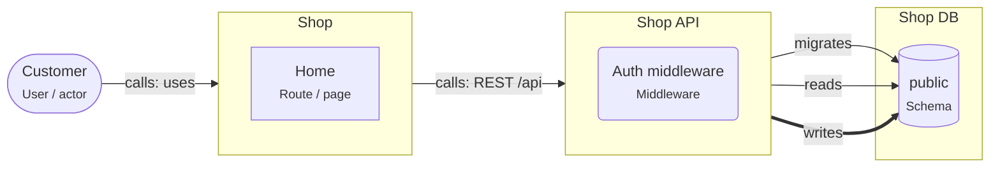

# Onboarding: Starter: React + Express + PostgreSQL

A React app calls one Node.js REST API, which owns one PostgreSQL schema. The smallest complete full-stack design.

This guide is written for the **intermediate** level. Open the project in ArchitectureGuide to see the diagram, follow the tour, and read every concept at your level.

## The big picture

## Tour of Starter: React + Express + PostgreSQL

1. **The browser part**: Customers use the Shop React app. It only renders screens and calls the API; it never holds database credentials.

   Look at: Customer, Shop.
2. **The API**: Shop API is the only way in. Its auth middleware checks the session cookie on every request.

   Look at: Shop API, Auth middleware.
3. **The data**: One schema, owned by the API: it reads, writes and migrates it. One owner per schema keeps changes safe.

   Look at: Shop DB, public.

## Patterns used

### Starter: React app, Node API, PostgreSQL

The smallest complete web application. A React app in the browser, one Node.js API, and one PostgreSQL database that only the API touches.

- Keep the API **stateless**: sessions live in a cookie plus a session table, not in
  process memory, so you can run two instances later.
- Configuration comes from environment variables (`DATABASE_URL`, `SESSION_SECRET`),
  never from the code (Twelve-Factor).
- Validate every request at the API boundary (zod), and share the request and response
  types with React through a small shared package.
- Migrations run in CI or at deploy time, before the new API version starts.

## Who owns which data

| Store | Owner (migrations) | Writers | Readers |
|---|---|---|---|
| schema.public | svc.shop-api | svc.shop-api | svc.shop-api |

## Rules of the road

- The Shop React app MUST NOT connect to PostgreSQL; it calls Shop API over HTTP.
- Only Shop API MAY write and migrate the "public" schema of Shop DB.
- Auth tokens MUST live in an HttpOnly cookie, not in localStorage.
- Only `svc.shop-api` MAY write `schema.public`. Only `svc.shop-api` MAY run migrations on it.

## Concepts used in this project

- **User / actor** (`gen.actor`): A person or role that uses the system — customer, admin, support agent. Diagrams start with who uses the system and why.

  - Name actors by role, not by person ("Support agent", not "Anna").
  - Actors call **apps**, not databases. If an actor talks to an external tool (a payment
    page), draw that too.
  - Roles on actors map to roles in authorization (RBAC).
- **Middleware** (`node.middleware`): Code that runs before (or after) every handler of a route group — authentication, rate limiting, request logging, error handling.

  - **Auth middleware** answers "who is calling?": it reads the session cookie or the
    bearer token, verifies it, and attaches the user to the request.
  - **Authorization** ("may this user cancel _this_ order?") usually needs the data, so it
    belongs in the use case, not only in middleware.
  - Order matters: logging and request IDs first, then auth, then validation, then the
    handler, then the error handler last.
- **Node service** (`node.service`): A Node.js process that answers requests. It checks who is calling, validates input, applies business rules, and is the only part that talks to the database.

  - Inside a service you usually find **route handlers** (HTTP in and out), **use cases**
    (one business action each) and **repositories** (database access).
  - Configure it with environment variables; keep secrets out of the code.
  - Run several **instances** behind a load balancer for availability; each has its own
    database **connection pool**.
  - Return clear errors: 400 for bad input, 401/403 for auth, 404, 409 for conflicts.
- **Database** (`pg.database`): A PostgreSQL database — the place where data survives restarts. Only backend code connects to it; schemas inside it group tables by owner.

  - Use transactions for changes that belong together.
  - Run schema changes as **migrations** owned by one service.
  - Back up regularly and test restores.
  - One database can serve several services if each owns its own schema; or each service
    gets its own database (database per service).
- **Schema** (`pg.schema`): A namespace of tables inside a database. In this tool it is also the ownership boundary — one service owns a schema and runs its migrations.

  - **Migrations** are versioned scripts (Prisma Migrate, Drizzle Kit, node-pg-migrate) that
    create and change tables. Exactly one owner runs them.
  - Other services that need the data call the owner's API, or read a published view or
    replica.
  - Database roles per service (`GRANT USAGE ON SCHEMA orders TO orders_app`) enforce the
    boundary.
  - **Row Level Security** (`rls`) restricts rows per user or tenant inside the database.
- **React app** (`react.app`): The part of the system that runs in the browser. It draws the screens and sends requests to the backend; it never holds secrets.

  - **Build:** Vite bundles the code into static files. Any static host (a CDN, or the
    Node service with the `serves` relation) can deliver them.
  - **Routing:** a router (React Router, TanStack Router) maps URLs to pages without a full
    page load.
  - **State:** server data in a server-state cache (TanStack Query), shared UI state in a
    small store, the rest in components.
  - **Config:** `import.meta.env.VITE_*` values are baked into the bundle at build time.
    They are public.
  - **Validation in the browser is for comfort only.** The API must validate everything
    again.
- **Route / page** (`react.route`): A screen reachable by URL. The router picks the page for the current address, so links, the back button and bookmarks work.

  - **Parameters:** `/orders/:id` gives the page the order ID; search parameters
    (`?page=2&sort=price`) keep list state in the URL, so it survives a reload.
  - **Lazy routes** load their code only when visited, which keeps the first download small.
  - **Protected routes** redirect to sign-in when there is no session. This is only a
    convenience: the API must still check every request.
  - Load data per route (a loader, or a query hook at the top of the page) and show
    loading and error states.
- **calls** (`calls`): A synchronous request and response — the caller waits for the answer. Set the protocol, auth, timeout and whether it is safe to retry.

  - Properties on the arrow document the decisions: `protocol` (http, graphql, trpc),
    `auth` (session cookie, bearer token, API key), `timeoutMs`, `idempotent`,
    `idempotencyKey`.
  - Every call needs a timeout.
  - Retry only idempotent calls, or send an idempotency key.
- **migrates** (`migrates`): This element owns the schema's DDL — it runs the migrations that create and change tables. Exactly one owner per schema.

  - Run migrations in the deploy pipeline before the new code starts.
  - Make them backward compatible (expand and contract) so old and new code can run at the
    same time.
- **reads** (`reads`): Code reads data from a store. Set via (the data-access library) and, where it matters, the isolation level.

  - `via` names the library (prisma, drizzle, kysely, pg).
  - Reading another service's tables couples you to its schema; prefer its API or a
    published view.
  - Reads can go to a replica when slightly old data is fine.
- **writes** (`writes`): Code changes data in a store. Set via, the transaction settings, and concurrencyControl when several writers can change the same rows.

  - `concurrencyControl` documents how concurrent writers are kept apart: `none`,
    `optimistic-version`, `row-lock`, `advisory-lock`, `serializable-retry`.
  - `isolation` documents the transaction isolation level.
  - Writes that belong together go in one transaction.
