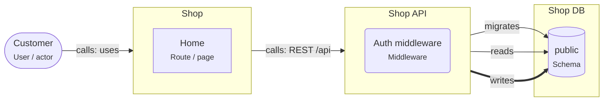

# Onboarding: Starter: React + Express + PostgreSQL

A React app calls one Node.js REST API, which owns one PostgreSQL schema. The smallest complete full-stack design.

This guide is written for the **intermediate** level. Open the project in ArchitectureGuide to see the diagram, follow the tour, and read every concept at your level.

## The big picture

## Tour of Starter: React + Express + PostgreSQL

1. **The browser part**: Customers use the Shop React app. It only renders screens and calls the API; it never holds database credentials.

   Look at: Customer, Shop.
2. **The API**: Shop API is the only way in. Its auth middleware checks the session cookie on every request.

   Look at: Shop API, Auth middleware.
3. **The data**: One schema, owned by the API: it reads, writes and migrates it. One owner per schema keeps changes safe.

   Look at: Shop DB, public.

## Patterns used

### Starter: React app, Node API, PostgreSQL

The smallest complete web application. A React app in the browser, one Node.js API, and one PostgreSQL database that only the API touches.

- Keep the API **stateless**: sessions live in a cookie plus a session table, not in
  process memory, so you can run two instances later.
- Configuration comes from environment variables (`DATABASE_URL`, `SESSION_SECRET`),
  never from the code (Twelve-Factor).
- Validate every request at the API boundary (zod), and share the request and response
  types with React through a small shared package.
- Migrations run in CI or at deploy time, before the new API version starts.

## Who owns which data

| Store | Owner (migrations) | Writers | Readers |
|---|---|---|---|
| schema.public | svc.shop-api | svc.shop-api | svc.shop-api |

## Rules of the road

- The Shop React app MUST NOT connect to PostgreSQL; it calls Shop API over HTTP.
- Only Shop API MAY write and migrate the "public" schema of Shop DB.
- Auth tokens MUST live in an HttpOnly cookie, not in localStorage.
- Only `svc.shop-api` MAY write `schema.public`. Only `svc.shop-api` MAY run migrations on it.

## Concepts used in this project

- **User / actor** (`gen.actor`): A person or role that uses the system (customer, admin, support agent).
- **Middleware** (`node.middleware`): Runs before or after handlers: auth, validation, rate limiting, error handling.
- **Node service** (`node.service`): A Node.js process that serves requests (Express, Fastify or NestJS).
- **Database** (`pg.database`): A PostgreSQL database.
- **Schema** (`pg.schema`): A namespace of tables.
- **React app** (`react.app`): A React single-page app built with Vite.
- **Route / page** (`react.route`): A page reachable by URL (React Router or TanStack Router route).
- **calls** (`calls`): Synchronous request/response.
- **migrates** (`migrates`): This element owns the DDL (migrations) of the schema.
- **reads** (`reads`): Reads data from a store.
- **writes** (`writes`): Writes data to a store.
