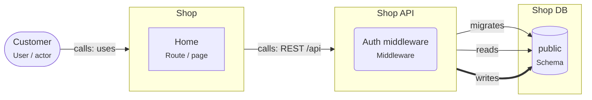

# Starter: React app, Node API, PostgreSQL

> The smallest complete web application. A React app in the browser, one Node.js API, and one PostgreSQL database that only the API touches.

## For beginners

Three parts, each with one job:

- **React app** (runs in the browser): shows screens and sends requests.
- **Node.js API** (runs on a server): checks who is calling, applies the business
  rules, and reads and writes data.
- **PostgreSQL** (the database): stores the data safely.

The browser never talks to the database. It sends `POST /api/orders` to the API; the
API checks the session, validates the input, writes rows in one transaction, and
answers with JSON.

One component owns the database schema: the API runs the migrations (the scripts that
create and change tables). Nobody else changes the tables.

## Going further

- Keep the API **stateless**: sessions live in a cookie plus a session table, not in
  process memory, so you can run two instances later.
- Configuration comes from environment variables (`DATABASE_URL`, `SESSION_SECRET`),
  never from the code (Twelve-Factor).
- Validate every request at the API boundary (zod), and share the request and response
  types with React through a small shared package.
- Migrations run in CI or at deploy time, before the new API version starts.

## In depth

This shape scales further than most teams expect: add modules inside the API, read
replicas, a job queue and a CDN before you add services. The decisions that are hard
to undo are the data model and the API contract, not the number of processes. Watch
for the API growing without internal boundaries; apply the layered or modular-monolith
templates inside it when it does.

## Common mistakes

- Putting the database URL in a `VITE_` variable: it ends up in the browser bundle.
- Checking permissions only by hiding buttons in React.
- Two apps running migrations on the same schema.

**An Express route with validation and a transaction (Prisma)**

```ts
const PlaceOrder = z.object({
  productId: z.string().uuid(),
  quantity: z.number().int().positive(),
});

app.post('/api/orders', requireUser, async (req, res) => {
  const input = PlaceOrder.parse(req.body);
  const order = await prisma.$transaction(async (tx) => {
    const created = await tx.order.create({ data: { customerId: req.user.id, ...input } });
    await tx.auditLog.create({ data: { action: 'order.placed', orderId: created.id } });
    return created;
  });
  res.status(201).json({ id: order.id });
});
```

## Template T1: Starter: React + Express + PostgreSQL

A React app calls one Node.js REST API, which owns one PostgreSQL schema. The smallest complete full-stack design.

**When to use**

- A new product or a prototype with one team.
- Learning how the three parts of a web application fit together.

**When not to use**

- Several teams need to deploy parts of the backend on their own.

**Trade-offs**

- Simple to build, run and debug: one deploy, one database.
- Everything grows in one codebase; keep modules inside the API clear as it grows.

## Invariants

- The Shop React app MUST NOT connect to PostgreSQL; it calls Shop API over HTTP.
- Only Shop API MAY write and migrate the "public" schema of Shop DB.
- Auth tokens MUST live in an HttpOnly cookie, not in localStorage.

## Folder layout

- `react.app`: `apps/web/**`
- `node.service`: `apps/api/**`
- `pg.schema`: `apps/api/prisma/**`

## Example (default settings: appName = Shop; apiName = Shop API; dbName = Shop DB)



## Walkthrough

1. **The browser part**: Customers use the Shop React app. It only renders screens and calls the API; it never holds database credentials.

   Look at: Customer, Shop.
2. **The API**: Shop API is the only way in. Its auth middleware checks the session cookie on every request.

   Look at: Shop API, Auth middleware.
3. **The data**: One schema, owned by the API: it reads, writes and migrates it. One owner per schema keeps changes safe.

   Look at: Shop DB, public.

## Sources

- [React — Quick Start](https://react.dev/learn)
- [Express — Routing](https://expressjs.com/en/guide/routing.html)
- [Prisma — Prisma Migrate](https://www.prisma.io/docs/orm/prisma-migrate)
- [The Twelve-Factor App](https://12factor.net/)
