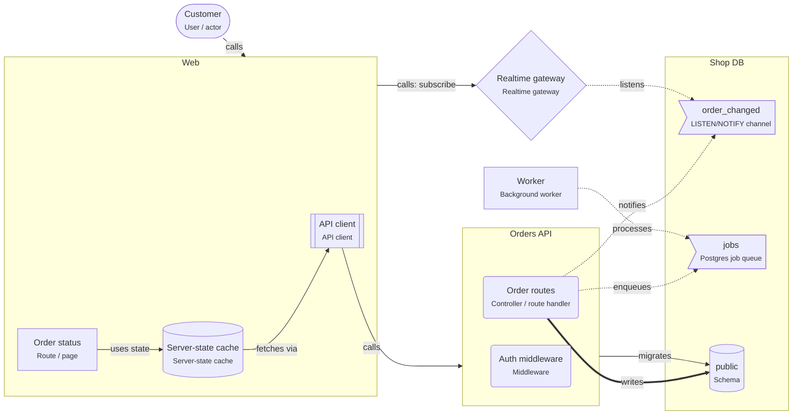

# Onboarding: Realtime updates

The browser keeps a WebSocket open to a realtime gateway. Services signal changes with PostgreSQL NOTIFY; the gateway pushes them to the clients. Durable work still goes through a job queue.

This guide is written for the **intermediate** level. Open the project in ArchitectureGuide to see the diagram, follow the tour, and read every concept at your level.

## The big picture

## Tour of Realtime updates

1. **Signal, then reload**: The order routes write the order and NOTIFY "order_changed" in the same transaction. The gateway listens and pushes the signal to the browser, which reloads the order through the API.

   Look at: Order routes, order_changed, Realtime gateway.
2. **Durable work**: NOTIFY is lost when nobody listens. Work that must happen (the receipt) goes through the job queue instead.

   Look at: jobs, Worker.

## Patterns used

### Realtime updates with LISTEN/NOTIFY

The browser keeps a WebSocket open to a realtime gateway; services signal changes with PostgreSQL NOTIFY, the gateway pushes them, and the browser reloads the data through the API.

- NOTIFY is delivered only after the transaction commits, and only to sessions that
  are listening right now. Messages are not stored.
- Keep payloads small (IDs). The limit is about 8000 bytes.
- The gateway needs one dedicated connection for LISTEN; transaction-mode poolers
  (PgBouncer) do not support LISTEN.
- Authenticate every socket connection and check that a user may join a room.
- In the browser, invalidate the server-state cache entry on a signal instead of
  patching data by hand.
- Work that must happen (sending a receipt) goes through a job queue, not NOTIFY.

## Who owns which data

| Store | Owner (migrations) | Writers | Readers |
|---|---|---|---|
| schema.public | svc.orders-api | svc.orders-api | – |

## Rules of the road

- NOTIFY messages MUST only signal that something changed; clients MUST reload the data through the API.
- Work that must not be lost MUST go through the job queue, not NOTIFY.
- The realtime gateway MUST authenticate every connection.
- Only `svc.orders-api` MAY write `schema.public`. Only `svc.orders-api` MAY run migrations on it.

## Concepts used in this project

- **User / actor** (`gen.actor`): A person or role that uses the system — customer, admin, support agent. Diagrams start with who uses the system and why.

  - Name actors by role, not by person ("Support agent", not "Anna").
  - Actors call **apps**, not databases. If an actor talks to an external tool (a payment
    page), draw that too.
  - Roles on actors map to roles in authorization (RBAC).
- **Middleware** (`node.middleware`): Code that runs before (or after) every handler of a route group — authentication, rate limiting, request logging, error handling.

  - **Auth middleware** answers "who is calling?": it reads the session cookie or the
    bearer token, verifies it, and attaches the user to the request.
  - **Authorization** ("may this user cancel _this_ order?") usually needs the data, so it
    belongs in the use case, not only in middleware.
  - Order matters: logging and request IDs first, then auth, then validation, then the
    handler, then the error handler last.
- **Controller / route handler** (`node.route-handler`): Code that receives an HTTP request, validates it, calls the business logic, and turns the result into an HTTP response. Thin by design.

  - Validate with a schema (zod, TypeBox, class-validator) and return 400 with details on
    failure (RNP-015 flags handlers without validation).
  - Map domain errors to HTTP: "out of stock" → 409, "not found" → 404.
  - One handler groups the endpoints of one resource (`/orders`, `/orders/:id`).
- **Node service** (`node.service`): A Node.js process that answers requests. It checks who is calling, validates input, applies business rules, and is the only part that talks to the database.

  - Inside a service you usually find **route handlers** (HTTP in and out), **use cases**
    (one business action each) and **repositories** (database access).
  - Configure it with environment variables; keep secrets out of the code.
  - Run several **instances** behind a load balancer for availability; each has its own
    database **connection pool**.
  - Return clear errors: 400 for bad input, 401/403 for auth, 404, 409 for conflicts.
- **Background worker** (`node.worker`): A Node process that runs jobs from a queue — emails, invoices, image resizing — outside the request, with retries when something fails.

  - Jobs must be **idempotent**: a job can run twice (a crash after the work, before the
    "done" mark). Sending an email twice is bad; check "already sent?" first.
  - Set **retries with backoff** and a **dead-letter** queue for jobs that keep failing.
  - `concurrency` controls how many jobs one worker runs at once; `instances` how many
    workers run.
  - Enqueue in the **same transaction** as the data (`inTransaction`), so an order never
    exists without its email job, and a rolled-back order never sends one.
- **Realtime gateway** (`node.ws-gateway`): Keeps open connections to browsers and pushes updates — "your order shipped", live stock — instead of making the browser ask again and again.

  - Authenticate the connection (cookie or token at connect time) and authorize each
    subscription ("may this user see order 42?").
  - With several gateway instances, a message must reach the instance that holds the
    user's connection: use a pub/sub channel (Postgres LISTEN/NOTIFY, Redis).
  - Push a small "something changed" message and let the client refetch, or push the data
    itself if it is small.
- **LISTEN/NOTIFY channel** (`pg.channel`): A Postgres message channel. Fast and simple for "something changed" signals, but not durable — listeners that are not connected miss messages.

  - Messages are delivered only to listeners connected **at that moment**; nothing is
    stored. Use a job queue for work that must happen.
  - NOTIFY inside a transaction is sent at commit; rolled-back transactions send nothing.
  - `LISTEN` needs a dedicated session connection; it does not work through a
    transaction-mode pooler.
- **Database** (`pg.database`): A PostgreSQL database — the place where data survives restarts. Only backend code connects to it; schemas inside it group tables by owner.

  - Use transactions for changes that belong together.
  - Run schema changes as **migrations** owned by one service.
  - Back up regularly and test restores.
  - One database can serve several services if each owns its own schema; or each service
    gets its own database (database per service).
- **Postgres job queue** (`pg.job-queue`): A durable job queue stored in Postgres tables (pg-boss, graphile-worker). Jobs can be added in the same transaction as your data, so neither is lost.

  - Workers take jobs with `SELECT … FOR UPDATE SKIP LOCKED`, so several workers never take
    the same job and never wait for each other.
  - Set retries, backoff, expiry and a dead-letter queue.
  - Jobs must be idempotent.
  - `inTransaction: true` on the `enqueues` relation documents the transactional enqueue.
- **Schema** (`pg.schema`): A namespace of tables inside a database. In this tool it is also the ownership boundary — one service owns a schema and runs its migrations.

  - **Migrations** are versioned scripts (Prisma Migrate, Drizzle Kit, node-pg-migrate) that
    create and change tables. Exactly one owner runs them.
  - Other services that need the data call the owner's API, or read a published view or
    replica.
  - Database roles per service (`GRANT USAGE ON SCHEMA orders TO orders_app`) enforce the
    boundary.
  - **Row Level Security** (`rls`) restricts rows per user or tenant inside the database.
- **API client** (`react.api-client`): The one place in the frontend that talks HTTP to the backend — base URL, auth, error handling, and request and response types.

  - Turn HTTP errors into typed errors (status, problem details), so the UI can show a good
    message and retry where it makes sense.
  - Send cookies (`credentials: 'include'`) or tokens in one place.
  - Generate the client from the API contract (OpenAPI, tRPC, GraphQL codegen), so types
    match the server.
  - The server-state cache, hooks and thunks use the client; components do not call it
    directly.
- **React app** (`react.app`): The part of the system that runs in the browser. It draws the screens and sends requests to the backend; it never holds secrets.

  - **Build:** Vite bundles the code into static files. Any static host (a CDN, or the
    Node service with the `serves` relation) can deliver them.
  - **Routing:** a router (React Router, TanStack Router) maps URLs to pages without a full
    page load.
  - **State:** server data in a server-state cache (TanStack Query), shared UI state in a
    small store, the rest in components.
  - **Config:** `import.meta.env.VITE_*` values are baked into the bundle at build time.
    They are public.
  - **Validation in the browser is for comfort only.** The API must validate everything
    again.
- **Route / page** (`react.route`): A screen reachable by URL. The router picks the page for the current address, so links, the back button and bookmarks work.

  - **Parameters:** `/orders/:id` gives the page the order ID; search parameters
    (`?page=2&sort=price`) keep list state in the URL, so it survives a reload.
  - **Lazy routes** load their code only when visited, which keeps the first download small.
  - **Protected routes** redirect to sign-in when there is no session. This is only a
    convenience: the API must still check every request.
  - Load data per route (a loader, or a query hook at the top of the page) and show
    loading and error states.
- **Server-state cache** (`react.server-state`): Data that belongs to the server (orders, users) needs caching and refetching; data that belongs to the UI (open dialogs, drafts) needs a simple store. Mixing them causes stale screens.

  - Each query has a **key** (`['orders', userId]`). Same key = same cached data, shared by
    every component that asks for it.
  - **staleTime** says how long cached data counts as fresh (TanStack Query's default is 0:
    refetch on mount, window focus and reconnect).
  - After a change (**mutation**), **invalidate** the affected keys so they refetch.
  - **Optimistic update:** change the cache immediately, roll back if the server says no.
    Good for toggles and likes, risky for payments.
  - Keep state as **local** as you can; lift it up only when two components need it.
  - Derived values (totals, filtered lists) are computed during render, not stored.
- **calls** (`calls`): A synchronous request and response — the caller waits for the answer. Set the protocol, auth, timeout and whether it is safe to retry.

  - Properties on the arrow document the decisions: `protocol` (http, graphql, trpc),
    `auth` (session cookie, bearer token, API key), `timeoutMs`, `idempotent`,
    `idempotencyKey`.
  - Every call needs a timeout.
  - Retry only idempotent calls, or send an idempotency key.
- **enqueues** (`enqueues`): Adds a job to a Postgres job queue. Set inTransaction when the job is added in the same transaction as the data.

  - `inTransaction: true` means the job is added in the same transaction as the business
    data — both commit or neither does.
  - Pass IDs, not whole objects; the worker loads fresh data.
- **fetches via** (`fetches-via`): React code loads data through the API client — a query, a thunk or an effect calls the backend.

  - Prefer fetching from a server-state cache (queries) over effects and thunks; it handles
    caching, retries and deduplication.
  - All calls go through the one API client, never `fetch` scattered in components.
- **listens** (`listens`): Runs LISTEN on a channel and receives its notifications while connected.

  - Needs a dedicated connection (not through a transaction-mode pooler).
  - After a reconnect, refetch state: messages sent while disconnected are gone.
- **migrates** (`migrates`): This element owns the schema's DDL — it runs the migrations that create and change tables. Exactly one owner per schema.

  - Run migrations in the deploy pipeline before the new code starts.
  - Make them backward compatible (expand and contract) so old and new code can run at the
    same time.
- **notifies** (`notifies`): Sends NOTIFY on a LISTEN/NOTIFY channel — a fast signal that is lost if nobody is listening.

  - Inside a transaction the signal is sent at commit.
  - Send IDs only; listeners load fresh data.
- **processes** (`processes`): A worker (or service) takes jobs from a Postgres job queue and runs them, with retries.

  - Set concurrency, retries and backoff; route failed jobs to a dead-letter queue.
  - Jobs must be idempotent: a crash after the work but before "done" runs them again.
- **uses state** (`uses-state`): React code reads or updates a client store or a server-state cache — a component reads the cart with a selector, a page reads orders from the query cache.

  - Read with selectors so only the parts you need trigger re-renders.
  - Changes go through actions (`dispatches` → action → `updates`), not direct writes.
- **writes** (`writes`): Code changes data in a store. Set via, the transaction settings, and concurrencyControl when several writers can change the same rows.

  - `concurrencyControl` documents how concurrent writers are kept apart: `none`,
    `optimistic-version`, `row-lock`, `advisory-lock`, `serializable-retry`.
  - `isolation` documents the transaction isolation level.
  - Writes that belong together go in one transaction.
