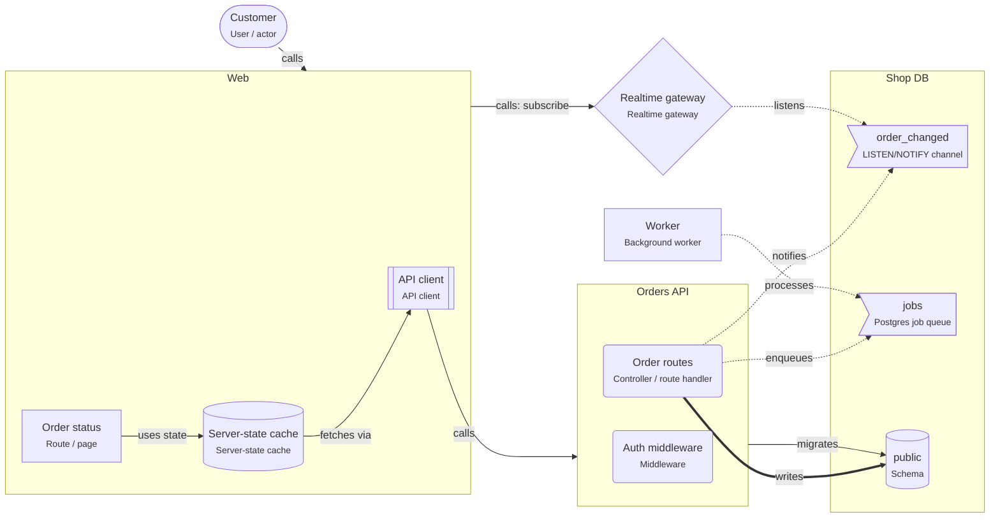

# Realtime updates with LISTEN/NOTIFY

> The browser keeps a WebSocket open to a realtime gateway; services signal changes with PostgreSQL NOTIFY, the gateway pushes them, and the browser reloads the data through the API.

## For beginners

Normally the browser asks the server for data. For live screens (order status, chat,
dashboards) the server should tell the browser when something changes. A **WebSocket**
keeps a connection open so the server can push.

With PostgreSQL you get the "something changed" signal for free: a service runs
`NOTIFY order_changed, '42'` in the transaction that changes order 42. A **realtime
gateway** runs `LISTEN order_changed` and pushes the signal to the browsers that watch
order 42. The browser then reloads the order through the normal API.

## Going further

- NOTIFY is delivered only after the transaction commits, and only to sessions that
  are listening right now. Messages are not stored.
- Keep payloads small (IDs). The limit is about 8000 bytes.
- The gateway needs one dedicated connection for LISTEN; transaction-mode poolers
  (PgBouncer) do not support LISTEN.
- Authenticate every socket connection and check that a user may join a room.
- In the browser, invalidate the server-state cache entry on a signal instead of
  patching data by hand.
- Work that must happen (sending a receipt) goes through a job queue, not NOTIFY.

## In depth

Scale the gateway horizontally with a shared adapter (the socket.io Postgres or Redis
adapter) so a signal reaches clients on every instance. Clients reconnect after
network drops and must refetch, because signals sent while they were away are gone.
At high message rates move to a dedicated pub/sub or a managed realtime service; keep
the "signal, then reload" contract so the client code does not change.

## Common mistakes

- Sending whole rows in NOTIFY.
- Using NOTIFY for work that must not be lost.
- A gateway that does not authenticate sockets.
- LISTEN through a transaction-pooling connection.

**Signal in the same transaction as the change**

```sql
BEGIN;
UPDATE orders SET status = 'paid' WHERE id = 42;
SELECT pg_notify('order_changed', '42');
COMMIT;
```

**Gateway: listen and push to the room of that order (socket.io)**

```ts
const client = await pool.connect();
await client.query('LISTEN order_changed');
client.on('notification', (msg) => {
  io.to(`order:${msg.payload}`).emit('order_changed', { id: msg.payload });
});
```

## Template T10: Realtime updates

The browser keeps a WebSocket open to a realtime gateway. Services signal changes with PostgreSQL NOTIFY; the gateway pushes them to the clients. Durable work still goes through a job queue.

**When to use**

- Screens must update without reloading: chat, live dashboards, order status, collaboration.

**When not to use**

- Updates every few minutes are fine: poll with the server-state cache.
- Many thousands of messages per second: use a dedicated pub/sub service.

**Trade-offs**

- Instant updates with no extra infrastructure beyond PostgreSQL.
- NOTIFY is fire-and-forget: clients that were offline must reload the state, not replay messages.

## Invariants

- NOTIFY messages MUST only signal that something changed; clients MUST reload the data through the API.
- Work that must not be lost MUST go through the job queue, not NOTIFY.
- The realtime gateway MUST authenticate every connection.

## Example (default settings: appName = Web)



## Walkthrough

1. **Signal, then reload**: The order routes write the order and NOTIFY "order_changed" in the same transaction. The gateway listens and pushes the signal to the browser, which reloads the order through the API.

   Look at: Order routes, order_changed, Realtime gateway.
2. **Durable work**: NOTIFY is lost when nobody listens. Work that must happen (the receipt) goes through the job queue instead.

   Look at: jobs, Worker.

## Sources

- [PostgreSQL docs — NOTIFY](https://www.postgresql.org/docs/current/sql-notify.html)
- [Socket.IO documentation](https://socket.io/docs/v4/)
- [TanStack Query — Query invalidation](https://tanstack.com/query/latest/docs/framework/react/guides/query-invalidation)
