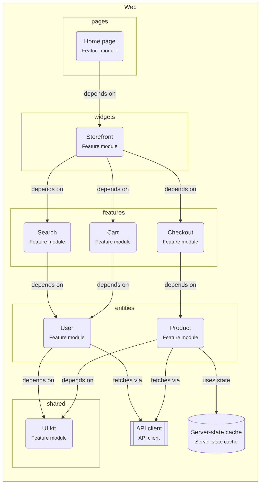

# Onboarding: Feature-Sliced React app

The React code is split into layers (pages, widgets, features, entities, shared) and slices. Code only imports from layers below it.

This guide is written for the **intermediate** level. Open the project in ArchitectureGuide to see the diagram, follow the tour, and read every concept at your level.

## The big picture

## Tour of Feature-Sliced React app

1. **Layers**: From top to bottom: pages, widgets, features, entities, shared. Code imports only downwards.

   Look at: pages, shared.
2. **Features stay apart**: Cart, Checkout, Search never import each other. A widget or a page composes them; what they share moves down to an entity.

   Look at: features.

## Patterns used

### Feature-Sliced Design

React code is split into layers (pages, widgets, features, entities, shared) and slices. Code imports only from layers below its own.

- Each slice (`features/cart`) exposes a public API through `index.ts`; other code
  imports only from it.
- Server data lives in a server-state cache (TanStack Query) via entity hooks such as
  `useProduct(id)`, not in a global store.
- Features talk to each other through the page that composes them (props, callbacks),
  or through shared state in an entity.
- Enforce the direction with ESLint (`eslint-plugin-boundaries` or Steiger, the FSD
  linter).

## Rules of the road

- Code MUST only import from layers below its own: pages → widgets → features → entities → shared.
- Features (Cart, Checkout, Search) MUST NOT import each other.

## Concepts used in this project

- **Layer** (`group.layer`): A horizontal layer such as presentation, application, domain or infrastructure.
- **API client** (`react.api-client`): The layer that talks to the backend: a fetch wrapper, axios, a generated OpenAPI client, or tRPC.
- **React app** (`react.app`): A React single-page app built with Vite.
- **Feature module** (`react.feature`): A folder that holds one feature: its components, hooks and state (for example `src/features/cart`).
- **Server-state cache** (`react.server-state`): Data that belongs to the server (orders, users) needs caching and refetching; data that belongs to the UI (open dialogs, drafts) needs a simple store. Mixing them causes stale screens.

  - Each query has a **key** (`['orders', userId]`). Same key = same cached data, shared by
    every component that asks for it.
  - **staleTime** says how long cached data counts as fresh (TanStack Query's default is 0:
    refetch on mount, window focus and reconnect).
  - After a change (**mutation**), **invalidate** the affected keys so they refetch.
  - **Optimistic update:** change the cache immediately, roll back if the server says no.
    Good for toggles and likes, risky for payments.
  - Keep state as **local** as you can; lift it up only when two components need it.
  - Derived values (totals, filtered lists) are computed during render, not stored.
- **depends on** (`depends-on`): Compile-time import of another module or package.
- **fetches via** (`fetches-via`): Loads data through the API client.
- **uses state** (`uses-state`): Reads or updates a client store or a server-state cache.
