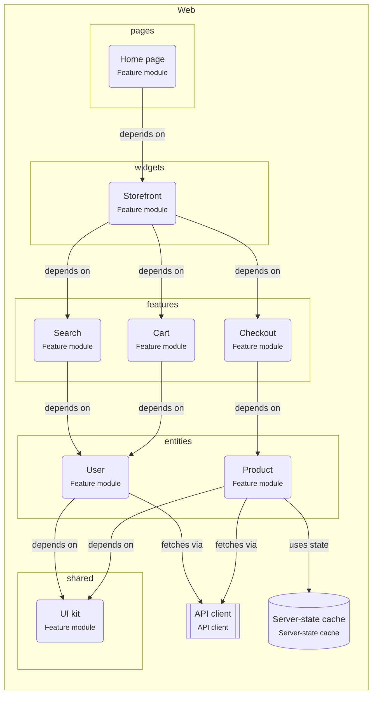

# Onboarding: Feature-Sliced React app

The React code is split into layers (pages, widgets, features, entities, shared) and slices. Code only imports from layers below it.

This guide is written for the **intermediate** level. Open the project in ArchitectureGuide to see the diagram, follow the tour, and read every concept at your level.

## The big picture

## Tour of Feature-Sliced React app

1. **Layers**: From top to bottom: pages, widgets, features, entities, shared. Code imports only downwards.

   Look at: pages, shared.
2. **Features stay apart**: Cart, Checkout, Search never import each other. A widget or a page composes them; what they share moves down to an entity.

   Look at: features.

## Patterns used

### Feature-Sliced Design

React code is split into layers (pages, widgets, features, entities, shared) and slices. Code imports only from layers below its own.

- Each slice (`features/cart`) exposes a public API through `index.ts`; other code
  imports only from it.
- Server data lives in a server-state cache (TanStack Query) via entity hooks such as
  `useProduct(id)`, not in a global store.
- Features talk to each other through the page that composes them (props, callbacks),
  or through shared state in an entity.
- Enforce the direction with ESLint (`eslint-plugin-boundaries` or Steiger, the FSD
  linter).

## Rules of the road

- Code MUST only import from layers below its own: pages → widgets → features → entities → shared.
- Features (Cart, Checkout, Search) MUST NOT import each other.

## Concepts used in this project

- **Layer** (`group.layer`): A horizontal band of a design — presentation, application, domain, infrastructure. Each layer may only depend on the layers below it.

  - Draw a layer group and put shapes inside; arrows connect the shapes, not the group.
  - In a hexagonal design the domain is in the middle and infrastructure depends on it
    (dependency inversion).
- **API client** (`react.api-client`): The one place in the frontend that talks HTTP to the backend — base URL, auth, error handling, and request and response types.

  - Turn HTTP errors into typed errors (status, problem details), so the UI can show a good
    message and retry where it makes sense.
  - Send cookies (`credentials: 'include'`) or tokens in one place.
  - Generate the client from the API contract (OpenAPI, tRPC, GraphQL codegen), so types
    match the server.
  - The server-state cache, hooks and thunks use the client; components do not call it
    directly.
- **React app** (`react.app`): The part of the system that runs in the browser. It draws the screens and sends requests to the backend; it never holds secrets.

  - **Build:** Vite bundles the code into static files. Any static host (a CDN, or the
    Node service with the `serves` relation) can deliver them.
  - **Routing:** a router (React Router, TanStack Router) maps URLs to pages without a full
    page load.
  - **State:** server data in a server-state cache (TanStack Query), shared UI state in a
    small store, the rest in components.
  - **Config:** `import.meta.env.VITE_*` values are baked into the bundle at build time.
    They are public.
  - **Validation in the browser is for comfort only.** The API must validate everything
    again.
- **Feature module** (`react.feature`): A folder that holds everything for one feature — components, hooks, state and API calls — with a small public entry point.

  - **Public API:** export only what pages need (`CartButton`, `useCart`); keep the rest
    private. A lint rule can block deep imports like `features/cart/internal/x`.
  - **Features do not import each other.** If two features need the same thing, move it
    down to a shared layer (an "entity" in Feature-Sliced Design) or let the page connect
    them through props.
  - Pages (routes) compose features.
- **Server-state cache** (`react.server-state`): Data that belongs to the server (orders, users) needs caching and refetching; data that belongs to the UI (open dialogs, drafts) needs a simple store. Mixing them causes stale screens.

  - Each query has a **key** (`['orders', userId]`). Same key = same cached data, shared by
    every component that asks for it.
  - **staleTime** says how long cached data counts as fresh (TanStack Query's default is 0:
    refetch on mount, window focus and reconnect).
  - After a change (**mutation**), **invalidate** the affected keys so they refetch.
  - **Optimistic update:** change the cache immediately, roll back if the server says no.
    Good for toggles and likes, risky for payments.
  - Keep state as **local** as you can; lift it up only when two components need it.
  - Derived values (totals, filtered lists) are computed during render, not stored.
- **depends on** (`depends-on`): A compile-time import — one module uses another's code. The direction of these arrows is the architecture.

  - Arrows should point toward stable things: features → shared, handlers → use cases →
    domain.
  - Browser code must not depend on server code (this tool refuses it); share types through
    a contract package.
  - Cycles (A → B → A) mean the boundary is wrong.
- **fetches via** (`fetches-via`): React code loads data through the API client — a query, a thunk or an effect calls the backend.

  - Prefer fetching from a server-state cache (queries) over effects and thunks; it handles
    caching, retries and deduplication.
  - All calls go through the one API client, never `fetch` scattered in components.
- **uses state** (`uses-state`): React code reads or updates a client store or a server-state cache — a component reads the cart with a selector, a page reads orders from the query cache.

  - Read with selectors so only the parts you need trigger re-renders.
  - Changes go through actions (`dispatches` → action → `updates`), not direct writes.
