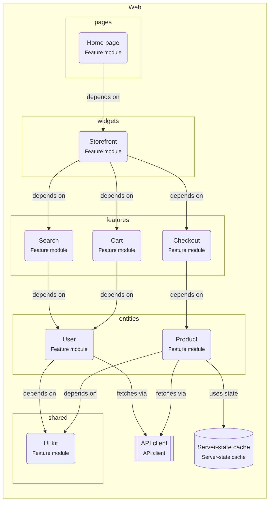

# Feature-Sliced Design

> React code is split into layers (pages, widgets, features, entities, shared) and slices. Code imports only from layers below its own.

## For beginners

Big React apps get messy when any file can import any other. Feature-Sliced Design
gives every piece of code a place, in layers from top to bottom:

- **pages**: whole screens, composed of the layers below.
- **widgets**: big blocks used on pages (header, sidebar).
- **features**: things the user does (add to cart, search).
- **entities**: business things (user, product) and how to show them.
- **shared**: UI kit, API client, helpers.

The one rule: **import only from layers below you**. A feature may use entities and
shared code, never a page or another feature.

## Going further

- Each slice (`features/cart`) exposes a public API through `index.ts`; other code
  imports only from it.
- Server data lives in a server-state cache (TanStack Query) via entity hooks such as
  `useProduct(id)`, not in a global store.
- Features talk to each other through the page that composes them (props, callbacks),
  or through shared state in an entity.
- Enforce the direction with ESLint (`eslint-plugin-boundaries` or Steiger, the FSD
  linter).

## In depth

FSD makes deletion cheap: removing a feature folder should only break the pages that
use it. The cost is classification debates (feature or entity?); settle them with
examples in the team docs. Cross-imports between entities are sometimes unavoidable;
FSD allows them only through an explicit `@x` public API, which keeps them visible.
For small apps, a plain `pages / components / api` split is enough.

## Common mistakes

- `features/cart` importing from `features/checkout`.
- A huge `shared` folder that holds business logic.
- Deep imports into a slice's internals instead of its `index.ts`.

**A page composes features; features use entities**

```tsx
// pages/checkout/ui/CheckoutPage.tsx
import { CartSummary } from '@/features/cart';
import { PaymentForm } from '@/features/checkout';

export function CheckoutPage() {
  return (
    <>
      <CartSummary />
      <PaymentForm />
    </>
  );
}

// features/cart/ui/CartSummary.tsx
import { ProductPrice, useProduct } from '@/entities/product'; // lower layer: allowed
```

## Template T11: Feature-Sliced React app

The React code is split into layers (pages, widgets, features, entities, shared) and slices. Code only imports from layers below it.

**When to use**

- A React app that several people work on and that keeps growing.

**When not to use**

- A small app with a handful of screens.

**Trade-offs**

- Clear places for code, and features that can be removed without breaking others.
- Takes discipline to decide what is a feature and what is an entity.

## Invariants

- Code MUST only import from layers below its own: pages → widgets → features → entities → shared.
- Features (Cart, Checkout, Search) MUST NOT import each other.

## Folder layout

- `react.feature`: `src/**`

## Example (default settings: appName = Web; features = Cart, Checkout, Search)



## Walkthrough

1. **Layers**: From top to bottom: pages, widgets, features, entities, shared. Code imports only downwards.

   Look at: pages, shared.
2. **Features stay apart**: Cart, Checkout, Search never import each other. A widget or a page composes them; what they share moves down to an entity.

   Look at: features.

## Sources

- [Feature-Sliced Design — Overview](https://feature-sliced.design/docs/get-started/overview)
- [Feature-Sliced Design — Layers](https://feature-sliced.design/docs/reference/layers)
- [TanStack Query — Overview](https://tanstack.com/query/latest/docs/framework/react/overview)
