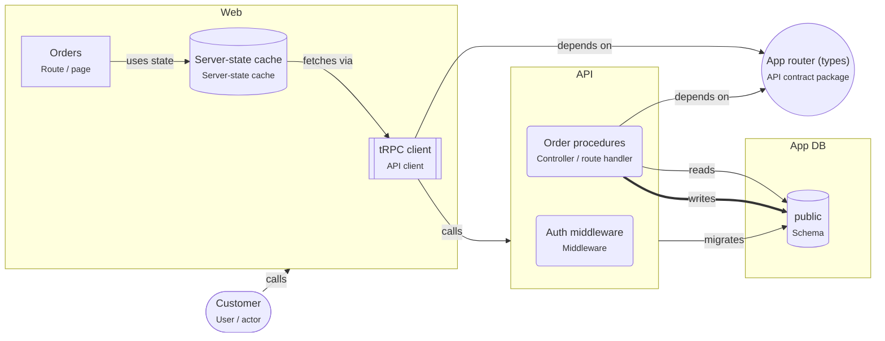

# Type-safe monorepo

> The React app and the Node API live in one repository and share one API contract (tRPC router types or an OpenAPI document with zod schemas), so a breaking change fails the build.

## For beginners

When the React app and the API are written by the same team in TypeScript, they can
share one definition of the API: the **contract**. The server implements it; the
client is typed from it. If someone renames a field on the server, the app does not
compile until it is fixed — the mistake never reaches users.

Two common styles:

- **tRPC:** the client imports the router's _types_ and calls procedures like functions.
- **OpenAPI:** the contract is an OpenAPI document (often generated from zod schemas),
  and a typed client is generated from it.

## Going further

- Put the contract in its own package (`packages/contract`) with only zod schemas and
  types — no server code, no database client.
- Validate every request on the server with the same schemas.
- The app calls the API only through the typed client; no hand-written `fetch` calls.
- Drizzle gives typed queries and migrations (drizzle-kit) on the server side.
- Build and type-check the workspace in CI, so a contract change is checked against
  every consumer.

## In depth

Shared types couple deploys: an app built against the new contract may talk to an old
API. Deploy API first with additive changes, or version the contract. For public or
third-party clients prefer OpenAPI with explicit versioning over tRPC. Keep the
contract small and stable; internal server types do not belong in it.

## Common mistakes

- Importing server modules into the app "just for a type".
- Validating on the client but not on the server.
- Hand-written fetch calls next to the typed client.

**A shared schema, used by the server and typed on the client (tRPC)**

```ts
// packages/contract/src/order.ts
export const CreateOrder = z.object({
  productId: z.string().uuid(),
  quantity: z.number().int().min(1),
});

// apps/api/src/router.ts
export const appRouter = router({
  createOrder: protectedProcedure
    .input(CreateOrder)
    .mutation(({ input, ctx }) => createOrder(ctx, input)),
});
export type AppRouter = typeof appRouter;

// apps/web/src/api.ts
export const api = createTRPCReact<AppRouter>();
```

## Template T12: Type-safe monorepo

One repository: the React app and the Node service share an API contract (tRPC router types or an OpenAPI document with zod schemas), so a breaking API change fails the build. Drizzle maps the tables.

**When to use**

- One team owns the web app and its API, in TypeScript end to end.

**When not to use**

- Public APIs used by clients you do not control: version an OpenAPI contract instead of sharing code.

**Trade-offs**

- API changes are checked by the compiler on both sides.
- The app and the API are coupled: they must be deployed together or kept compatible.

## Invariants

- The app MUST call the API only through the generated or typed API client.
- Request and response shapes MUST be defined once, in packages/contract, and validated on the server.
- Browser code MUST NOT import server code; it MAY import the contract package.

## Folder layout

- `react.app`: `apps/web/**`
- `node.service`: `apps/api/**`
- `node.contract`: `packages/contract/**`

## Example (default settings: api = trpc)



## Walkthrough

1. **One contract**: The contract defines every request and response once. The server implements it; the client is typed from it, so a breaking change fails the build.

   Look at: App router (types), tRPC client, Order procedures.

## Sources

- [tRPC documentation](https://trpc.io/docs)
- [OpenAPI Specification](https://spec.openapis.org/oas/latest.html)
- [Zod documentation](https://zod.dev/)
- [Drizzle ORM documentation](https://orm.drizzle.team/docs/overview)
