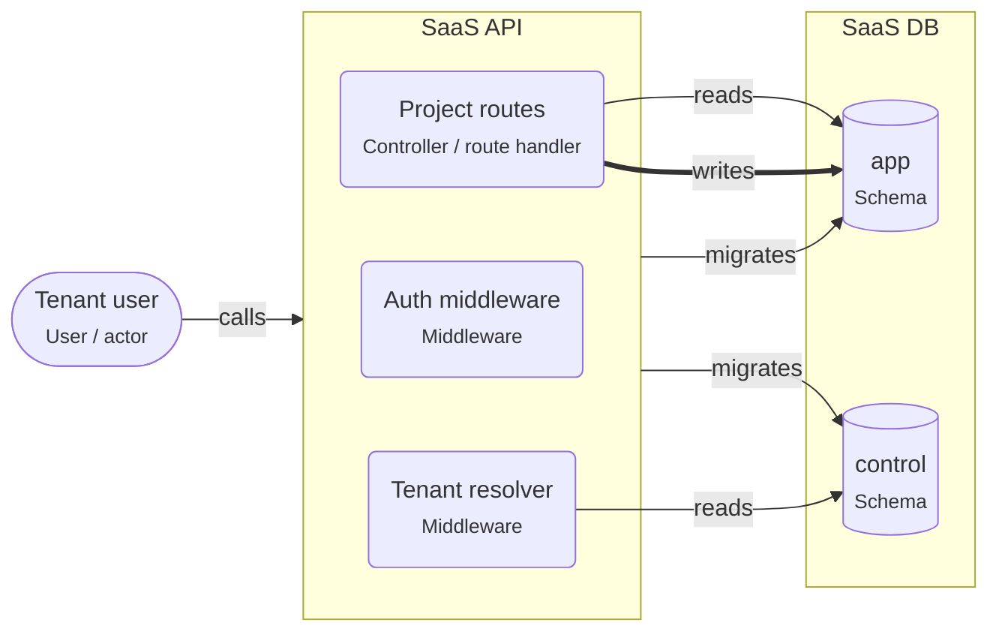

# Onboarding: Multi-tenant SaaS

Many customers (tenants) share one deployment. Each request is tied to a tenant, and PostgreSQL keeps tenants apart: with row-level security on shared tables, or with one schema per tenant.

This guide is written for the **intermediate** level. Open the project in ArchitectureGuide to see the diagram, follow the tour, and read every concept at your level.

## The big picture

## Tour of Multi-tenant SaaS

1. **Which tenant?**: The tenant resolver finds the tenant of the session and sets app.tenant_id for the transaction.

   Look at: Tenant resolver.
2. **The database keeps tenants apart**: Every table in "app" has a tenant_id column and a row-level security policy, so a forgotten WHERE clause cannot leak data.

   Look at: app.

## Patterns used

### Multi-tenant SaaS on PostgreSQL

Many customer organizations share one deployment; each request is tied to a tenant, and PostgreSQL keeps tenants apart with row-level security or one schema per tenant.

- Set the tenant per transaction: `SET LOCAL app.tenant_id = '…'` (rls) or
  `SET LOCAL search_path = tenant_acme` (schema per tenant). With a connection pool,
  never set it per session.
- The application's database role must not own the tables and must not have
  `BYPASSRLS`, or the policies do not apply.
- Index `tenant_id` first in composite indexes.
- Background jobs carry the tenant ID in their payload and set it before touching data.
- Keep shared data (plans, tenants, users) in a separate control schema.

## Who owns which data

| Store | Owner (migrations) | Writers | Readers |
|---|---|---|---|
| schema.app | svc.saas-api | svc.saas-api | svc.saas-api |
| schema.control | svc.saas-api | – | svc.saas-api |

## Rules of the road

- Every request MUST be tied to exactly one tenant before it touches data.
- Tenant data MUST be isolated by the database (row-level security or one schema per tenant), not only by WHERE clauses in code.
- Background jobs MUST carry the tenant ID and set it before they touch data.
- Only `svc.saas-api` MAY write `schema.app`. Only `svc.saas-api` MAY run migrations on it.

## Concepts used in this project

- **User / actor** (`gen.actor`): A person or role that uses the system — customer, admin, support agent. Diagrams start with who uses the system and why.

  - Name actors by role, not by person ("Support agent", not "Anna").
  - Actors call **apps**, not databases. If an actor talks to an external tool (a payment
    page), draw that too.
  - Roles on actors map to roles in authorization (RBAC).
- **Middleware** (`node.middleware`): Code that runs before (or after) every handler of a route group — authentication, rate limiting, request logging, error handling.

  - **Auth middleware** answers "who is calling?": it reads the session cookie or the
    bearer token, verifies it, and attaches the user to the request.
  - **Authorization** ("may this user cancel _this_ order?") usually needs the data, so it
    belongs in the use case, not only in middleware.
  - Order matters: logging and request IDs first, then auth, then validation, then the
    handler, then the error handler last.
- **Controller / route handler** (`node.route-handler`): Code that receives an HTTP request, validates it, calls the business logic, and turns the result into an HTTP response. Thin by design.

  - Validate with a schema (zod, TypeBox, class-validator) and return 400 with details on
    failure (RNP-015 flags handlers without validation).
  - Map domain errors to HTTP: "out of stock" → 409, "not found" → 404.
  - One handler groups the endpoints of one resource (`/orders`, `/orders/:id`).
- **Node service** (`node.service`): A Node.js process that answers requests. It checks who is calling, validates input, applies business rules, and is the only part that talks to the database.

  - Inside a service you usually find **route handlers** (HTTP in and out), **use cases**
    (one business action each) and **repositories** (database access).
  - Configure it with environment variables; keep secrets out of the code.
  - Run several **instances** behind a load balancer for availability; each has its own
    database **connection pool**.
  - Return clear errors: 400 for bad input, 401/403 for auth, 404, 409 for conflicts.
- **Database** (`pg.database`): A PostgreSQL database — the place where data survives restarts. Only backend code connects to it; schemas inside it group tables by owner.

  - Use transactions for changes that belong together.
  - Run schema changes as **migrations** owned by one service.
  - Back up regularly and test restores.
  - One database can serve several services if each owns its own schema; or each service
    gets its own database (database per service).
- **Schema** (`pg.schema`): A namespace of tables inside a database. In this tool it is also the ownership boundary — one service owns a schema and runs its migrations.

  - **Migrations** are versioned scripts (Prisma Migrate, Drizzle Kit, node-pg-migrate) that
    create and change tables. Exactly one owner runs them.
  - Other services that need the data call the owner's API, or read a published view or
    replica.
  - Database roles per service (`GRANT USAGE ON SCHEMA orders TO orders_app`) enforce the
    boundary.
  - **Row Level Security** (`rls`) restricts rows per user or tenant inside the database.
- **calls** (`calls`): A synchronous request and response — the caller waits for the answer. Set the protocol, auth, timeout and whether it is safe to retry.

  - Properties on the arrow document the decisions: `protocol` (http, graphql, trpc),
    `auth` (session cookie, bearer token, API key), `timeoutMs`, `idempotent`,
    `idempotencyKey`.
  - Every call needs a timeout.
  - Retry only idempotent calls, or send an idempotency key.
- **migrates** (`migrates`): This element owns the schema's DDL — it runs the migrations that create and change tables. Exactly one owner per schema.

  - Run migrations in the deploy pipeline before the new code starts.
  - Make them backward compatible (expand and contract) so old and new code can run at the
    same time.
- **reads** (`reads`): Code reads data from a store. Set via (the data-access library) and, where it matters, the isolation level.

  - `via` names the library (prisma, drizzle, kysely, pg).
  - Reading another service's tables couples you to its schema; prefer its API or a
    published view.
  - Reads can go to a replica when slightly old data is fine.
- **writes** (`writes`): Code changes data in a store. Set via, the transaction settings, and concurrencyControl when several writers can change the same rows.

  - `concurrencyControl` documents how concurrent writers are kept apart: `none`,
    `optimistic-version`, `row-lock`, `advisory-lock`, `serializable-retry`.
  - `isolation` documents the transaction isolation level.
  - Writes that belong together go in one transaction.
