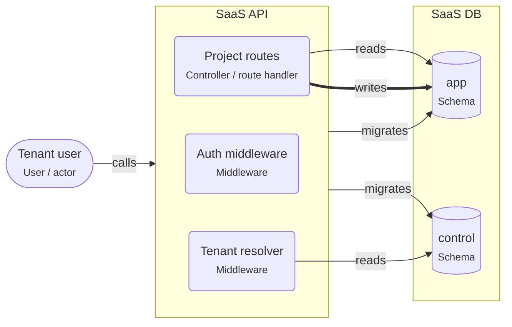

# Multi-tenant SaaS on PostgreSQL

> Many customer organizations share one deployment; each request is tied to a tenant, and PostgreSQL keeps tenants apart with row-level security or one schema per tenant.

## For beginners

A SaaS product serves many customer organizations — **tenants** — from one
deployment. The most important rule: a tenant must never see another tenant's data.

Every request is first tied to a tenant (from the logged-in user). Then the database
keeps tenants apart, in one of two ways:

- **Row-level security (rls):** all tenants share the tables; every row has a
  `tenant_id`, and a policy lets each transaction see only its tenant's rows.
- **Schema per tenant:** each tenant gets its own copy of the schema; the request
  switches to it.

## Going further

- Set the tenant per transaction: `SET LOCAL app.tenant_id = '…'` (rls) or
  `SET LOCAL search_path = tenant_acme` (schema per tenant). With a connection pool,
  never set it per session.
- The application's database role must not own the tables and must not have
  `BYPASSRLS`, or the policies do not apply.
- Index `tenant_id` first in composite indexes.
- Background jobs carry the tenant ID in their payload and set it before touching data.
- Keep shared data (plans, tenants, users) in a separate control schema.

## In depth

rls scales to many small tenants with simple migrations; schema-per-tenant gives
stronger separation, per-tenant restore and per-tenant customization, but migrations
run N times and the catalog grows with tenants (thousands of schemas strain tools).
Large or regulated tenants may need their own database — a hybrid is common. Test
isolation explicitly: a test that runs as tenant A must never read tenant B's rows.

## Common mistakes

- Relying only on WHERE clauses in application code.
- Setting the tenant on a pooled connection for the session instead of the transaction.
- Running the app as the table owner (policies are skipped).
- Jobs without a tenant ID.

**A row-level security policy for one table**

```sql
ALTER TABLE projects ENABLE ROW LEVEL SECURITY;
CREATE POLICY tenant_isolation ON projects
  USING (tenant_id = current_setting('app.tenant_id')::uuid)
  WITH CHECK (tenant_id = current_setting('app.tenant_id')::uuid);
```

**Set the tenant for one transaction**

```ts
await prisma.$transaction(async (tx) => {
  await tx.$executeRaw`SELECT set_config('app.tenant_id', ${tenantId}, true)`;
  return tx.project.findMany();
});
```

## Template T13: Multi-tenant SaaS

Many customers (tenants) share one deployment. Each request is tied to a tenant, and PostgreSQL keeps tenants apart: with row-level security on shared tables, or with one schema per tenant.

**When to use**

- A SaaS product where each customer organization must only ever see its own data.

**When not to use**

- Customers that need their own database for compliance or very different load: give them separate databases.

**Trade-offs**

- rls: one schema and simple migrations; every query is filtered by the database.
- schema-per-tenant: strong separation and per-tenant backups; migrations run once per tenant.

## Invariants

- Every request MUST be tied to exactly one tenant before it touches data.
- Tenant data MUST be isolated by the database (row-level security or one schema per tenant), not only by WHERE clauses in code.
- Background jobs MUST carry the tenant ID and set it before they touch data.

## Example (default settings: strategy = rls)



## Walkthrough

1. **Which tenant?**: The tenant resolver finds the tenant of the session and sets app.tenant_id for the transaction.

   Look at: Tenant resolver.
2. **The database keeps tenants apart**: Every table in "app" has a tenant_id column and a row-level security policy, so a forgotten WHERE clause cannot leak data.

   Look at: app.

## Sources

- [PostgreSQL docs — Row security policies](https://www.postgresql.org/docs/current/ddl-rowsecurity.html)
- [AWS — Multi-tenant data isolation with PostgreSQL row level security](https://aws.amazon.com/blogs/database/multi-tenant-data-isolation-with-postgresql-row-level-security/)
- [PostgreSQL docs — Schemas and the search path](https://www.postgresql.org/docs/current/ddl-schemas.html)
