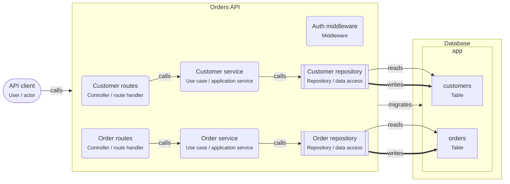

# Layered architecture

> Code is split into presentation, application and data-access layers. Each layer calls only the layer below it.

## For beginners

Every request goes **down** through three layers:

1. **Route handler** (presentation): reads the HTTP request, validates it, calls a
   use case, turns the result into a response.
2. **Use case / service** (application): the business rules. "Place order", "Cancel
   order".
3. **Repository** (data access): runs the queries. Only this layer knows SQL or the ORM.

A layer never skips the one below it, and never calls the one above it. When something
breaks, you know where to look.

## Going further

- Handlers stay thin: no queries, no rules. If a handler is longer than the use case it
  calls, rules are leaking upwards.
- One repository per entity (or per aggregate). Use cases can call several
  repositories inside one transaction; pass the transaction down.
- Errors travel up as typed results or domain errors (`OrderNotFound`), and only the
  handler maps them to HTTP status codes.
- Test use cases with fake repositories; test repositories against a real PostgreSQL
  (Testcontainers or a test database).

## In depth

Plain layering lets the application layer depend on data-access types, for example
Prisma models returned from repositories. That couples rules to the schema. Map rows to
your own types at the repository boundary, or move to ports and adapters
(hexagonal) when the domain is complex. Organize folders by feature first and by layer
second (`orders/http`, `orders/application`, `orders/db`) so a feature's code stays
together as the service grows.

## Common mistakes

- Calling the ORM from route handlers "just this once".
- Use cases that receive `req` and `res`: they then only work over HTTP.
- Repositories with business rules (`if (order.status === 'shipped') ...`).

**Handler → use case → repository**

```ts
// http/orders.routes.ts
router.post('/orders/:id/cancel', async (req, res) => {
  const result = await cancelOrder(req.params.id, req.user.id);
  if (result === 'not-found') return res.status(404).end();
  if (result === 'already-shipped') return res.status(409).json({ error: 'Already shipped' });
  res.status(204).end();
});

// application/cancel-order.ts
export async function cancelOrder(orderId: string, userId: string) {
  const order = await orders.findById(orderId);
  if (!order || order.customerId !== userId) return 'not-found';
  if (order.status === 'shipped') return 'already-shipped';
  await orders.updateStatus(orderId, 'cancelled');
  return 'ok';
}
```

## Template T2: Layered Node API

Each entity gets a route handler, a use case and a repository. Requests go down the layers, never around them.

**When to use**

- CRUD-heavy APIs with some business rules.
- Teams that want one obvious place for each kind of code.

**When not to use**

- The business rules are complex and change often (use the hexagonal template).
- A thin proxy with no rules of its own.

**Trade-offs**

- Easy to learn and to navigate.
- Use cases can depend on the ORM types, so the database leaks upwards unless you are strict.

## Invariants

- A node.route-handler in Orders API MUST call a node.use-case, never a repository or the database.
- Only node.repository code MAY import the database client.
- Each of Order, Customer has exactly one repository.

## Folder layout

- `node.route-handler`: `src/http/**`
- `node.use-case`: `src/application/**`
- `node.repository`: `src/repositories/**`

## Example (default settings: serviceName = Orders API; entities = Order, Customer)



## Walkthrough

1. **Three layers**: Route handlers turn HTTP into calls, use cases hold the rules, repositories talk to the database.

   Look at: Order routes, Order service, Order repository.
2. **One way down**: A request goes handler → use case → repository → table. A handler that queries the database itself skips the rules (RNP-005).
3. **Tables per entity**: Each of Order, Customer has its own table and its own repository, so database code for one entity lives in one place.

   Look at: app.

## Sources

- [Martin Fowler — Presentation Domain Data Layering](https://martinfowler.com/bliki/PresentationDomainDataLayering.html)
- [Martin Fowler — Service Layer (P of EAA)](https://martinfowler.com/eaaCatalog/serviceLayer.html)
- [Martin Fowler — Repository (P of EAA)](https://martinfowler.com/eaaCatalog/repository.html)
