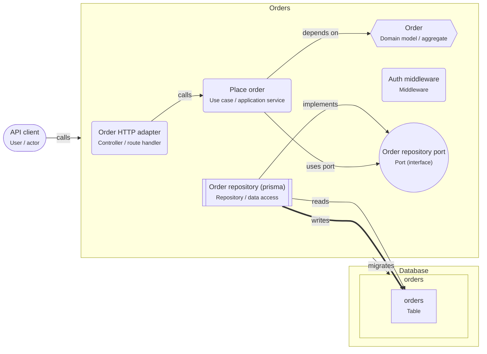

# Hexagonal architecture (ports and adapters)

> The domain sits in the middle and depends on nothing. It talks to the outside through ports (interfaces) that adapters implement.

## For beginners

Picture the business rules as the center of the application. Everything technical
(HTTP, the database, e-mail) is outside. The center does not know about the outside:

- A **port** is an interface the center needs, such as `OrderRepository` with
  `findById` and `save`.
- An **adapter** implements the port with real technology, such as a Prisma
  repository. Another adapter can implement the same port in memory for tests.
- An **HTTP adapter** (route handler) calls a use case; so could a CLI or a queue
  consumer.

The center can be tested in milliseconds, without a database.

## Going further

- Dependencies point inwards: adapters → application → domain. The domain imports no
  framework or ORM. Check it automatically (dependency-cruiser rule on
  `src/domain/**`).
- Use cases orchestrate: load through a port, call domain methods, save through a port,
  publish events.
- Map at the edges: request DTO → command, entity → row, entity → response. The
  mapping code is the price of independence.
- Transactions: a "unit of work" port, or a repository method that saves an aggregate
  atomically.

## In depth

Hexagonal pays off when the domain is rich: pricing, scheduling, workflows with
invariants. For CRUD it adds interfaces with one implementation and mapping layers that
only copy fields. Keep ports few and shaped by the domain's needs (`OrdersAwaitingPayment`),
not as generic `Repository<T>` wrappers around the ORM. Infrastructure concerns
(retries, idempotency keys, outbox) live in adapters and the application layer, not in
the domain model.

## Common mistakes

- Domain classes decorated with ORM annotations, or importing Prisma types.
- Ports that mirror the ORM one-to-one (`findMany(where: any)`).
- Use cases that call adapters directly instead of ports.

**Port, adapter and use case**

```ts
// domain/ports/order-repository.ts
export interface OrderRepository {
  findById(id: OrderId): Promise<Order | undefined>;
  save(order: Order): Promise<void>;
}

// adapters/db/prisma-order-repository.ts
export class PrismaOrderRepository implements OrderRepository {
  constructor(private readonly db: PrismaClient) {}
  async findById(id: OrderId) {
    const row = await this.db.order.findUnique({ where: { id }, include: { lines: true } });
    return row ? Order.fromSnapshot(toSnapshot(row)) : undefined;
  }
  async save(order: Order) {
    await this.db.order.upsert(toUpsert(order.snapshot()));
  }
}

// application/place-order.ts
export const placeOrder = (orders: OrderRepository) => async (cmd: PlaceOrderCommand) => {
  const order = Order.place(cmd.customerId, cmd.lines); // rules live in the domain
  await orders.save(order);
  return order.id;
};
```

## Template T3: Hexagonal Node service

The domain is in the middle and depends on nothing. Use cases call ports (interfaces); adapters implement them for HTTP and the database.

**When to use**

- Business rules that are complex, important, and need fast tests.
- You expect to replace the database library or add other entry points (queues, CLI).

**When not to use**

- Simple CRUD: the extra interfaces cost more than they give.

**Trade-offs**

- The domain is tested without a database or HTTP.
- More files and indirection; new developers need the map.

## Invariants

- `services/orders/src/domain` MUST NOT import @prisma/client, drizzle-orm, kysely, express or any adapter.
- Persistence MUST go through a node.port; node.repository implements it.
- node.route-handler MUST call a node.use-case, never a node.repository.

## Folder layout

- `node.domain`: `services/{serviceName:slug}/src/domain/**`
- `node.use-case`: `services/{serviceName:slug}/src/application/**`
- `node.port`: `services/{serviceName:slug}/src/domain/ports/**`
- `node.repository`: `services/{serviceName:slug}/src/adapters/db/**`
- `node.route-handler`: `services/{serviceName:slug}/src/adapters/http/**`

## Example (default settings: serviceName = Orders; aggregate = Order; orm = prisma)



## Walkthrough

1. **The domain in the middle**: The Order domain model holds the rules and imports nothing: no ORM, no HTTP.

   Look at: Order.
2. **Ports and adapters**: The use case asks for a port (an interface). The repository adapter implements it with prisma. Tests use an in-memory adapter instead.

   Look at: Order repository port, Order repository (prisma).
3. **Entry point**: The HTTP adapter validates input and calls the use case. Other entry points (a queue, a CLI) would call the same use case.

   Look at: Order HTTP adapter, Place order.

## Sources

- [Alistair Cockburn — Hexagonal Architecture](https://alistair.cockburn.us/hexagonal-architecture/)
- [Microsoft — Designing a DDD-oriented microservice](https://learn.microsoft.com/en-us/dotnet/architecture/microservices/microservice-ddd-cqrs-patterns/ddd-oriented-microservice)
