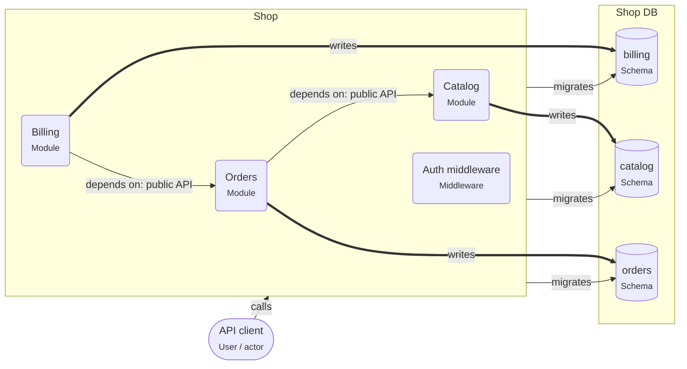

# Onboarding: NestJS modular monolith

One deployable split into modules. Each module owns its own schema and offers a public API; other modules never touch its tables.

This guide is written for the **intermediate** level. Open the project in ArchitectureGuide to see the diagram, follow the tour, and read every concept at your level.

## The big picture

## Tour of NestJS modular monolith

1. **One deployable, many modules**: Shop runs as one process. Inside, Orders, Catalog, Billing are separate modules with clear owners.

   Look at: Shop.
2. **Each module owns its schema**: A module reads and writes only its own schema. Reaching into another module’s tables is reported (RNP-028).

   Look at: Shop DB.
3. **Talk through public APIs**: Modules call each other through exported services, so a module can later move into its own service.

   Look at: Orders.

## Patterns used

### Modular monolith

One deployable, split into modules with clear owners. Each module owns its tables and offers a public API to the others.

- Give each module its own PostgreSQL **schema** (`orders`, `billing`). It makes
  ownership visible, and lets you grant privileges per schema later.
- In NestJS, `@Module({ exports: [...] })` defines the public API. Keep repositories
  and entities out of `exports`.
- Enforce the walls in CI: dependency-cruiser or ESLint boundaries rules that forbid
  imports from another module's internals.
- Cross-module workflows: call the other module's service, or emit an in-process event
  that the other module handles.

## Who owns which data

| Store | Owner (migrations) | Writers | Readers |
|---|---|---|---|
| schema.billing | svc.shop, module Billing | svc.shop | – |
| schema.catalog | svc.shop, module Catalog | svc.shop | – |
| schema.orders | svc.shop, module Orders | svc.shop | – |

## Rules of the road

- Each of Orders, Catalog, Billing MUST only write its own schema.
- A module MUST use another module only through its exported service, never its repositories or tables.
- Only `svc.shop` MAY write `schema.billing`. Only `svc.shop` MAY run migrations on it.
- Only `svc.shop` MAY write `schema.catalog`. Only `svc.shop` MAY run migrations on it.
- Only `svc.shop` MAY write `schema.orders`. Only `svc.shop` MAY run migrations on it.

## Concepts used in this project

- **User / actor** (`gen.actor`): A person or role that uses the system — customer, admin, support agent. Diagrams start with who uses the system and why.

  - Name actors by role, not by person ("Support agent", not "Anna").
  - Actors call **apps**, not databases. If an actor talks to an external tool (a payment
    page), draw that too.
  - Roles on actors map to roles in authorization (RBAC).
- **Middleware** (`node.middleware`): Code that runs before (or after) every handler of a route group — authentication, rate limiting, request logging, error handling.

  - **Auth middleware** answers "who is calling?": it reads the session cookie or the
    bearer token, verifies it, and attaches the user to the request.
  - **Authorization** ("may this user cancel _this_ order?") usually needs the data, so it
    belongs in the use case, not only in middleware.
  - Order matters: logging and request IDs first, then auth, then validation, then the
    handler, then the error handler last.
- **Module** (`node.module`): A part of a service with its own responsibility, its own tables and a small public API — "orders", "payments". Modules talk only through their public APIs.

  - Each module owns **its tables** (its schema); other modules do not read them directly.
  - Modules talk through public calls or **events** (`OrderPlaced`) instead of reaching
    into each other's code.
  - This is the core of a **modular monolith**: one deployable, clear inner boundaries,
    easy to split later.
- **Node service** (`node.service`): A Node.js process that answers requests. It checks who is calling, validates input, applies business rules, and is the only part that talks to the database.

  - Inside a service you usually find **route handlers** (HTTP in and out), **use cases**
    (one business action each) and **repositories** (database access).
  - Configure it with environment variables; keep secrets out of the code.
  - Run several **instances** behind a load balancer for availability; each has its own
    database **connection pool**.
  - Return clear errors: 400 for bad input, 401/403 for auth, 404, 409 for conflicts.
- **Database** (`pg.database`): A PostgreSQL database — the place where data survives restarts. Only backend code connects to it; schemas inside it group tables by owner.

  - Use transactions for changes that belong together.
  - Run schema changes as **migrations** owned by one service.
  - Back up regularly and test restores.
  - One database can serve several services if each owns its own schema; or each service
    gets its own database (database per service).
- **Schema** (`pg.schema`): A namespace of tables inside a database. In this tool it is also the ownership boundary — one service owns a schema and runs its migrations.

  - **Migrations** are versioned scripts (Prisma Migrate, Drizzle Kit, node-pg-migrate) that
    create and change tables. Exactly one owner runs them.
  - Other services that need the data call the owner's API, or read a published view or
    replica.
  - Database roles per service (`GRANT USAGE ON SCHEMA orders TO orders_app`) enforce the
    boundary.
  - **Row Level Security** (`rls`) restricts rows per user or tenant inside the database.
- **calls** (`calls`): A synchronous request and response — the caller waits for the answer. Set the protocol, auth, timeout and whether it is safe to retry.

  - Properties on the arrow document the decisions: `protocol` (http, graphql, trpc),
    `auth` (session cookie, bearer token, API key), `timeoutMs`, `idempotent`,
    `idempotencyKey`.
  - Every call needs a timeout.
  - Retry only idempotent calls, or send an idempotency key.
- **depends on** (`depends-on`): A compile-time import — one module uses another's code. The direction of these arrows is the architecture.

  - Arrows should point toward stable things: features → shared, handlers → use cases →
    domain.
  - Browser code must not depend on server code (this tool refuses it); share types through
    a contract package.
  - Cycles (A → B → A) mean the boundary is wrong.
- **migrates** (`migrates`): This element owns the schema's DDL — it runs the migrations that create and change tables. Exactly one owner per schema.

  - Run migrations in the deploy pipeline before the new code starts.
  - Make them backward compatible (expand and contract) so old and new code can run at the
    same time.
- **writes** (`writes`): Code changes data in a store. Set via, the transaction settings, and concurrencyControl when several writers can change the same rows.

  - `concurrencyControl` documents how concurrent writers are kept apart: `none`,
    `optimistic-version`, `row-lock`, `advisory-lock`, `serializable-retry`.
  - `isolation` documents the transaction isolation level.
  - Writes that belong together go in one transaction.
