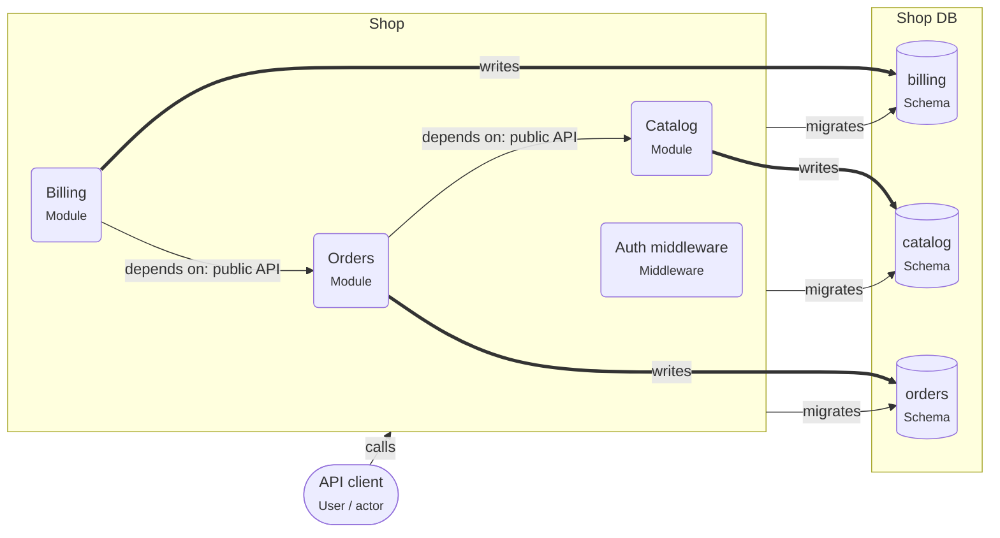

# Modular monolith

> One deployable, split into modules with clear owners. Each module owns its tables and offers a public API to the others.

## For beginners

A **monolith** is one application that you deploy as one unit. A **modular** monolith
is still one application, but its code is split into modules (Orders, Catalog,
Billing) with walls between them:

- Each module has its own folder, its own tables, and an owner.
- A module only uses another module through what it **exports**, such as an
  `OrdersService`.
- Nobody reads another module's tables.

You get one deploy and real database transactions, without the tangle of a
"big ball of mud".

## Going further

- Give each module its own PostgreSQL **schema** (`orders`, `billing`). It makes
  ownership visible, and lets you grant privileges per schema later.
- In NestJS, `@Module({ exports: [...] })` defines the public API. Keep repositories
  and entities out of `exports`.
- Enforce the walls in CI: dependency-cruiser or ESLint boundaries rules that forbid
  imports from another module's internals.
- Cross-module workflows: call the other module's service, or emit an in-process event
  that the other module handles.

## In depth

The modular monolith is the cheapest way to find the right boundaries. Extracting a
module into a service later is mostly mechanical if the module already owns its data
and talks through an API: the in-process call becomes HTTP or a queue. The hard part is
transactions that span modules today; list them, because each one becomes a saga or an
outbox when you split. Shared "common" modules tend to grow into a second monolith;
keep them to technical utilities.

## Common mistakes

- Importing another module's repository "because it is faster".
- One shared `entities` folder for all modules.
- Foreign keys across module schemas that make every module depend on the others.

**A NestJS module with a narrow public API**

```ts
@Module({
  imports: [PrismaModule],
  providers: [OrdersService, OrdersRepository],
  controllers: [OrdersController],
  exports: [OrdersService], // the repository stays private
})
export class OrdersModule {}

@Module({ imports: [OrdersModule], providers: [BillingService] })
export class BillingModule {}

@Injectable()
export class BillingService {
  constructor(private readonly orders: OrdersService) {}
  async invoiceFor(orderId: string) {
    const total = await this.orders.totalOf(orderId); // through the public API
    return this.createInvoice(orderId, total);
  }
}
```

## Template T4: NestJS modular monolith

One deployable split into modules. Each module owns its own schema and offers a public API; other modules never touch its tables.

**When to use**

- Several teams or areas in one product, without the cost of microservices.
- A first step before splitting services out later.

**When not to use**

- Parts must scale or deploy on their own schedule today.

**Trade-offs**

- One deploy and real transactions, with boundaries you can enforce.
- Boundaries only hold if they are checked (see the modular-monolith rules and dependency-cruiser).

## Invariants

- Each of Orders, Catalog, Billing MUST only write its own schema.
- A module MUST use another module only through its exported service, never its repositories or tables.

## Folder layout

- `node.module`: `src/modules/**`

## Example (default settings: appName = Shop; modules = Orders, Catalog, Billing)



## Walkthrough

1. **One deployable, many modules**: Shop runs as one process. Inside, Orders, Catalog, Billing are separate modules with clear owners.

   Look at: Shop.
2. **Each module owns its schema**: A module reads and writes only its own schema. Reaching into another module’s tables is reported (RNP-028).

   Look at: Shop DB.
3. **Talk through public APIs**: Modules call each other through exported services, so a module can later move into its own service.

   Look at: Orders.

## Sources

- [Shopify Engineering — Deconstructing the Monolith](https://shopify.engineering/deconstructing-monolith-designing-software-maximizes-developer-productivity)
- [Martin Fowler — MonolithFirst](https://martinfowler.com/bliki/MonolithFirst.html)
- [NestJS — Modules](https://docs.nestjs.com/modules)
