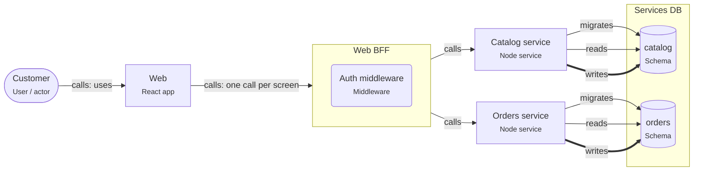

# Onboarding: React + Node backend-for-frontend

The React app talks to one Node BFF. The BFF holds the session, combines calls to the backend services, and shapes data for the screens.

This guide is written for the **intermediate** level. Open the project in ArchitectureGuide to see the diagram, follow the tour, and read every concept at your level.

## The big picture

## Tour of React + Node backend-for-frontend

1. **One door for the app**: The Web app only knows its BFF. It makes one request per screen.

   Look at: Web, Web BFF.
2. **The BFF holds the session**: The browser gets an HttpOnly cookie; the BFF keeps the tokens and checks them in its auth middleware.

   Look at: Auth middleware.
3. **Services own their data**: Each of Orders, Catalog has its own schema. The BFF reads nothing directly; it calls the services.

   Look at: Services DB.

## Patterns used

### Backend-for-frontend (BFF)

A small Node service made for one frontend. It holds the session, calls the backend services, and returns exactly the data each screen needs.

- One BFF per kind of client (web, mobile), owned by the frontend team.
- Call backend services in parallel (`Promise.all`) with timeouts; decide per field
  what a partial failure shows.
- Token handling: the BFF runs the OpenID Connect code flow, stores tokens server-side,
  and adds them to backend calls. This keeps tokens out of reach of XSS.
- Protect against CSRF: `SameSite` cookies plus a custom header or token on mutating
  requests.

## Who owns which data

| Store | Owner (migrations) | Writers | Readers |
|---|---|---|---|
| schema.catalog | svc.catalog-service | svc.catalog-service | svc.catalog-service |
| schema.orders | svc.orders-service | svc.orders-service | svc.orders-service |

## Rules of the road

- The Web app MUST call only the BFF.
- The BFF MUST NOT write any database; Orders, Catalog own their data.
- Session tokens MUST stay in the BFF; the browser gets an HttpOnly cookie.
- Only `svc.catalog-service` MAY write `schema.catalog`. Only `svc.catalog-service` MAY run migrations on it.
- Only `svc.orders-service` MAY write `schema.orders`. Only `svc.orders-service` MAY run migrations on it.

## Concepts used in this project

- **User / actor** (`gen.actor`): A person or role that uses the system — customer, admin, support agent. Diagrams start with who uses the system and why.

  - Name actors by role, not by person ("Support agent", not "Anna").
  - Actors call **apps**, not databases. If an actor talks to an external tool (a payment
    page), draw that too.
  - Roles on actors map to roles in authorization (RBAC).
- **Backend-for-Frontend** (`node.bff`): A small backend made for one frontend. It combines calls to other services into the shape that screen needs, and can keep tokens out of the browser.

  - The frontend team owns its BFF; it changes with the UI.
  - Call backend services in parallel with timeouts; decide per field what a partial
    failure shows.
  - A BFF is a good place for the sign-in flow: it runs OpenID Connect, keeps tokens on the
    server, and gives the browser an HttpOnly session cookie.
  - This tool flags a React app that calls more than two services directly (RNP-011).
- **Middleware** (`node.middleware`): Code that runs before (or after) every handler of a route group — authentication, rate limiting, request logging, error handling.

  - **Auth middleware** answers "who is calling?": it reads the session cookie or the
    bearer token, verifies it, and attaches the user to the request.
  - **Authorization** ("may this user cancel _this_ order?") usually needs the data, so it
    belongs in the use case, not only in middleware.
  - Order matters: logging and request IDs first, then auth, then validation, then the
    handler, then the error handler last.
- **Node service** (`node.service`): A Node.js process that answers requests. It checks who is calling, validates input, applies business rules, and is the only part that talks to the database.

  - Inside a service you usually find **route handlers** (HTTP in and out), **use cases**
    (one business action each) and **repositories** (database access).
  - Configure it with environment variables; keep secrets out of the code.
  - Run several **instances** behind a load balancer for availability; each has its own
    database **connection pool**.
  - Return clear errors: 400 for bad input, 401/403 for auth, 404, 409 for conflicts.
- **Database** (`pg.database`): A PostgreSQL database — the place where data survives restarts. Only backend code connects to it; schemas inside it group tables by owner.

  - Use transactions for changes that belong together.
  - Run schema changes as **migrations** owned by one service.
  - Back up regularly and test restores.
  - One database can serve several services if each owns its own schema; or each service
    gets its own database (database per service).
- **Schema** (`pg.schema`): A namespace of tables inside a database. In this tool it is also the ownership boundary — one service owns a schema and runs its migrations.

  - **Migrations** are versioned scripts (Prisma Migrate, Drizzle Kit, node-pg-migrate) that
    create and change tables. Exactly one owner runs them.
  - Other services that need the data call the owner's API, or read a published view or
    replica.
  - Database roles per service (`GRANT USAGE ON SCHEMA orders TO orders_app`) enforce the
    boundary.
  - **Row Level Security** (`rls`) restricts rows per user or tenant inside the database.
- **React app** (`react.app`): The part of the system that runs in the browser. It draws the screens and sends requests to the backend; it never holds secrets.

  - **Build:** Vite bundles the code into static files. Any static host (a CDN, or the
    Node service with the `serves` relation) can deliver them.
  - **Routing:** a router (React Router, TanStack Router) maps URLs to pages without a full
    page load.
  - **State:** server data in a server-state cache (TanStack Query), shared UI state in a
    small store, the rest in components.
  - **Config:** `import.meta.env.VITE_*` values are baked into the bundle at build time.
    They are public.
  - **Validation in the browser is for comfort only.** The API must validate everything
    again.
- **calls** (`calls`): A synchronous request and response — the caller waits for the answer. Set the protocol, auth, timeout and whether it is safe to retry.

  - Properties on the arrow document the decisions: `protocol` (http, graphql, trpc),
    `auth` (session cookie, bearer token, API key), `timeoutMs`, `idempotent`,
    `idempotencyKey`.
  - Every call needs a timeout.
  - Retry only idempotent calls, or send an idempotency key.
- **migrates** (`migrates`): This element owns the schema's DDL — it runs the migrations that create and change tables. Exactly one owner per schema.

  - Run migrations in the deploy pipeline before the new code starts.
  - Make them backward compatible (expand and contract) so old and new code can run at the
    same time.
- **reads** (`reads`): Code reads data from a store. Set via (the data-access library) and, where it matters, the isolation level.

  - `via` names the library (prisma, drizzle, kysely, pg).
  - Reading another service's tables couples you to its schema; prefer its API or a
    published view.
  - Reads can go to a replica when slightly old data is fine.
- **writes** (`writes`): Code changes data in a store. Set via, the transaction settings, and concurrencyControl when several writers can change the same rows.

  - `concurrencyControl` documents how concurrent writers are kept apart: `none`,
    `optimistic-version`, `row-lock`, `advisory-lock`, `serializable-retry`.
  - `isolation` documents the transaction isolation level.
  - Writes that belong together go in one transaction.
