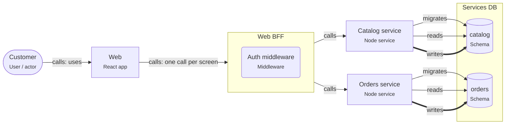

# Backend-for-frontend (BFF)

> A small Node service made for one frontend. It holds the session, calls the backend services, and returns exactly the data each screen needs.

## For beginners

When a screen needs data from several backend services, the React app would have to
call each of them, wait, and combine the answers. A **BFF** does that work on the
server instead:

- The app makes **one** request: `GET /bff/order-page/42`.
- The BFF calls Orders, Catalog and Shipping in parallel, combines the results, and
  answers.
- The BFF also handles sign-in and keeps the tokens. The browser only gets an
  HttpOnly cookie.

## Going further

- One BFF per kind of client (web, mobile), owned by the frontend team.
- Call backend services in parallel (`Promise.all`) with timeouts; decide per field
  what a partial failure shows.
- Token handling: the BFF runs the OpenID Connect code flow, stores tokens server-side,
  and adds them to backend calls. This keeps tokens out of reach of XSS.
- Protect against CSRF: `SameSite` cookies plus a custom header or token on mutating
  requests.

## In depth

A BFF is an anti-corruption layer for the UI: backend teams can change their APIs
while the BFF keeps the screens' contract stable. It is also a coupling point: with
many screens it grows, so keep it free of business rules and of its own database
(cache only). GraphQL gateways and tRPC routers are BFFs too; the same rules apply.

## Common mistakes

- Business logic in the BFF.
- A BFF that writes to the services' databases.
- One shared BFF for web and mobile that serves neither well.

**Fastify route that combines two services**

```ts
app.get('/bff/order-page/:id', { preHandler: requireSession }, async (req) => {
  const headers = { authorization: `Bearer ${req.session.accessToken}` };
  const [order, recommendations] = await Promise.all([
    fetch(`${ORDERS_URL}/orders/${req.params.id}`, { headers, signal: AbortSignal.timeout(2000) }),
    fetch(`${CATALOG_URL}/recommendations?order=${req.params.id}`, {
      signal: AbortSignal.timeout(1000),
    }).catch(() => undefined), // optional: the page still works without it
  ]);
  if (!order.ok) throw httpErrors.createError(order.status);
  return {
    order: toOrderView(await order.json()),
    recommendations: recommendations?.ok ? await recommendations.json() : [],
  };
});
```

## Template T5: React + Node backend-for-frontend

The React app talks to one Node BFF. The BFF holds the session, combines calls to the backend services, and shapes data for the screens.

**When to use**

- The frontend needs data from several backend services.
- You want tokens out of the browser (the BFF keeps them server-side).

**When not to use**

- There is only one backend service: the BFF adds a hop for nothing.

**Trade-offs**

- One request per screen, and backend changes stay hidden from the app.
- One more service to run; it must not grow business rules of its own.

## Invariants

- The Web app MUST call only the BFF.
- The BFF MUST NOT write any database; Orders, Catalog own their data.
- Session tokens MUST stay in the BFF; the browser gets an HttpOnly cookie.

## Example (default settings: appName = Web; services = Orders, Catalog)



## Walkthrough

1. **One door for the app**: The Web app only knows its BFF. It makes one request per screen.

   Look at: Web, Web BFF.
2. **The BFF holds the session**: The browser gets an HttpOnly cookie; the BFF keeps the tokens and checks them in its auth middleware.

   Look at: Auth middleware.
3. **Services own their data**: Each of Orders, Catalog has its own schema. The BFF reads nothing directly; it calls the services.

   Look at: Services DB.

## Sources

- [Sam Newman — Backends For Frontends](https://samnewman.io/patterns/architectural/bff/)
- [Microsoft — Backends for Frontends pattern](https://learn.microsoft.com/en-us/azure/architecture/patterns/backends-for-frontends)
- [IETF — OAuth 2.0 for Browser-Based Applications](https://datatracker.ietf.org/doc/html/draft-ietf-oauth-browser-based-apps)
