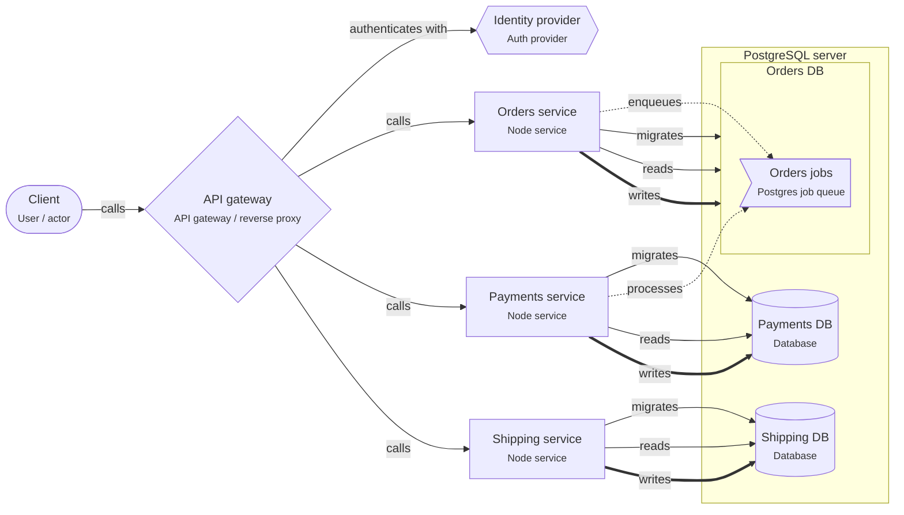

# Onboarding: Node services, database per service

A gateway in front of independent services. Each service has its own database on a shared PostgreSQL server; slow or follow-up work goes through a job queue.

This guide is written for the **intermediate** level. Open the project in ArchitectureGuide to see the diagram, follow the tour, and read every concept at your level.

## The big picture

## Tour of Node services, database per service

1. **The gateway**: All traffic enters through the gateway, which checks tokens with the identity provider and routes to the services.

   Look at: API gateway, Identity provider.
2. **A database per service**: Each service has its own database on one PostgreSQL server. Nobody else connects to it.

   Look at: PostgreSQL server.
3. **Work between services**: Instead of calling the next service and waiting, the first service enqueues a job in the same transaction as its data. The other service processes it.

   Look at: Orders jobs.

## Patterns used

### Database per service

Each service owns its own database and nobody else connects to it. Services share data through APIs and events, not tables.

- "Own database" can be a separate database on a shared PostgreSQL server: cheap to
  run, still separate. Use a separate database role per service, so access is enforced.
- No cross-service transactions. Use a job or event enqueued in the **same
  transaction** as the data, and make consumers idempotent.
- Avoid chains of synchronous calls (A → B → C → D): each hop adds latency and a way to
  fail. Prefer events for follow-up work.
- Count connections: every instance of every service has a pool. Add PgBouncer before
  you hit `max_connections`.

## Who owns which data

| Store | Owner (migrations) | Writers | Readers |
|---|---|---|---|
| db.orders-db | svc.orders-service | svc.orders-service | svc.orders-service |
| db.payments-db | svc.payments-service | svc.payments-service | svc.payments-service |
| db.shipping-db | svc.shipping-service | svc.shipping-service | svc.shipping-service |

## Rules of the road

- Each of Orders, Payments, Shipping MUST only connect to its own database.
- Services MUST NOT call each other in a cycle; follow-up work goes through the job queue.
- All external traffic MUST pass the gateway, which checks tokens.
- Only `svc.orders-service` MAY write `db.orders-db`. Only `svc.orders-service` MAY run migrations on it.
- Only `svc.payments-service` MAY write `db.payments-db`. Only `svc.payments-service` MAY run migrations on it.
- Only `svc.shipping-service` MAY write `db.shipping-db`. Only `svc.shipping-service` MAY run migrations on it.

## Concepts used in this project

- **User / actor** (`gen.actor`): A person or role that uses the system (customer, admin, support agent).
- **Auth provider** (`gen.auth-provider`): Issues and verifies identities: Auth0, Clerk, Cognito, Keycloak, or your own auth service.
- **API gateway / reverse proxy** (`gen.gateway`): Single entry point that routes requests to services: nginx, Traefik, Kong, a cloud API gateway.
- **Node service** (`node.service`): A Node.js process that serves requests (Express, Fastify or NestJS).
- **Postgres server** (`pg.cluster`): A PostgreSQL server (instance) that holds one or more databases.
- **Database** (`pg.database`): A PostgreSQL database.
- **Postgres job queue** (`pg.job-queue`): A durable job queue stored in Postgres tables (pg-boss, graphile-worker).
- **authenticates with** (`authenticates-with`): Uses an auth provider to sign in users or verify tokens.
- **calls** (`calls`): Synchronous request/response.
- **enqueues** (`enqueues`): Adds a job to a Postgres job queue.
- **migrates** (`migrates`): This element owns the DDL (migrations) of the schema.
- **processes** (`processes`): Runs jobs from a Postgres job queue.
- **reads** (`reads`): Reads data from a store.
- **writes** (`writes`): Writes data to a store.
