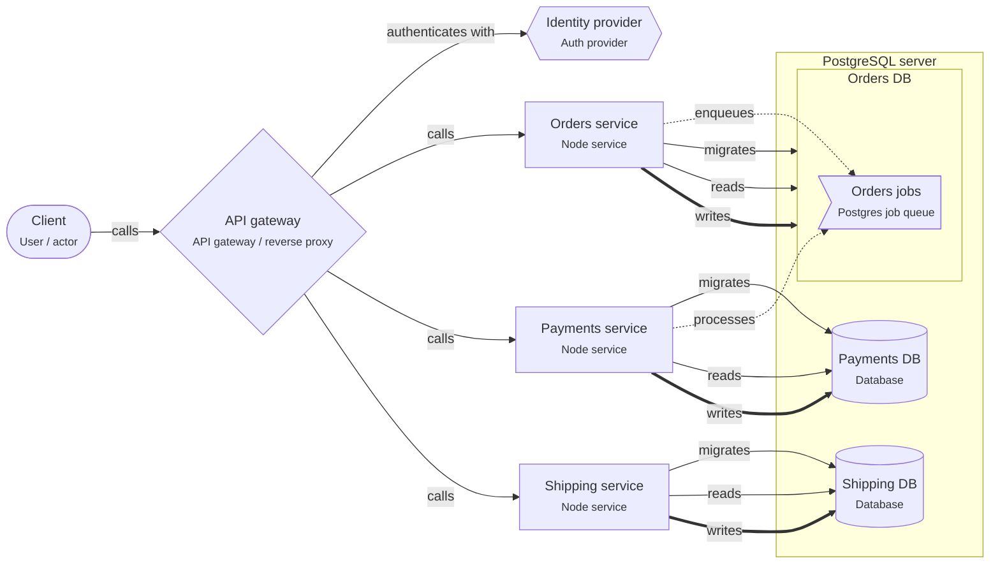

# Database per service

> Each service owns its own database and nobody else connects to it. Services share data through APIs and events, not tables.

## For beginners

In a microservice design, each service is a separate program that a team can change
and deploy on its own. That only works if services do not share tables. So each
service gets **its own database**:

- Orders writes only the Orders database; Payments only the Payments database.
- If Payments needs to know about an order, it asks the Orders API or listens for an
  event.
- A **gateway** in front checks tokens and routes requests to the right service.

## Going further

- "Own database" can be a separate database on a shared PostgreSQL server: cheap to
  run, still separate. Use a separate database role per service, so access is enforced.
- No cross-service transactions. Use a job or event enqueued in the **same
  transaction** as the data, and make consumers idempotent.
- Avoid chains of synchronous calls (A → B → C → D): each hop adds latency and a way to
  fail. Prefer events for follow-up work.
- Count connections: every instance of every service has a pool. Add PgBouncer before
  you hit `max_connections`.

## In depth

You trade joins and ACID transactions for independent deploys. Queries that span
services become read models built from events (CQRS) or API composition in a BFF.
Consistency becomes eventual and needs design: idempotency keys, outbox, sagas with
compensations, and reconciliation jobs. If most features touch several services, the
boundaries are wrong; a modular monolith is the better start.

## Common mistakes

- "Microservices" that all connect to one database: a distributed monolith.
- Synchronous call cycles between services.
- Publishing events after the commit, outside the transaction (lost events).

**An idempotent job handler (the job may run twice)**

```sql
-- Payments service, inside the job's transaction
INSERT INTO processed_jobs (job_id) VALUES ($1)
ON CONFLICT (job_id) DO NOTHING
RETURNING job_id;
-- No row returned: the job was handled before. Commit and stop.
-- A row returned: do the work in the same transaction, then commit.
```

## Template T6: Node services, database per service

A gateway in front of independent services. Each service has its own database on a shared PostgreSQL server; slow or follow-up work goes through a job queue.

**When to use**

- Teams that must deploy and scale their service on their own.
- Clear business areas with little shared data.

**When not to use**

- One small team: a modular monolith is cheaper.
- Most features need data from several services in one transaction.

**Trade-offs**

- Independent deploys, failures and scaling.
- No joins or transactions across services; data is copied with events, and is eventually consistent.

## Invariants

- Each of Orders, Payments, Shipping MUST only connect to its own database.
- Services MUST NOT call each other in a cycle; follow-up work goes through the job queue.
- All external traffic MUST pass the gateway, which checks tokens.

## Example (default settings: services = Orders, Payments, Shipping; gateway = nginx)



## Walkthrough

1. **The gateway**: All traffic enters through the gateway, which checks tokens with the identity provider and routes to the services.

   Look at: API gateway, Identity provider.
2. **A database per service**: Each service has its own database on one PostgreSQL server. Nobody else connects to it.

   Look at: PostgreSQL server.
3. **Work between services**: Instead of calling the next service and waiting, the first service enqueues a job in the same transaction as its data. The other service processes it.

   Look at: Orders jobs.

## Sources

- [microservices.io — Database per service](https://microservices.io/patterns/data/database-per-service.html)
- [microservices.io — API gateway](https://microservices.io/patterns/apigateway.html)
- [Martin Fowler — Microservices](https://martinfowler.com/articles/microservices.html)
