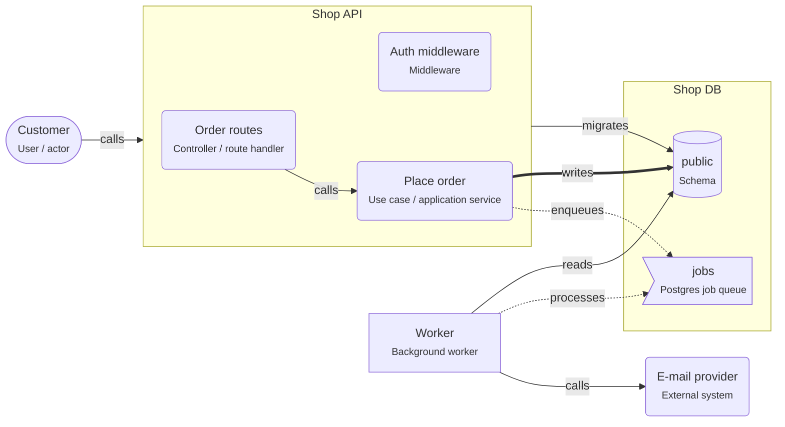

# Onboarding: Background jobs on PostgreSQL

The API saves the request and enqueues a job in the same transaction. A worker process runs slow or failure-prone work, with retries.

This guide is written for the **intermediate** level. Open the project in ArchitectureGuide to see the diagram, follow the tour, and read every concept at your level.

## The big picture

## Tour of Background jobs on PostgreSQL

1. **Answer fast**: "Place order" saves the order and enqueues the jobs in one transaction, then answers. The customer never waits for Send confirmation email, Generate invoice PDF.

   Look at: Place order, jobs.
2. **The worker**: A separate process takes jobs from the queue (pg-boss), retries failures, and moves jobs that keep failing to a dead-letter queue.

   Look at: Worker.

## Patterns used

### Background jobs on PostgreSQL

The API saves data and enqueues a job in the same transaction; a separate worker process runs the slow work later, with retries.

- Workers pick jobs with `SELECT ... FOR UPDATE SKIP LOCKED`, so many workers can run
  without taking the same job.
- Set a concurrency per worker, and count it in your connection budget.
- Jobs run **at least once**: make handlers idempotent (unique keys, "already done"
  checks), and pass IDs in the payload, not whole objects that can go stale.
- Use exponential backoff for retries, and a timeout per job.
- Scheduled jobs (cron) are jobs too: the library enqueues them on a schedule.

## Who owns which data

| Store | Owner (migrations) | Writers | Readers |
|---|---|---|---|
| schema.public | svc.shop-api | svc.shop-api | wrk.worker |

## Rules of the road

- Jobs MUST be enqueued in the same transaction as the data they belong to.
- Job handlers MUST be idempotent: a job can run more than once.
- Jobs that keep failing MUST move to a dead-letter queue after the last retry.
- Only `svc.shop-api` MAY write `schema.public`. Only `svc.shop-api` MAY run migrations on it.

## Concepts used in this project

- **User / actor** (`gen.actor`): A person or role that uses the system — customer, admin, support agent. Diagrams start with who uses the system and why.

  - Name actors by role, not by person ("Support agent", not "Anna").
  - Actors call **apps**, not databases. If an actor talks to an external tool (a payment
    page), draw that too.
  - Roles on actors map to roles in authorization (RBAC).
- **External system** (`gen.external`): A system outside your control — Stripe, SendGrid, a partner API. It can be slow or down; design every call to it for failure.

  - Always set **timeouts**; a hanging call blocks your request.
  - Retry only safe calls, or send an **idempotency key** (Stripe supports this) so a retry
    does not charge twice.
  - Slow or non-urgent calls (emails) belong in a background job.
  - Keep the provider behind a port/adapter so you can test without it and switch later.
- **Middleware** (`node.middleware`): Code that runs before (or after) every handler of a route group — authentication, rate limiting, request logging, error handling.

  - **Auth middleware** answers "who is calling?": it reads the session cookie or the
    bearer token, verifies it, and attaches the user to the request.
  - **Authorization** ("may this user cancel _this_ order?") usually needs the data, so it
    belongs in the use case, not only in middleware.
  - Order matters: logging and request IDs first, then auth, then validation, then the
    handler, then the error handler last.
- **Controller / route handler** (`node.route-handler`): Code that receives an HTTP request, validates it, calls the business logic, and turns the result into an HTTP response. Thin by design.

  - Validate with a schema (zod, TypeBox, class-validator) and return 400 with details on
    failure (RNP-015 flags handlers without validation).
  - Map domain errors to HTTP: "out of stock" → 409, "not found" → 404.
  - One handler groups the endpoints of one resource (`/orders`, `/orders/:id`).
- **Node service** (`node.service`): A Node.js process that answers requests. It checks who is calling, validates input, applies business rules, and is the only part that talks to the database.

  - Inside a service you usually find **route handlers** (HTTP in and out), **use cases**
    (one business action each) and **repositories** (database access).
  - Configure it with environment variables; keep secrets out of the code.
  - Run several **instances** behind a load balancer for availability; each has its own
    database **connection pool**.
  - Return clear errors: 400 for bad input, 401/403 for auth, 404, 409 for conflicts.
- **Use case / application service** (`node.use-case`): One business action — PlaceOrder, RefundOrder — as one function or class. It loads data, asks the domain to apply the rules, saves, and starts follow-up work.

  - One use case = one **transaction** boundary in most designs: either everything is saved
    or nothing.
  - It depends on **ports** (interfaces like `OrderRepository`) or on repositories directly
    in a layered design, never on HTTP objects.
  - Return a result or a domain error; let the handler choose the status code.
  - Enqueue follow-up jobs in the same transaction.
- **Background worker** (`node.worker`): A Node process that runs jobs from a queue — emails, invoices, image resizing — outside the request, with retries when something fails.

  - Jobs must be **idempotent**: a job can run twice (a crash after the work, before the
    "done" mark). Sending an email twice is bad; check "already sent?" first.
  - Set **retries with backoff** and a **dead-letter** queue for jobs that keep failing.
  - `concurrency` controls how many jobs one worker runs at once; `instances` how many
    workers run.
  - Enqueue in the **same transaction** as the data (`inTransaction`), so an order never
    exists without its email job, and a rolled-back order never sends one.
- **Database** (`pg.database`): A PostgreSQL database — the place where data survives restarts. Only backend code connects to it; schemas inside it group tables by owner.

  - Use transactions for changes that belong together.
  - Run schema changes as **migrations** owned by one service.
  - Back up regularly and test restores.
  - One database can serve several services if each owns its own schema; or each service
    gets its own database (database per service).
- **Postgres job queue** (`pg.job-queue`): A durable job queue stored in Postgres tables (pg-boss, graphile-worker). Jobs can be added in the same transaction as your data, so neither is lost.

  - Workers take jobs with `SELECT … FOR UPDATE SKIP LOCKED`, so several workers never take
    the same job and never wait for each other.
  - Set retries, backoff, expiry and a dead-letter queue.
  - Jobs must be idempotent.
  - `inTransaction: true` on the `enqueues` relation documents the transactional enqueue.
- **Schema** (`pg.schema`): A namespace of tables inside a database. In this tool it is also the ownership boundary — one service owns a schema and runs its migrations.

  - **Migrations** are versioned scripts (Prisma Migrate, Drizzle Kit, node-pg-migrate) that
    create and change tables. Exactly one owner runs them.
  - Other services that need the data call the owner's API, or read a published view or
    replica.
  - Database roles per service (`GRANT USAGE ON SCHEMA orders TO orders_app`) enforce the
    boundary.
  - **Row Level Security** (`rls`) restricts rows per user or tenant inside the database.
- **calls** (`calls`): A synchronous request and response — the caller waits for the answer. Set the protocol, auth, timeout and whether it is safe to retry.

  - Properties on the arrow document the decisions: `protocol` (http, graphql, trpc),
    `auth` (session cookie, bearer token, API key), `timeoutMs`, `idempotent`,
    `idempotencyKey`.
  - Every call needs a timeout.
  - Retry only idempotent calls, or send an idempotency key.
- **enqueues** (`enqueues`): Adds a job to a Postgres job queue. Set inTransaction when the job is added in the same transaction as the data.

  - `inTransaction: true` means the job is added in the same transaction as the business
    data — both commit or neither does.
  - Pass IDs, not whole objects; the worker loads fresh data.
- **migrates** (`migrates`): This element owns the schema's DDL — it runs the migrations that create and change tables. Exactly one owner per schema.

  - Run migrations in the deploy pipeline before the new code starts.
  - Make them backward compatible (expand and contract) so old and new code can run at the
    same time.
- **processes** (`processes`): A worker (or service) takes jobs from a Postgres job queue and runs them, with retries.

  - Set concurrency, retries and backoff; route failed jobs to a dead-letter queue.
  - Jobs must be idempotent: a crash after the work but before "done" runs them again.
- **reads** (`reads`): Code reads data from a store. Set via (the data-access library) and, where it matters, the isolation level.

  - `via` names the library (prisma, drizzle, kysely, pg).
  - Reading another service's tables couples you to its schema; prefer its API or a
    published view.
  - Reads can go to a replica when slightly old data is fine.
- **writes** (`writes`): Code changes data in a store. Set via, the transaction settings, and concurrencyControl when several writers can change the same rows.

  - `concurrencyControl` documents how concurrent writers are kept apart: `none`,
    `optimistic-version`, `row-lock`, `advisory-lock`, `serializable-retry`.
  - `isolation` documents the transaction isolation level.
  - Writes that belong together go in one transaction.
