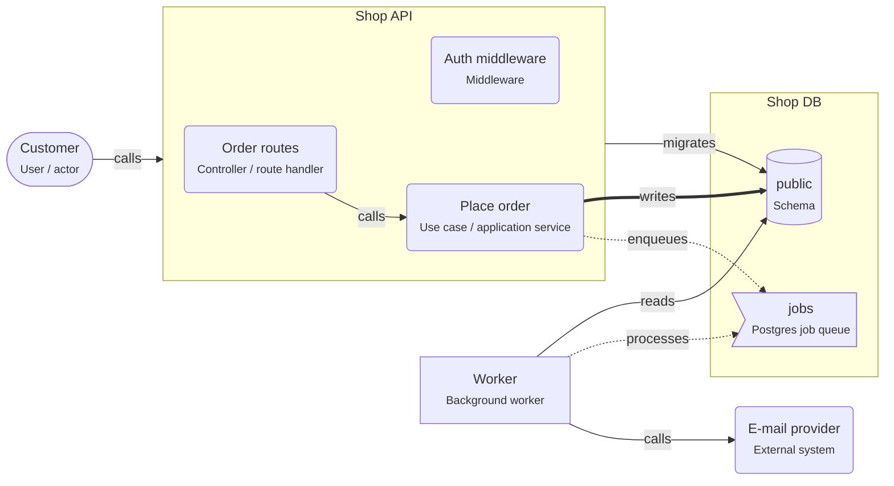

# Background jobs on PostgreSQL

> The API saves data and enqueues a job in the same transaction; a separate worker process runs the slow work later, with retries.

## For beginners

Some work is too slow, or fails too often, to do while the user waits: sending
e-mails, building PDFs, calling a slow partner. Instead:

1. The API saves the order **and** adds a job ("send confirmation for order 42") in
   the **same database transaction**, then answers at once.
2. A separate **worker** process takes jobs from the queue and does the work.
3. If the work fails, the worker tries again later. After the last attempt, the job
   goes to a **dead-letter queue** where a person can look at it.

With PostgreSQL you do not need another system: libraries such as pg-boss and Graphile
Worker keep the queue in tables.

## Going further

- Workers pick jobs with `SELECT ... FOR UPDATE SKIP LOCKED`, so many workers can run
  without taking the same job.
- Set a concurrency per worker, and count it in your connection budget.
- Jobs run **at least once**: make handlers idempotent (unique keys, "already done"
  checks), and pass IDs in the payload, not whole objects that can go stale.
- Use exponential backoff for retries, and a timeout per job.
- Scheduled jobs (cron) are jobs too: the library enqueues them on a schedule.

## In depth

A Postgres-backed queue is a great default up to hundreds of jobs per second. Beyond
that, table bloat, vacuum and index churn become the limit; then move hot queues to a
broker, often via the outbox pattern. Keep the queue in the producer's database so
enqueue is transactional. For external side effects (charging a card), combine the
job with an idempotency key at the provider, so a retry after a timeout does not charge
twice.

## Common mistakes

- Sending the e-mail inside the HTTP request.
- Enqueuing after the commit (lost jobs on a crash), or with a different database connection than the data (not atomic).
- Non-idempotent handlers that double-charge or double-send on retry.
- Workers doing CPU-heavy work with high concurrency in one process.

**Enqueue in the same transaction (Graphile Worker, node-postgres)**

```ts
const client = await pool.connect();
try {
  await client.query('BEGIN');
  const { rows } = await client.query(
    'INSERT INTO orders (customer_id, total_cents) VALUES ($1, $2) RETURNING id',
    [customerId, totalCents],
  );
  await client.query(
    "SELECT graphile_worker.add_job('send_confirmation', json_build_object('orderId', $1::bigint))",
    [rows[0].id],
  );
  await client.query('COMMIT');
} catch (error) {
  await client.query('ROLLBACK');
  throw error;
} finally {
  client.release();
}
```

**How a worker takes one job safely**

```sql
WITH next AS (
  SELECT id FROM jobs
  WHERE run_at <= now() AND locked_at IS NULL
  ORDER BY run_at
  FOR UPDATE SKIP LOCKED
  LIMIT 1
)
UPDATE jobs SET locked_at = now(), attempts = attempts + 1
FROM next WHERE jobs.id = next.id
RETURNING jobs.*;
```

## Template T7: Background jobs on PostgreSQL

The API saves the request and enqueues a job in the same transaction. A worker process runs slow or failure-prone work, with retries.

**When to use**

- E-mails, PDFs, imports, calls to slow partners: anything the user should not wait for.
- You already run PostgreSQL and do not want another broker.

**When not to use**

- Thousands of jobs per second: use a dedicated broker.

**Trade-offs**

- Jobs commit or roll back with the data: no lost or ghost jobs.
- The database also carries the queue load; watch its size and vacuum.

## Invariants

- Jobs MUST be enqueued in the same transaction as the data they belong to.
- Job handlers MUST be idempotent: a job can run more than once.
- Jobs that keep failing MUST move to a dead-letter queue after the last retry.

## Example (default settings: apiName = Shop API; jobs = Send confirmation email, Generate invoice PDF; lib = pg-boss)



## Walkthrough

1. **Answer fast**: "Place order" saves the order and enqueues the jobs in one transaction, then answers. The customer never waits for Send confirmation email, Generate invoice PDF.

   Look at: Place order, jobs.
2. **The worker**: A separate process takes jobs from the queue (pg-boss), retries failures, and moves jobs that keep failing to a dead-letter queue.

   Look at: Worker.

## Sources

- [pg-boss](https://github.com/timgit/pg-boss)
- [Graphile Worker](https://worker.graphile.org/)
- [PostgreSQL docs — SELECT ... FOR UPDATE SKIP LOCKED](https://www.postgresql.org/docs/current/sql-select.html#SQL-FOR-UPDATE-SHARE)
- [microservices.io — Transactional outbox](https://microservices.io/patterns/data/transactional-outbox.html)
