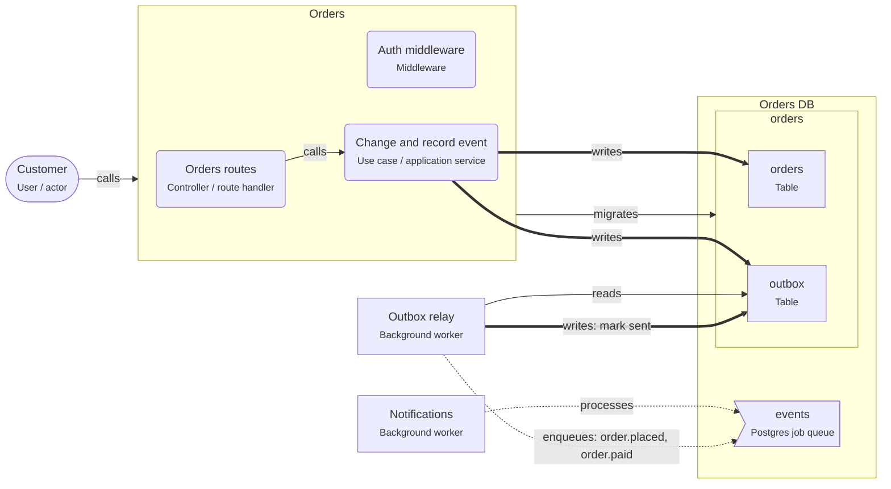

# Transactional outbox

> The service writes its data and the event about it to an outbox table in one transaction; a relay publishes the outbox rows afterwards, so no event is lost or invented.

## For beginners

A service often has to do two things when something happens: save the change, and tell
others about it ("order placed"). If it saves and then sends, a crash in between loses
the message. If it sends and then saves, a failed save leaves a message about an order
that does not exist. This is the **dual-write problem**.

The outbox fixes it with one rule: write the message into a table, the **outbox**, in the
**same transaction** as the data. Either both are saved or neither is. A separate
**relay** reads the outbox and publishes the messages, then marks them as sent.

## Going further

- The outbox row holds the event type (topic), a payload with IDs and the facts the
  consumer needs, and a `sent_at` column.
- The relay reads unsent rows in order (`ORDER BY id`) and in small batches; with several
  relay instances use `FOR UPDATE SKIP LOCKED`.
- Delivery is **at least once**: a relay that crashes after publishing sends the event
  again. Give each event an ID and make consumers idempotent.
- If the target is a PostgreSQL job queue in the same database, the relay can enqueue
  and mark the row sent in one transaction. For an external broker (Kafka, RabbitMQ) it
  publishes first and marks after.
- Delete or archive sent rows on a schedule so the table stays small.

## In depth

Change data capture (Debezium reading the write-ahead log) can replace the polling relay:
lower latency, no polling load, and the order of the log is the order of commits. Polling
is simpler to run and good up to thousands of events per second. Keep event schemas
versioned, and do not leak the service's table shapes into events: an event is a
public contract. Ordering per aggregate (all events of order 42 in order) usually
matters; global ordering rarely does — partition by aggregate ID.

## Common mistakes

- Publishing to the broker inside the database transaction (the broker does not roll back).
- A relay that marks rows sent before publishing (lost events on a crash).
- Consumers that are not idempotent.
- Putting whole database rows into the event instead of a designed payload.

**Write the data and the event in one transaction (Prisma)**

```ts
await prisma.$transaction(async (tx) => {
  const order = await tx.order.create({ data: { customerId, totalCents } });
  await tx.outbox.create({
    data: { topic: 'order.placed', payload: { orderId: order.id, totalCents } },
  });
});
```

**The relay takes a batch safely**

```sql
SELECT id, topic, payload FROM outbox
WHERE sent_at IS NULL
ORDER BY id
FOR UPDATE SKIP LOCKED
LIMIT 100;
```

## Template T8: Transactional outbox on PostgreSQL

The service writes its data and the events about it to an outbox table in one transaction. A relay publishes the outbox rows; consumers react to them.

**When to use**

- Other parts of the system must hear about a change, and losing or inventing an event is not acceptable.
- You publish to a broker or a queue that is not in the same database transaction.

**When not to use**

- The consumer only needs a job in the same database: enqueue it in the transaction (T7).

**Trade-offs**

- No lost or ghost events: an event exists exactly when its data was committed.
- Events arrive a little later, at least once and possibly twice: consumers must be idempotent.

## Invariants

- Orders MUST write its data and the outbox row in one transaction; it MUST NOT publish directly.
- Only the outbox relay MAY publish the events (order.placed, order.paid); it marks rows as sent after publishing.
- Consumers MUST be idempotent: the relay delivers each event at least once.

## Folder layout

- `node.service`: `services/Orders/**`
- `node.worker`: `services/Orders/src/outbox/**`

## Example (default settings: serviceName = Orders; events = order.placed, order.paid; delivery = job-queue)



## Walkthrough

1. **One transaction**: "Change and record event" writes the Orders row and the outbox row together. Either both are committed or neither is.

   Look at: Change and record event, orders, outbox.
2. **The relay**: A separate process reads unsent rows in order, publishes them (order.placed, order.paid) and marks them sent. If it crashes in between, it sends again: consumers must be idempotent.

   Look at: Outbox relay, Notifications.

## Sources

- [microservices.io — Transactional outbox](https://microservices.io/patterns/data/transactional-outbox.html)
- [Debezium — Outbox event router](https://debezium.io/documentation/reference/stable/transformations/outbox-event-router.html)
- [PostgreSQL docs — SELECT ... FOR UPDATE SKIP LOCKED](https://www.postgresql.org/docs/current/sql-select.html#SQL-FOR-UPDATE-SHARE)
