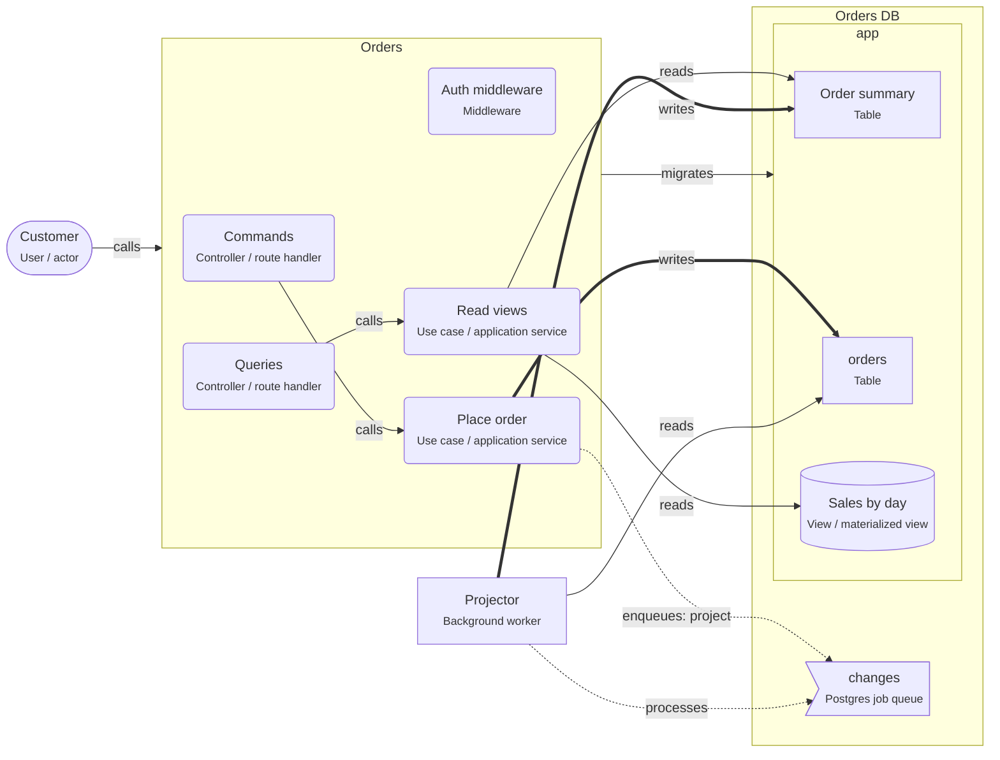

# CQRS-lite on PostgreSQL

> Commands change the write tables; a projector keeps read models (projection tables and materialized views) up to date; queries read only the read models.

## For beginners

Some screens need data in a very different shape from how it is saved: a dashboard with
totals per day, a list that joins five tables. Computing that on every request is slow.

CQRS ("command query responsibility segregation") splits the two sides:

- **Commands** (place order, cancel order) change the normal tables: the **write model**.
- A **projector** builds **read models** from those tables: tables or materialized views
  shaped exactly for a screen.
- **Queries** read only the read models.

The read models are a little behind the writes, usually by milliseconds to seconds.

## Going further

- Trigger the projector with a job enqueued in the command's transaction (or from an
  outbox), so no change is missed.
- A materialized view is the simplest read model: `REFRESH MATERIALIZED VIEW
CONCURRENTLY` rebuilds it without blocking readers (it needs a unique index).
- Projection tables updated row by row scale better than refreshing a whole view.
- Make projections idempotent and rebuildable: you will need to rebuild them when their
  shape changes.
- Screens must handle the lag: after a command, show the command's result, not a fresh
  query of the read model.

## In depth

"CQRS-lite" keeps one database and one service; it does not require event sourcing. Add
it per screen where reads hurt, not for the whole system. Watch projector lag as a
metric. For heavy analytics, a replica or a separate analytical store may be the better
read side. Keep read models in the service's own schema so ownership stays clear.

## Common mistakes

- Route handlers writing read models directly.
- Read models that cannot be rebuilt from the write tables.
- Applying CQRS to simple CRUD screens.
- Screens that query the read model right after a command and show stale data.

**A read model as a materialized view, refreshed without blocking readers**

```sql
CREATE MATERIALIZED VIEW sales_by_day AS
  SELECT date_trunc('day', created_at) AS day, sum(total_cents) AS total_cents
  FROM orders GROUP BY 1;
CREATE UNIQUE INDEX ON sales_by_day (day);
REFRESH MATERIALIZED VIEW CONCURRENTLY sales_by_day;
```

## Template T9: CQRS-lite on PostgreSQL

Commands change the write tables; a projector keeps read models (projection tables and materialized views) up to date; queries read only the read models.

**When to use**

- Screens need data shaped very differently from how it is written (dashboards, search lists, reports).
- Reads are much more frequent than writes, and slightly stale reads are fine.

**When not to use**

- Simple CRUD screens: read the tables directly.
- Every read must see the latest write (read your own writes) and you cannot design around it.

**Trade-offs**

- Fast, simple queries on data shaped for the screen.
- Read models lag behind writes; the projector is more code to run and watch.

## Invariants

- Queries MUST read only the read models (Order summary, Sales by day); commands MUST write only the write tables.
- Only the projector MAY write the read models.
- Read models MAY lag behind the write tables; screens MUST NOT assume read-your-own-writes.

## Folder layout

- `node.use-case`: `services/Orders/src/application/**`
- `node.worker`: `services/Orders/src/projector/**`

## Example (default settings: serviceName = Orders; readModels = Order summary, Sales by day)



## Walkthrough

1. **Two sides**: Commands change the write table; queries read only the read models (Order summary, Sales by day).

   Look at: Commands, Queries, orders.
2. **The projector**: Each change enqueues a "project" job in the same transaction. The projector rebuilds the affected rows of the read models, so they lag a little behind the writes.

   Look at: Projector, changes.

## Sources

- [Martin Fowler — CQRS](https://martinfowler.com/bliki/CQRS.html)
- [Microsoft — CQRS pattern](https://learn.microsoft.com/en-us/azure/architecture/patterns/cqrs)
- [PostgreSQL docs — Materialized views](https://www.postgresql.org/docs/current/rules-materializedviews.html)
